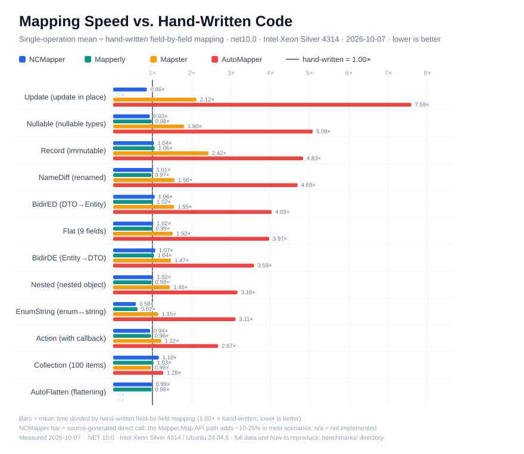
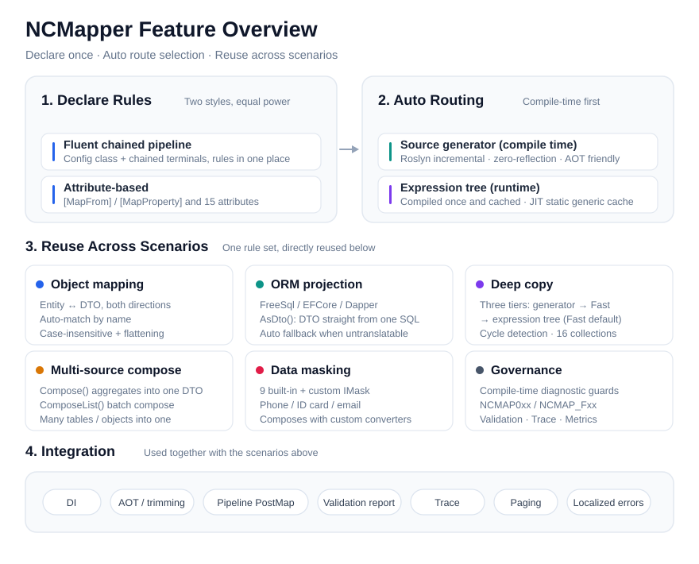

**English** | [中文](README.zh-CN.md)

# NCMapper

[](https://github.com/hchxxzx/NCMapper/actions/workflows/ci.yml)
[](https://www.nuget.org/packages/NCMapper)
[](LICENSE)
[](#installation)

A fast, **free forever** (Apache-2.0) and **AOT-ready** object mapper for .NET, with built-in **EF Core / FreeSql / Dapper projection** — a practical alternative for teams migrating from AutoMapper's commercial license.



*Across the 12 benchmark scenarios, NCMapper runs within 0.6–1.2× of hand-written field-by-field code, while AutoMapper needs 1.3–7.6× (net10.0, Intel Xeon Silver 4314; [reproduce](benchmarks/README.md)).*

The whole setup is one declaration:

```csharp
[MapperConfig]
public class UserMapperConfig
{
    public static void Configure(FluentMappingConfig cfg)
        => cfg.For<UserEntity, UserDto>();   // same-name auto-match — that's the entire declaration
}

var dto = Mapper.Map<UserEntity, UserDto>(user);   // mapped by code generated at compile time; nothing to configure at runtime
```

Migrating from AutoMapper? The [migration guide](docs/en-US/getting-started/migrating-from-other-mappers.md) provides a concept-by-concept mapping table and a capability matrix.

---

Technically, it is a dual-engine (source generator + expression tree), dual-channel (Fluent chain + attribute annotation) mapping library: the engines auto-select the optimal path, with compile-time diagnostic codes guarding mapping correctness. Declare once and reuse the rules across in-memory mapping, ORM projection (a single SQL straight to DTOs), deep copy, multi-source composition, and more — mapping rules are never defined twice.

It comes down to just three keywords:

| Keyword | Meaning |
| ------- | ------- |
| Dual engine | Two execution engines — source generator + expression tree: declared type pairs get code emitted directly at compile time; undeclared pairs are covered automatically at runtime |
| Dual channel | Two declaration styles — Fluent chain and attribute annotation — with equivalent capabilities, coexisting long-term |
| Adaptive | You just declare (or even skip declaring); which engine is used and whether to degrade is decided and handled automatically by the system |

**You decide how rules are declared; the library decides how mappings are executed.**



## Features

| Capability | Engine | Description |
| ---------- | ------ | ---------- |
| Dual-channel declaration | Dual engine | **Fluent channel** (`[MapperConfig]` configuration class + `FluentMappingConfig` chained declaration) and **attribute channel** (`[MapFrom]` / `[MapProperty]` and other attribute families) have equivalent capabilities and coexist long-term: a given type pair may be declared by only one channel exactly once (`NCMAP_F11` mutual exclusion); different pairs may freely mix channels |
| Single-object mapping | Dual engine | `Mapper.Map<S,T>(src)` — same-name properties match automatically (case-insensitive + flattening); one declaration covers both directions (Entity ↔ DTO) |
| List mapping | Dual engine | `Mapper.MapList<S,T>(srcs)` for batch mapping; `MapListInto` reuses pre-allocated targets in place, zero top-level allocation |
| Update existing instance | Dual engine | `Mapper.Map(src, dst)` overwrites only the mapped fields |
| Callbacks & hooks | Dual engine | `Action` callbacks; class-level `[BeforeMapping]` / `[AfterMapping]` and chained `.BeforeMapping` / `.AfterMapping` are equivalent across channels |
| Custom conversion | Dual engine | `[Convert]` / `[ConvertBack]` (static method references, 4 forms) ↔ chained `.Convert` / `.ConvertBack`; reverse direction does not consume forward conversions by default (`NCMAP033` hint) |
| Conditional guards | Dual engine | `[MapWhen]` / chained `.MapWhen` (named method + inline lambda, two forms) |
| Ignore control | Dual engine | `[MapIgnore]` / chained `.Ignore`: bidirectional by default, optional `Direction` to ignore one direction only; participates in ORM projection decisions |
| Constructor parameter binding | Compile-time | Chained `.MapCtorParam` (a Fluent-only capability, no attribute-side form) |
| Polymorphic subtype dispatch | Dual engine | `[MapSubclass]` / chained `.MapSubclass<TSrcDerived, TTargetDerived>()` — most-derived first + base-class fallback |
| Tree building | Dual engine | `[MapTree]` / chained `.Tree()`: class-level declaration of the key / parent-key / children triple; flat list → tree, with `ToTreeList()` producing the tree directly |
| JSON expansion | Dual engine | `[MapProperty(IsFromJson = true)]` / chained `.FromJson(dest)`: JSON text column ↔ strongly typed object |
| Property-level formatting | Dual engine | `[MapFormat("format")]` / chained `.Format(dest, format)`: when the source type implements `IFormattable` (DateTime / numeric / enum, etc.) the value is written to a `string` target using the format string, which is embedded at compile time |
| Cross-table field source | Compile-time | `[MapProperty(FromSource = typeof(Sub))]` / chained `.From<Sub>(…)`: folds fields from a secondary source type into the same DTO alongside primary-source fields |
| Auto-match switch (whitelist) | Dual engine | Attribute side `[MapNoAutoMatch]` (class-level) ↔ chained `.NoAutoMatch()` (pair-level): disables same-name auto-matching / auto-flattening for that type pair so only explicitly declared members map; since undeclared columns must never be read, ORM projection automatically degrades to a two-step in-memory map. **Distinct from the property-level `[MapNoAutoInclude]`** — that one only skips navigation collection for a single property; different granularity, and the two can be combined |
| Multi-source Compose | Dual engine | `Compose()` assembles an aggregate DTO from multiple source objects; `ComposeList()` for batch composition |
| Deep copy (DeepCopy) | Dual engine | Three-tier strategy: source generator (~179 ns, fastest) → `Fast` (default, ternary classification with conditional dispatch) → `ExpressionTree` (cycle-reference detection + DAG shared-reference preservation); POCO / record / 16 collection types |
| Data masking (Mask) | Dual engine | `[Mask]` / chained `.Mask` — 9 built-in implementations + custom `IMask`, orthogonal composition with conversion |
| ORM projection | Dual engine | Three independent extension packages `NCMapper.FreeSql` / `NCMapper.EFCore` / `NCMapper.Dapper`; the `AsDto()` terminal operation emits a single SQL straight to DTOs, automatically degrading to two-step mapping when it encounters untranslatable declarations |
| Global mapping configuration | Dual engine | `[assembly: MapDefaults]` (naming strategies / prefix-suffix stripping / ignore lists, bidirectional + ToEntity, two tiers), also configurable via MSBuild properties (`NCMapperXxx`) |
| Mapping pipeline | Runtime | `Mapper.Pipeline` with pluggable PostMap callbacks; zero overhead when the pipeline is empty |
| Mapping validation | Runtime | `Validate()` scans assemblies and produces an OK / Warning / Error three-level report; `ValidateOrThrow()` for fail-fast |
| Diagnostics Trace | Runtime | Toggle-controlled, per-mapping-path output (global / per-call `MapTraceOptions`, two granularities) |
| Performance metrics | Runtime | `MetricsEnabled` counts invocations / cache hits / compilations |
| Compile-time diagnostics | Compile-time | `NCMAP0xx` (attribute family) + `NCMAP_Fxx` (Fluent family), Error / Warn / Info three levels; full unique index of all codes in [Diagnostics Rules](docs/en-US/diagnostics/rules.md) |
| DI integration | Runtime | `AddNCMapper()` injects `IMapper` in one line, with Options callback and `appsettings.json` configuration binding supported |
| Pluggable strategies | Runtime | JSON serializer (`JsonSerializerBase.Current`) and deep-copy provider (`DeepCopyProviderBase.Current`) are both pluggable |
| AOT compatibility | Dual engine | Declared type pairs (both channels) take the source-generator path — AOT / trimming friendly; runtime fallback paths are annotated `[RequiresDynamicCode]` |
| record support | Dual engine | Primary-constructor parameters match automatically, `with` pattern supported; cyclic-reference record pairs are auto-detected at source generation and fall back to runtime (`NCMAP012`) |
| Paging wrapper | Runtime | `PagedList<T>` + `ToPagedList` / `ToPagedListAsync` |

Full capability documentation: [What is NCMapper](docs/en-US/getting-started/overview.md); limitations and caveats: [Limitations](docs/en-US/explanation/limitations.md).

## Installation

```bash
dotnet add package NCMapper
```

Package matrix and selection:

| Package | Purpose | When to install |
| ------- | ------- | --------------- |
| `NCMapper` | Core library (runtime engine + expression tree + reflection fallback) + source generator (bundled as an Analyzer asset) | Required (all scenarios) |
| `NCMapper.FreeSql` | FreeSql integration (`AsDto<T>()` projection, paging, tree building) | When using FreeSql |
| `NCMapper.EFCore` | EF Core integration (`AsDto<T>()` projection, degradation detection) | When using EF Core |
| `NCMapper.Dapper` | Dapper integration (`AsDto` column-name mapping, `ToPagedList`, `ToTreeList`) | When using Dapper |

Target frameworks: **net8.0 / net9.0 / net10.0**.

The source generator is built into the `NCMapper` NuGet package (distributed as an Analyzer asset) — referencing the package activates it automatically, no manual install or registration; it can be tuned via csproj properties:

```xml
<PropertyGroup>
  <NCMapperSourceGenEnabled>true</NCMapperSourceGenEnabled>  <!-- compile-time diagnostics, on by default -->
  <NCMapperGenerateReport>false</NCMapperGenerateReport>      <!-- Markdown mapping report, off by default -->
  <NCMapperEmitGeneratedFiles>false</NCMapperEmitGeneratedFiles>  <!-- write generated sources to disk (obj/NCMapper/Generated), off by default -->
</PropertyGroup>
```

## Quick Start

The recommended entry point is the **Fluent channel**: mapping rules are centralized in a single configuration class, keeping entities and DTOs free of annotations.

```csharp
// 1. Define the entity and DTO (plain classes, no annotations needed)
public class UserEntity
{
    public int Id { get; set; }
    public string Name { get; set; }
    public DateTime CreatedAt { get; set; }
}

public class UserDto
{
    public int Id { get; set; }
    public string Name { get; set; }
    public DateTime CreatedAt { get; set; }
}

// 2. Mapping configuration class: marked with [MapperConfig], declaring a static method inside (any method name, fixed signature)
[MapperConfig]
public class UserMapperConfig
{
    public static void Configure(FluentMappingConfig cfg)
        => cfg.For<UserEntity, UserDto>();   // same-name, same-type auto-matching, no per-property declaration needed
}

// 3. Map: the same entry point as the attribute channel; same-name properties are assigned automatically
var user = new UserEntity { Id = 1, Name = "Zhang San", CreatedAt = DateTime.Now };
var dto = Mapper.Map<UserEntity, UserDto>(user);
// dto.Id = 1, dto.Name = "Zhang San"
```

Once the configuration class is declared, **no manual registration is needed**: the source generator scans the `Configure` method body at compile time to generate mapping code, auto-registering it into `Mapper` via `[ModuleInitializer]`.

When same-name auto-matching is not enough, append terminal methods to the `For(...)` chain (renamed mapping, ignore, masking, custom conversion, conditional guards, hooks, etc.) in chained form:

```csharp
[MapperConfig]
public class OrderMapper
{
    public static void Configure(FluentMappingConfig cfg)
    {
        cfg.For<OrderEntity, OrderDto>()
           .Map(d => d.OrderId, s => s.Id)                 // renamed mapping
           .Map(d => d.CustomerName, s => s.Customer.Name) // nested source path
           .Ignore(d => d.InternalNote)                     // ignore
           .Mask<MaskPhone, string>(d => d.CustomerPhone)   // masking
           .AfterMapping(ApplyComputedFields);              // lifecycle hook
    }

    public static void ApplyComputedFields(OrderEntity src, OrderDto dst)
        => dst.TotalWeight = src.Items.Sum(i => i.Weight);
}
```

Full terminal-method table and diagnostic code index: [Fluent Basics](docs/en-US/how-to/fluent/basics.md); verify by running: `dotnet run --scenario 101`.

### Equivalent form: attribute channel

The same pair can also be declared by putting `[MapFrom]` directly on the DTO class, making the rules self-descriptive on the type; the source generator emits **exactly identical** mapping code for both channels — zero runtime difference:

```csharp
[MapFrom(typeof(UserEntity))]
public class UserDto
{
    public int Id { get; set; }
    public string Name { get; set; }
    public DateTime CreatedAt { get; set; }
}
```

The two channels may declare **the same type pair** only once (pick one); declaring on both sides raises `NCMAP_F11` at compile time. Cross-channel selection and per-dimension equivalence: [Dual API Face Comparison](docs/en-US/reference/api-comparison.md); full attribute table (16 attributes): [Attribute Index](docs/en-US/reference/attributes-index.md).

### Common invocation entry points

```csharp
// With an Action callback: extra processing after mapping
var dto2 = Mapper.Map<UserEntity, UserDto>(user, (s, t) => t.Name = t.Name.ToUpper());

// List mapping
var dtos = Mapper.MapList<UserEntity, UserDto>(users);

// In-place batch mapping: reuse pre-allocated targets
Mapper.MapListInto<UserEntity, UserDto>(users, dtos);

// Update an existing object (only mapped fields are overwritten)
var existing = new UserDto();
Mapper.Map(user, existing);

// Extension methods (generated by the source generator, more concise syntax, common to both channels)
using NCMapper.Generated;
var dto3 = user.MapToUserDto();               // equivalent to Mapper.Map<UserEntity, UserDto>(user)
var dtos2 = users.MapToUserDtoList();          // equivalent to Mapper.MapList
```

`Mapper.Map` internally prefers the source-generated delegate, falling back to expression trees only on a miss; extension methods and `Mapper.Map` are built on the same generated code and are nearly performance-equivalent — pick whichever syntax you prefer.

### DI registration

```csharp
services.AddNCMapper();
// Options callback and appsettings.json binding are also supported:
// services.AddNCMapper(opts => { opts.TraceEnabled = true; });
// services.AddNCMapper(config.GetSection("NCMapper"));

public class MyService
{
    private readonly IMapper _mapper;
    public MyService(IMapper mapper) => _mapper = mapper;
    public void Do(UserEntity entity) => _mapper.Map<UserEntity, UserDto>(entity);
}
```

## Performance

> Baseline: net10.0, Intel Xeon Silver 4314 / Ubuntu 24.04.5 (full benchmark batch, 2026-10-07). Performance figures vary significantly with the test machine's CPU / OS / .NET version; the tables below only represent the relative level and magnitude for this environment, not an absolute cross-environment performance guarantee.

*The comparison chart at the top of this README summarizes the rival comparison below — full numbers here.*

**Mapping (mean per single operation, three paths)**:

| Scenario | Source-gen direct call | API call | Runtime expression tree | Hand-written |
| -------- | ---------------------: | -------: | ----------------------: | -----------: |
| Flat (9 flat fields) | 20.4 ns | 23.9 ns | 34.8 ns | 20.0 ns |
| NameDiff (renamed) | 16.4 ns | 19.7 ns | 28.4 ns | 16.3 ns |
| Nested (nested object) | 26.7 ns | 29.2 ns | 38.4 ns | 26.2 ns |
| EnumString (enum ↔ string) | 15.4 ns | 18.4 ns | 29.9 ns | 26.7 ns |
| Action (with callback) | 32.4 ns | 37.4 ns | 46.2 ns | 34.5 ns |
| Update (update existing object) | 7.1 ns | 10.4 ns | 18.6 ns | 8.2 ns |
| Collection (100 elements) | 2.49 μs | 2.46 μs | 2.13 μs | 2.14 μs |

**Deep copy (three-framework comparison)**:

| Path | net8.0 | net9.0 | net10.0 |
| ---- | -----: | -----: | ------: |
| Source generator | 233.0 ns | 203.1 ns | 179.2 ns |
| Runtime (Fast, default) | 530.5 ns | 456.1 ns | 400.9 ns |
| Expression tree | 555.0 ns | 474.6 ns | 409.2 ns |

(Hand-written reference: 87.0 / 84.4 / 70.6 ns)

**Against alternatives (mean per single operation, net10.0)**:

| Scenario | NCMapper (direct) | Mapperly | Mapster | AutoMapper | Hand-written |
| ---- | -------: | -------: | -------: | -------: | -------: |
| Update (update in place) | 7.1 ns | — | 17.4 ns | 62.4 ns | 8.2 ns |
| Nullable (nullable types) | 13.3 ns | 14.0 ns | 25.7 ns | 72.4 ns | 14.2 ns |
| Record (immutable) | 16.4 ns | 16.6 ns | 38.2 ns | 76.1 ns | 15.8 ns |
| NameDiff (renamed) | 16.4 ns | 15.8 ns | 25.4 ns | 76.4 ns | 16.3 ns |
| BidirED (DTO→Entity) | 20.7 ns | 19.9 ns | 30.4 ns | 79.0 ns | 19.6 ns |
| Flat (9 fields) | 20.4 ns | 19.8 ns | 30.3 ns | 79.3 ns | 20.0 ns |
| BidirDE (Entity→DTO) | 24.6 ns | 23.9 ns | 33.8 ns | 82.3 ns | 22.9 ns |
| Nested (nested object) | 26.7 ns | 25.6 ns | 37.8 ns | 82.8 ns | 26.2 ns |
| EnumString (enum↔string) | 15.4 ns | 16.6 ns | 30.6 ns | 83.2 ns | 26.7 ns |
| Action (with callback) | 32.4 ns | 33.2 ns | 42.2 ns | 92.0 ns | 34.5 ns |
| Collection (100 items) | 2.49 μs | 2.20 μs | 2.07 μs | 2.73 μs | 2.14 μs |
| AutoFlatten (flattening) | 23.2 ns | 22.9 ns | — | — | 23.4 ns |

> `—` = not implemented in that library. NCMapper column = source-generated direct call; the `Mapper.Map` API path is in the table above. Reproduce with `benchmarks/`.

Key takeaways: source-gen direct calls run at ~7–33 ns (depending on scenario complexity), close to hand-written assignment — 34/36 groups within 1.10× of the hand-written implementation; 15/36 groups faster than the fastest competing implementation, and no group trails by more than 15%. Full data (13 mapping scenarios × 3 frameworks + three deep-copy strategies + competitor comparison): the `benchmarks/` directory and the [Performance chapter](docs/en-US/explanation/performance.md).

## Documentation

Documentation portal (Simplified Chinese is the authoritative source; the English site is open in parallel; each language builds its own offline package):

- Chinese portal: [docs/zh-CN/index.md](docs/zh-CN/index.md)
- English: [docs/en-US/index.md](docs/en-US/index.md)

### Offline documentation packages (no build required)

**Just want to read the docs offline? Download a ready-made package — no need to clone or build anything.**

Go to the [**Releases page**](https://github.com/hchxxzx/ncmapper/releases/latest) and download the package for your platform and language:

| Package | Platform | Notes |
| ------- | -------- | ----- |
| `NCMapper-离线包-中文-v*-win-x64.zip` | Windows | Chinese, self-contained, double-click to open |
| `NCMapper-Offline-EN-v*-win-x64.zip` | Windows | English, self-contained |
| `NCMapper-离线包-中文-v*-linux-x64.zip` | Linux | Chinese |
| `NCMapper-Offline-EN-v*-linux-x64.zip` | Linux | English |

Each package is self-contained: extract, then run the bundled start script (`.bat` on Windows / `.sh` on Linux). It launches a local documentation website that opens in your browser — no .NET runtime, no internet connection required. Packages are built automatically and attached to every GitHub Release.

**Locate in 3 seconds**:

| What you want to do | Go here |
| ------------------- | ------- |
| First use — learn basic mapping | [Quick Start](docs/en-US/getting-started/quickstart.md) · [15-minute Tutorial](docs/en-US/getting-started/tutorial-15min.md) |
| Replace attribute annotation with chained declaration (Fluent channel) | [Fluent Basics](docs/en-US/how-to/fluent/basics.md) |
| Choose between the two channels, per-dimension equivalence and migration | [Dual API Face Comparison](docs/en-US/reference/api-comparison.md) |
| Solve a specific problem ("how do I configure X") | [How-to Guide](docs/en-US/how-to/fluent/basics.md) (task-oriented, Fluent entry) |
| Look up API, attribute, and configuration facts | [Core API](docs/en-US/reference/core-api.md) · [Attribute Index](docs/en-US/reference/attributes-index.md) · [Configuration & Extensions](docs/en-US/reference/configuration.md) |
| Look up what a diagnostic code means | [Diagnostic Code Full Index](docs/en-US/diagnostics/rules.md) |
| Understand principles and design decisions | [Dual-Engine Architecture](docs/en-US/explanation/dual-engine.md) · [Dual-Channel Architecture](docs/en-US/explanation/dual-channel.md) · [ORM Degradation Mechanism](docs/en-US/explanation/orm-degradation.md) |
| Migrate from another mapping library | [Migrating from Other Mappers](docs/en-US/getting-started/migrating-from-other-mappers.md) · [Three Principles of Mapping Configuration Ownership](docs/en-US/explanation/semantics/mapping-config-ownership.md) |

## Running Samples

All samples are in `samples/NCMapper.Samples/` (**22 runnable scenarios**, one-to-one with the how-to chapters; mapping table: [Samples Index](docs/en-US/reference/samples-index.md)):

```bash
cd samples/NCMapper.Samples
dotnet run --scenario 101   # run a specific scenario
dotnet run --all            # run all scenarios
```

Scenario domains: 01-Fluent (101–108) · 02-Declarative (201–202) · 03-Compose (301) · 04-DeepCopy (401) · 05-Orm (501–503) · 06-Infrastructure (601–607); AOT / NativeAOT deployment demo: `samples/NCMapper.AotSample/`.

## Project Structure

```
src/
├── NCMapper/            — core library (net8.0;net9.0;net10.0)
├── NCMapper.SourceGen/  — source generator (netstandard2.0, Roslyn IIncrementalGenerator)
├── NCMapper.FreeSql/    — FreeSql projection extension package
├── NCMapper.EFCore/     — EF Core projection extension package
└── NCMapper.Dapper/     — Dapper adapter extension package
benchmarks/              — BenchmarkDotNet (performance comparison)
samples/                 — interactive demo project (21 scenarios) + minimal NativeAOT deployment sample
test/                    — six test projects (unit / source generator / integration / AOT / fuzzing / crash probes)
```

Details: [Project Structure](docs/en-US/reference/project-structure.md).

## Companion Tools

- **NCMapper.Migrate** — AutoMapper migration CLI tool, an **independent companion project** of the NCMapper ecosystem, published as a standalone .NET global tool (not distributed with the NCMapper NuGet package). **Not yet released (to be opened up independently, lagging behind NCMapper)**: the source repository is planned as a separate open-source repository (GitHub `https://github.com/hchxxzx/ncmapper.migrate.git`); once released, install via `dotnet tool install --global NCMapper.Migrate`.

## Contributing

See [CONTRIBUTING.md](CONTRIBUTING.md) for dev environment setup, coding conventions, and the PR process.

## Security Policy

See [SECURITY.md](SECURITY.md) for the vulnerability reporting process.

## License

[Apache License 2.0](LICENSE)
