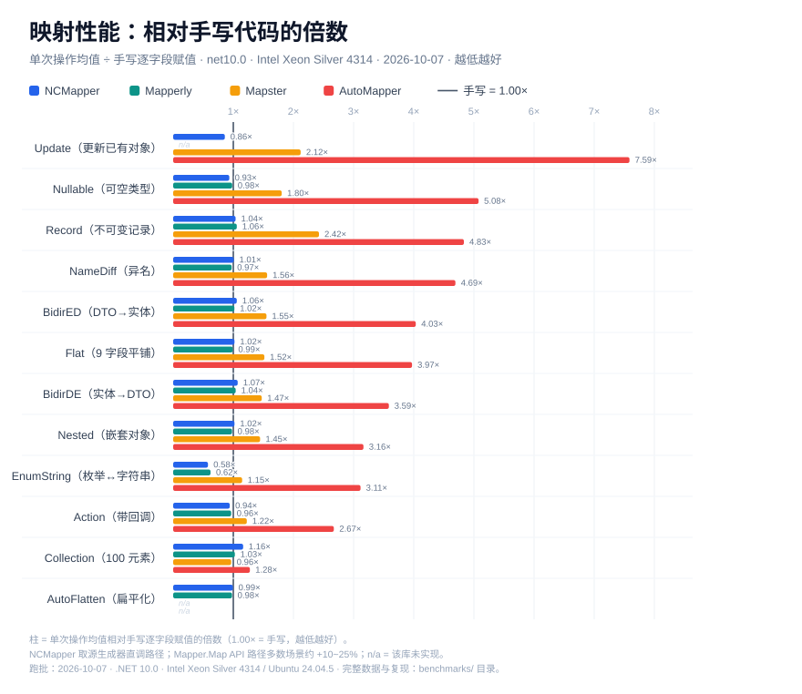
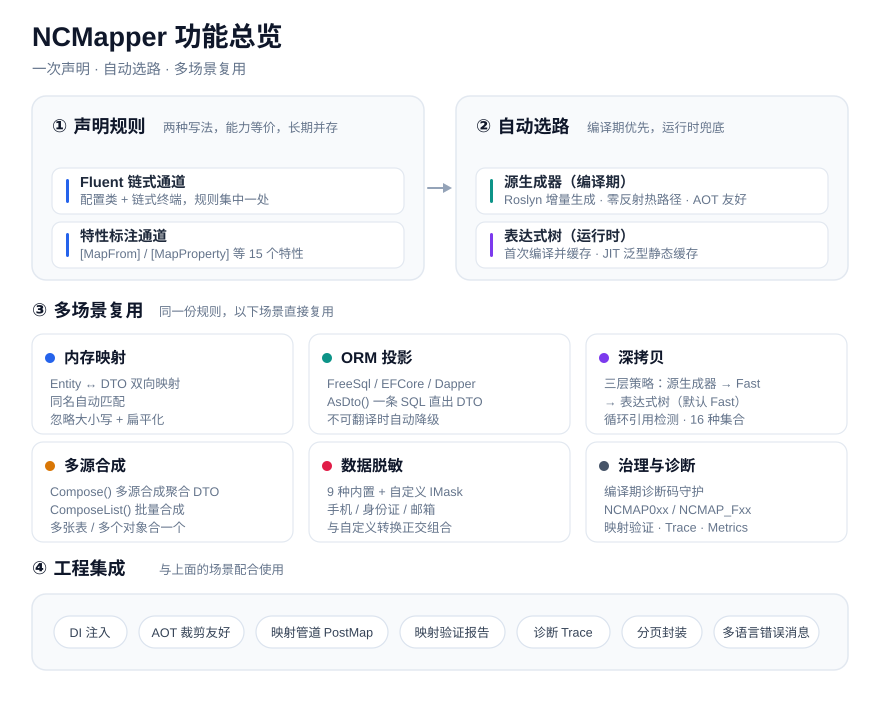

[English](README.md) | **中文**

# NCMapper

[](https://github.com/hchxxzx/NCMapper/actions/workflows/ci.yml)
[](https://www.nuget.org/packages/NCMapper)
[](LICENSE)
[](#%E5%AE%89%E8%A3%85)

.NET 高性能对象映射库——**永久免费**（Apache-2.0）、**AOT 友好**，单库内置 **EF Core / FreeSql / Dapper 投影**——为受 AutoMapper 商业许可影响的团队提供务实的替代选择。



*12 个基准场景中，NCMapper 全部保持在手写逐字段赋值的 0.6–1.2 倍以内，AutoMapper 则需要 1.3–7.6 倍（net10.0，Intel Xeon Silver 4314；[复现方式](benchmarks/README.md)）。*

整个接入只需要一条声明：

```csharp
[MapperConfig]
public class UserMapperConfig
{
    public static void Configure(FluentMappingConfig cfg)
        => cfg.For<UserEntity, UserDto>();   // 同名属性自动匹配——声明到此结束
}

var dto = Mapper.Map<UserEntity, UserDto>(user);   // 编译期已生成映射代码，运行时无需任何配置
```

正在从 AutoMapper 迁移？[迁移指南](docs/zh-CN/getting-started/migrating-from-other-mappers.md)提供逐概念对照表与能力矩阵。

---

技术上，它是一套双引擎（源生成器 + 表达式树）、双通道（Fluent 链式 + 特性标注）的映射库：引擎自动选择最优路径，编译期诊断码守护映射正确性。一次声明，在内存映射、ORM 投影（一条 SQL 直出 DTO）、深拷贝、多源合成等场景间复用，规则不重复定义。

理解它只需三个关键词：

| 关键词 | 含义 |
| ------ | ---- |
| 双引擎 | 源生成器 + 表达式树两套执行装置：声明过的类型对编译期直接出代码，未声明的运行时自动兜底 |
| 双通道 | Fluent 链式与特性标注两种声明写法，能力等价，长期并存 |
| 自适应 | 你只管声明（甚至不声明），走哪个引擎、要不要降级，系统自动判断、自动兜底 |

**规则怎么写你说了算，映射怎么走库说了算。**



## 特性

| 能力 | 引擎 | 说明 |
| ---- | ---- | ---- |
| 双通道声明 | 双引擎 | **Fluent 通道**（`[MapperConfig]` 配置类 + `FluentMappingConfig` 链式声明）与**特性通道**（`[MapFrom]` / `[MapProperty]` 等特性族）能力等价、长期并存：同一类型对只能由一条通道声明一次（`NCMAP_F11` 互斥），不同对可自由混用 |
| 单对象映射 | 双引擎 | `Mapper.Map<S,T>(src)`，同名属性自动匹配（忽略大小写 + 扁平化），一次声明即双向（Entity ↔ DTO） |
| 列表映射 | 双引擎 | `Mapper.MapList<S,T>(srcs)` 批量映射；`MapListInto` 就地复用预分配目标，顶层零分配 |
| 更新既有实例 | 双引擎 | `Mapper.Map(src, dst)` 只覆盖被映射的字段 |
| 回调与钩子 | 双引擎 | `Action` 回调；类级 `[BeforeMapping]` / `[AfterMapping]` 与链式 `.BeforeMapping` / `.AfterMapping` 双通道等价 |
| 自定义转换 | 双引擎 | `[Convert]` / `[ConvertBack]`（静态方法引用 4 形态）↔ 链式 `.Convert` / `.ConvertBack`；反向默认不消费正向转换（`NCMAP033` 提示） |
| 条件守卫 | 双引擎 | `[MapWhen]` / 链式 `.MapWhen`（命名方法 + 内联 lambda 双形态） |
| 忽略控制 | 双引擎 | `[MapIgnore]` / 链式 `.Ignore`：默认双向忽略，可带 `Direction` 参数只忽略单方向；参与 ORM 投影判定 |
| 构造器形参绑定 | 编译时 | 链式 `.MapCtorParam`（Fluent 独有能力，无特性侧形态） |
| 多态子类型分派 | 双引擎 | `[MapSubclass]` / 链式 `.MapSubclass<TSrcDerived, TTargetDerived>()`，最派生优先 + 基类兜底 |
| 树形结构构建 | 双引擎 | `[MapTree]` / 链式 `.Tree()`：类级声明主键 / 父键 / 子集合三要素，扁平列表 → 树，配 `ToTreeList()` 直接出树 |
| JSON 展开 | 双引擎 | `[MapProperty(IsFromJson = true)]` / 链式 `.FromJson()`（Member 段内）：JSON 文本列 ↔ 强类型对象 |
| 属性级格式化 | 双引擎 | `[MapFormat("格式串")]` / 链式 `.Format(dest, format)`：源类型实现 `IFormattable`（DateTime / 数值 / 枚举等）时按格式串输出到目标 `string`，格式串编译期内嵌 |
| 跨表字段来源 | 编译时 | `[MapProperty(FromSource = typeof(Sub))]` / 链式 `.From<Sub>(…)`：把副源类型的字段合成进同一 DTO，与主源字段并列 |
| 自动匹配开关（白名单） | 双引擎 | 特性侧 `[MapNoAutoMatch]`（类级）↔ 链式 `.NoAutoMatch()`（对级）：该类型对关闭自动匹配 / 自动扁平化，仅映射显式声明；未声明列不得被读出，故 ORM 投影自动降级为二步内存映射。**注意与属性级 `[MapNoAutoInclude]` 区分**——后者只让单个属性跳过导航收集，粒度不同、可叠加 |
| 多源合成 Compose | 双引擎 | `Compose()` 从多个源对象合成聚合 DTO；`ComposeList()` 批量合成 |
| 深拷贝 DeepCopy | 双引擎 | 三层策略：源生成器（~179 ns，最快）→ `Fast`（默认，三值分类条件分发）→ `ExpressionTree`（循环引用检测 + DAG 共享保持）；POCO / record / 16 种集合 |
| 数据脱敏 Mask | 双引擎 | `[Mask]` / 链式 `.Mask`，9 种内置实现 + 自定义 `IMask`，与转换正交组合 |
| ORM 投影 | 双引擎 | 三个独立扩展包 `NCMapper.FreeSql` / `NCMapper.EFCore` / `NCMapper.Dapper`；`AsDto()` 终端操作一条 SQL 直出 DTO，遇不可翻译声明自动降级二步映射。**FreeSql 通道注意**：引用导航嵌套投影支持 SQL 直出，但 null 导航物化为空壳 DTO（非 null），与 EF Core 的 null 传播语义不同，见[限制篇](docs/zh-CN/explanation/limitations.md) |
| 全局映射配置 | 双引擎 | `[assembly: MapDefaults]`（命名策略 / 前后缀剥离 / 忽略清单，双向 + ToEntity 两级），亦可经 MSBuild 属性（`NCMapperXxx`）配置 |
| 映射管道 | 运行时 | `Mapper.Pipeline` 可插拔 PostMap 回调，空管道零开销 |
| 映射验证 | 运行时 | `Validate()` 程序集扫描 OK / Warning / Error 三级报告；`ValidateOrThrow()` 快速失败 |
| 诊断 Trace | 运行时 | 开关控制，逐映射路径输出（全局 / 单调用 `MapTraceOptions` 两种粒度） |
| 性能指标 | 运行时 | `MetricsEnabled` 计数调用 / 命中 / 编译次数 |
| 编译时诊断 | 编译时 | `NCMAP0xx`（特性族）+ `NCMAP_Fxx`（Fluent 族），Error / Warn / Info 三级；诊断码**主表**见[诊断规则](docs/zh-CN/diagnostics/rules.md)（F 族逐码条目按分页转指到各 Fluent 专页） |
| DI 集成 | 运行时 | `AddNCMapper()` 一行注入 `IMapper`，支持 Options 回调与 `appsettings.json` 配置绑定 |
| 策略可替换 | 运行时 | JSON 序列化器（`JsonSerializerBase.Current`）、深拷贝提供者（`DeepCopyProviderBase.Current`）均可插拔 |
| AOT 兼容 | 双引擎 | 声明过的类型对（两通道同）走源生成器路径，AOT / 裁剪友好；运行时回退路径标注 `[RequiresDynamicCode]` |
| record 支持 | 双引擎 | 主构造器参数自动匹配，支持 `with` 模式；循环引用 record 源生成期自动检测并回退运行时（`NCMAP012`） |
| 分页封装 | 运行时 | `PagedList<T>` + `ToPagedList` / `ToPagedListAsync` |

完整能力说明见 [NCMapper 是什么](docs/zh-CN/getting-started/overview.md)；限制与注意事项见 [限制篇](docs/zh-CN/explanation/limitations.md)。

## 安装

```bash
dotnet add package NCMapper
```

包矩阵与选型：

| 包 | 用途 | 何时安装 |
| -- | ---- | -------- |
| `NCMapper` | 核心库（运行时引擎 + 表达式树 + 反射回退）+ 源生成器（以 Analyzer 资产随包分发） | 必装（所有场景） |
| `NCMapper.FreeSql` | FreeSql 集成（`AsDto<T>()` 投影、分页、树构建） | 使用 FreeSql 时 |
| `NCMapper.EFCore` | EF Core 集成（`AsDto<T>()` 投影、降级检测） | 使用 EF Core 时 |
| `NCMapper.Dapper` | Dapper 集成（`AsDto` 列名映射、`ToPagedList`、`ToTreeList`） | 使用 Dapper 时 |

目标框架：**net8.0 / net9.0 / net10.0**。

源生成器已内置于 `NCMapper` NuGet 包（以 Analyzer 资产随包分发），引用即自动生效，无需手动安装与注册；可经 csproj 属性调优：

```xml
<PropertyGroup>
  <NCMapperSourceGenEnabled>true</NCMapperSourceGenEnabled>  <!-- 编译时诊断，默认开启 -->
  <NCMapperGenerateReport>false</NCMapperGenerateReport>      <!-- Markdown 映射报告，默认关闭 -->
  <NCMapperEmitGeneratedFiles>false</NCMapperEmitGeneratedFiles>  <!-- 生成产物写盘（obj/NCMapper/Generated），默认关闭 -->
</PropertyGroup>
```

## 快速开始

推荐入口是 **Fluent 通道**：映射规则集中在一个配置类里，实体与 DTO 保持零标注。

```csharp
// 1. 定义实体与 DTO（普通类，无需任何标注）
public class UserEntity
{
    public int Id { get; set; }
    public string Name { get; set; }
    public DateTime CreatedAt { get; set; }
}

public class UserDto
{
    public int Id { get; set; }
    public string Name { get; set; }
    public DateTime CreatedAt { get; set; }
}

// 2. 映射配置类：标注 [MapperConfig]，类内声明静态方法（方法名任意，签名固定）
[MapperConfig]
public class UserMapperConfig
{
    public static void Configure(FluentMappingConfig cfg)
        => cfg.For<UserEntity, UserDto>();   // 同名同类型自动匹配，无需逐属性声明
}

// 3. 映射：与特性通道共用同一入口，同名属性自动赋值
var user = new UserEntity { Id = 1, Name = "张三", CreatedAt = DateTime.Now };
var dto = Mapper.Map<UserEntity, UserDto>(user);
// dto.Id = 1, dto.Name = "张三"
```

配置类声明后**无需手动注册**：源生成器在编译期扫描 `Configure` 方法体生成映射代码，经 `[ModuleInitializer]` 自动注册进 `Mapper`。

同名自动匹配不够用时，在 `For(...)` 链上追加终端方法（异名映射、忽略、脱敏、自定义转换、条件守卫、钩子等），链式连写形态：

```csharp
[MapperConfig]
public class OrderMapper
{
    public static void Configure(FluentMappingConfig cfg)
    {
        cfg.For<OrderEntity, OrderDto>()
           .Member(d => d.OrderId).From(s => s.Id)                 // 异名映射
           .Member(d => d.CustomerName).From(s => s.Customer.Name) // 嵌套源路径
           .Member(d => d.InternalNote).Ignore()                   // 忽略
           .Member(d => d.CustomerPhone).Mask<MaskPhone>()         // 脱敏
           .AfterMapping(ApplyComputedFields);                     // 生命周期钩子
    }

    public static void ApplyComputedFields(OrderEntity src, OrderDto dst)
        => dst.TotalWeight = src.Items.Sum(i => i.Weight);
}
```

终端方法全表与诊断码索引见 [Fluent 基础](docs/zh-CN/how-to/fluent/basics.md)；可运行验证：`dotnet run --scenario 101`。

### 等价写法：特性通道

同一对映射也可以直接把 `[MapFrom]` 标在 DTO 类上，规则随类自描述；源生成器对两通道生成**完全相同**的映射代码，运行时零差异：

```csharp
[MapFrom(typeof(UserEntity))]
public class UserDto
{
    public int Id { get; set; }
    public string Name { get; set; }
    public DateTime CreatedAt { get; set; }
}
```

两条通道对**同一类型对**只能声明一次（二选一），双侧同时声明编译期报 `NCMAP_F11`。跨面选型与逐维度等价关系见[双 API 面对照](docs/zh-CN/reference/api-comparison.md)；特性全表（17 个）见 [Attribute 速查表](docs/zh-CN/reference/attributes-index.md)。

### 常用调用入口

```csharp
// 带 Action 回调：映射完成后额外处理
var dto2 = Mapper.Map<UserEntity, UserDto>(user, (s, t) => t.Name = t.Name.ToUpper());

// 列表映射
var dtos = Mapper.MapList<UserEntity, UserDto>(users);

// 就地批量映射：复用预分配目标
Mapper.MapListInto<UserEntity, UserDto>(users, dtos);

// 更新既有对象（只覆盖被映射的字段）
var existing = new UserDto();
Mapper.Map(user, existing);

// 扩展方法（源生成器生成，语法更简洁，两通道通用）
using NCMapper.Generated;
var dto3 = user.MapToUserDto();               // 等价于 Mapper.Map<UserEntity, UserDto>(user)
var dtos2 = users.MapToUserDtoList();          // 等价于 Mapper.MapList
```

`Mapper.Map` 内部优先调用源生成委托，未命中才回退表达式树；扩展方法与 `Mapper.Map` 基于同一份生成代码，性能基本等价，按语法偏好选择即可。

### DI 注册

```csharp
services.AddNCMapper();
// 支持 Options 回调与 appsettings.json 绑定：
// services.AddNCMapper(opts => { opts.TraceEnabled = true; });
// services.AddNCMapper(config.GetSection("NCMapper"));

public class MyService
{
    private readonly IMapper _mapper;
    public MyService(IMapper mapper) => _mapper = mapper;
    public void Do(UserEntity entity) => _mapper.Map<UserEntity, UserDto>(entity);
}
```

## 性能

> 口径：net10.0，Intel Xeon Silver 4314 / Ubuntu 24.04.5（2026-10-07 全量跑批）。性能数值随测试机 CPU / OS / .NET 版本差异较大，下表仅代表该环境的相对水平与量级，不作为跨环境绝对性能承诺。

*竞品对比图见本 README 首屏——完整数字如下。*

**映射（单次操作均值，三条路径）**：

| 场景 | 源生成器直调 | API 调用 | 运行时表达式树 | 手写 |
| ---- | -------: | -------: | ------------: | -------: |
| Flat（9 字段平铺） | 20.4 ns | 23.9 ns | 34.8 ns | 20.0 ns |
| NameDiff（异名） | 16.4 ns | 19.7 ns | 28.4 ns | 16.3 ns |
| Nested（嵌套对象） | 26.7 ns | 29.2 ns | 38.4 ns | 26.2 ns |
| EnumString（枚举↔字符串） | 15.4 ns | 18.4 ns | 29.9 ns | 26.7 ns |
| Action（带回调） | 32.4 ns | 37.4 ns | 46.2 ns | 34.5 ns |
| Update（更新已有对象） | 7.1 ns | 10.4 ns | 18.6 ns | 8.2 ns |
| Collection（100 元素） | 2.49 μs | 2.46 μs | 2.13 μs | 2.14 μs |

**深拷贝（三框架对比）**：

| 路径 | net8.0 | net9.0 | net10.0 |
| ---- | -----: | -----: | ------: |
| 源生成器 | 233.0 ns | 203.1 ns | 179.2 ns |
| 运行时（Fast，默认） | 530.5 ns | 456.1 ns | 400.9 ns |
| 表达式树 | 555.0 ns | 474.6 ns | 409.2 ns |

（手写参照：87.0 / 84.4 / 70.6 ns）

**对比替代方案（单次操作均值，net10.0）**：

| 场景 | NCMapper（直调） | Mapperly | Mapster | AutoMapper | 手写 |
| ---- | -------: | -------: | -------: | -------: | -------: |
| Update（更新已有对象） | 7.1 ns | — | 17.4 ns | 62.4 ns | 8.2 ns |
| Nullable（可空类型） | 13.3 ns | 14.0 ns | 25.7 ns | 72.4 ns | 14.2 ns |
| Record（不可变记录） | 16.4 ns | 16.6 ns | 38.2 ns | 76.1 ns | 15.8 ns |
| NameDiff（异名） | 16.4 ns | 15.8 ns | 25.4 ns | 76.4 ns | 16.3 ns |
| BidirED（DTO→实体） | 20.7 ns | 19.9 ns | 30.4 ns | 79.0 ns | 19.6 ns |
| Flat（9 字段平铺） | 20.4 ns | 19.8 ns | 30.3 ns | 79.3 ns | 20.0 ns |
| BidirDE（实体→DTO） | 24.6 ns | 23.9 ns | 33.8 ns | 82.3 ns | 22.9 ns |
| Nested（嵌套对象） | 26.7 ns | 25.6 ns | 37.8 ns | 82.8 ns | 26.2 ns |
| EnumString（枚举↔字符串） | 15.4 ns | 16.6 ns | 30.6 ns | 83.2 ns | 26.7 ns |
| Action（带回调） | 32.4 ns | 33.2 ns | 42.2 ns | 92.0 ns | 34.5 ns |
| Collection（100 元素） | 2.49 μs | 2.20 μs | 2.07 μs | 2.73 μs | 2.14 μs |
| AutoFlatten（扁平化） | 23.2 ns | 22.9 ns | — | — | 23.4 ns |

> `—` = 该库未实现该场景。NCMapper 列取源生成器直调路径；`Mapper.Map` API 路径见上表。可用 `benchmarks/` 复现。

关键结论：源生成器直调 ~7–33 ns（视场景复杂度），接近手写赋值——34/36 组达到手写实现的 1.10 倍以内；15/36 组快于竞品最快实现，0 组落后超过 15%。完整数据（13 映射场景 × 3 框架 + 深拷贝三策略 + 竞品对比）见 `benchmarks/` 目录与 [性能篇](docs/zh-CN/explanation/performance.md)。

## 文档

文档门户（简体中文为权威源，英文站同步开放，各语言独立构建离线包）：

- 中文门户：[docs/zh-CN/index.md](docs/zh-CN/index.md)
- English: [docs/en-US/index.md](docs/en-US/index.md)

### 离线文档包（无需自己打包）

**只想离线看文档？直接下载现成的，不用克隆仓库、不用自己构建。**

前往 [**Releases 页面**](https://github.com/hchxxzx/ncmapper/releases/latest)，按平台与语言下载：

| 离线包 | 平台 | 说明 |
| ------ | ---- | ---- |
| `NCMapper-离线包-中文-v*-win-x64.zip` | Windows | 中文，自包含，解压即用 |
| `NCMapper-Offline-EN-v*-win-x64.zip` | Windows | 英文，自包含 |
| `NCMapper-离线包-中文-v*-linux-x64.zip` | Linux | 中文 |
| `NCMapper-Offline-EN-v*-linux-x64.zip` | Linux | 英文 |

每个包都是自包含的：解压后运行包内启动脚本（Windows 用 `.bat`，Linux 用 `.sh`），即可在浏览器打开本地文档站——**无需安装 .NET 运行环境，无需联网**。离线包在每次 GitHub Release 发布时自动构建并作为附件上传。

**3 秒定位**：

| 你要做什么 | 去这里 |
| ---------- | ------ |
| 第一次使用，学会基本映射 | [快速开始](docs/zh-CN/getting-started/quickstart.md) · [15 分钟上手](docs/zh-CN/getting-started/tutorial-15min.md) |
| 用链式声明替代特性标注（Fluent 通道） | [Fluent 基础](docs/zh-CN/how-to/fluent/basics.md) |
| 两条通道选型、逐维度等价对照与迁移 | [双 API 面对照](docs/zh-CN/reference/api-comparison.md) |
| 解决一个具体问题（"怎么配置 X"） | [操作指南](docs/zh-CN/how-to/fluent/basics.md)（任务导向，Fluent 入口） |
| 查 API、特性、配置事实 | [核心 API](docs/zh-CN/reference/core-api.md) · [Attribute 速查表](docs/zh-CN/reference/attributes-index.md) · [配置与扩展](docs/zh-CN/reference/configuration.md) |
| 查诊断码含义 | [诊断码全索引](docs/zh-CN/diagnostics/rules.md) |
| 理解原理与设计决策 | [双引擎架构](docs/zh-CN/explanation/dual-engine.md) · [双通道架构](docs/zh-CN/explanation/dual-channel.md) · [ORM 降级机制](docs/zh-CN/explanation/orm-degradation.md) |
| 从其他映射库迁入 | [从其他映射库迁移](docs/zh-CN/getting-started/migrating-from-other-mappers.md) · [映射配置所有权三原则](docs/zh-CN/explanation/semantics/mapping-config-ownership.md) |

## 运行示例

全部示例位于 `samples/NCMapper.Samples/`（**22 个可运行场景**，与 how-to 篇目一一对应，映射关系见 [samples 场景映射表](docs/zh-CN/reference/samples-index.md)）：

```bash
cd samples/NCMapper.Samples
dotnet run --scenario 101   # 运行指定场景
dotnet run --all            # 运行全部场景
```

场景域：01-Fluent（101–108）· 02-Declarative（201–202）· 03-Compose（301）· 04-DeepCopy（401）· 05-Orm（501–503）· 06-Infrastructure（601–607）；AOT / NativeAOT 部署演示见 `samples/NCMapper.AotSample/`。

## 项目结构

```
src/
├── NCMapper/            — 核心库（net8.0;net9.0;net10.0）
├── NCMapper.SourceGen/  — 源生成器（netstandard2.0，Roslyn IIncrementalGenerator）
├── NCMapper.FreeSql/    — FreeSql 投影扩展包
├── NCMapper.EFCore/     — EF Core 投影扩展包
└── NCMapper.Dapper/     — Dapper 适配扩展包
benchmarks/              — BenchmarkDotNet（性能对比）
samples/                 — 交互式演示项目（21 场景）+ NativeAOT 最小部署示例
test/                    — 六个测试工程（单元测试 / 源生成器 / 集成 / AOT / 模糊 / 崩溃探针）
```

详见 [项目结构](docs/zh-CN/reference/project-structure.md)。

## 配套工具

- **NCMapper.Migrate** — AutoMapper 迁移 CLI 工具，NCMapper 生态的**独立伴随项目**，以独立 .NET 全局工具形式发布（不随 NCMapper NuGet 包分发）。**尚未发布（将滞后于 NCMapper 独立开放）**：源码仓库计划作为独立开源仓库对外公开（GitHub `https://github.com/hchxxzx/ncmapper.migrate.git`），发布后即可通过 `dotnet tool install --global NCMapper.Migrate` 安装。

## 参与贡献

参见 [CONTRIBUTING.md](CONTRIBUTING.md)，了解开发环境搭建、编码规范和 PR 流程。

## 安全策略

参见 [SECURITY.zh-CN.md](SECURITY.zh-CN.md)，了解漏洞报告流程。

## 许可证

[Apache License 2.0](LICENSE)
