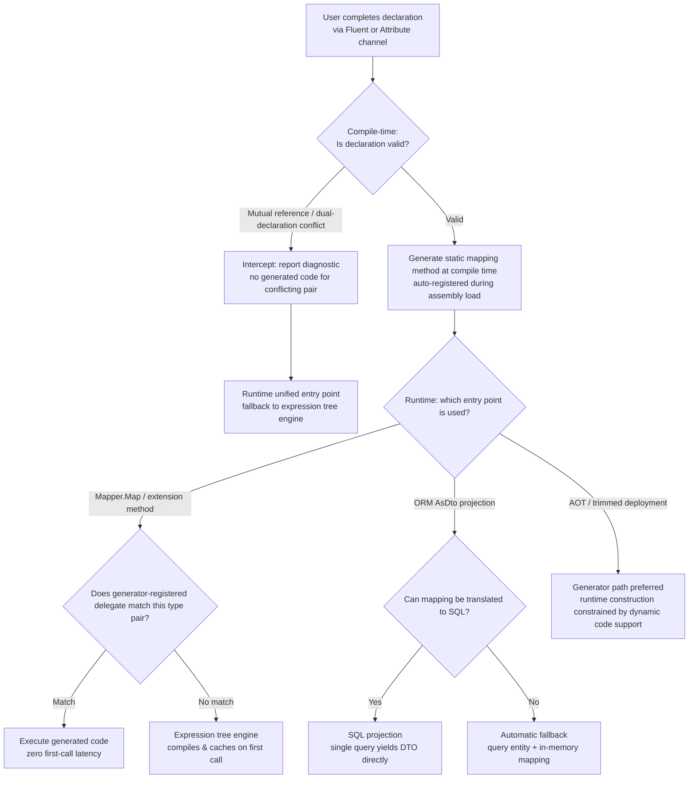

> [!WARNING]
> This documentation has been machine-translated from Chinese source comments and may contain inaccuracies. Please refer to the original Chinese IntelliSense documentation or the source code for authoritative descriptions.

---
wiki-id: explanation/adaptive-routing
Related Diagnostic Codes:
Library Version: v1.0.0+
Last Updated: 2026-09-29
---

# Adaptive Routing Mechanism

## Overview

The user’s responsibility is singular: **declare mappings**, either via Fluent API chaining or by applying attributes on DTOs (see [Dual-Channel Architecture](./dual-channel.md)). Once declarations are complete, the actual execution path for each mapping request is automatically selected by the component at *compile time* and *runtime*, across several decision points — users need not write `if` statements to check environments, manually switch engines, or manually dispatch between “SQL projection” and “in-memory mapping” inside ORM queries.

This article provides a **high-level overview** of those decision points: what each one evaluates, what criteria it uses, and where each resulting path leads. Implementation details for individual decision points are covered in dedicated articles; they are not repeated here.

---

## 1. Decision Point Summary Diagram

A mapping request flows from declaration to execution through the following automatic routing points:

Summary of all decision points:

| # | Decision Point | Evaluation Criteria | Outcome | Details |
|---|----------------|---------------------|---------|---------|
| 1 | Compile-time: Declaration Generability | Whether declaration contains mutual references or dual declarations (diagnostic codes 025 / F11 / F16) | Valid → generate & register; Conflict → no code generation, report diagnostic | [Dual-Channel Architecture §4](./dual-channel.md) |
| 2 | Runtime: Engine Selection | Whether generator-registered delegate matches the source/target type pair | Match → execute compiled static method; No match → fall back to expression tree engine (compiled & cached on first call) | [Dual-Engine Architecture §3](./dual-engine.md) |
| 3 | ORM Projection: Translatability | Whether mapping declaration can be translated into SQL (e.g., attribute translatability, constructor usage, nesting depth) | Yes → SQL projection; No → automatic two-step fallback | [ORM Fallback Mechanism](./orm-degradation.md) |
| 4 | Deployment Environment: Dynamic Code Availability | Whether target environment supports runtime code generation | In AOT/trimmed environments, generator path is preferred | [AOT Deployment](../how-to/aot/deployment.md) |

Dapper integration has *no decision points*: SQL is fully controlled by the user, with no SQL-side projection capability — it always follows the full in-memory mapping pipeline.

---

## 2. Compile-Time: Block Conflicts First, Then Emit Code

The source generator processes declarations with two possible outcomes:

- **Valid declaration**: Generates a static mapping method for each type pair and auto-registers it into the runtime cache during assembly load. All subsequent runtime decision points assume “registration succeeded.”
- **Conflicting declaration** (e.g., mutual reference between types, or dual declarations via both Fluent and attributes): For that type pair, **no code is generated**, and a compile-time diagnostic is reported. This design reflects the principle: “When two conflicting declarations exist, it’s safer to require the user to resolve ambiguity than to guess arbitrarily.” Not generating code does *not* mean the mapping becomes unusable — the runtime unified entry point still serves as a fallback (see next section). However, the compile-time warning *must* be addressed; otherwise, you forfeit both the performance benefits and compile-time correctness checks of the generated path.

---

## 3. Runtime: Unified Entry Point Automatically Selects Engine

`Mapper.Map<TSource, TTarget>` serves as the single, unified entry point for all mapping requests. Its internal routing logic is simple:

1. First, check whether a delegate registered by the source generator matches the source/target type pair — if so, invoke the statically generated method directly, with zero first-call latency.
2. If no match is found (e.g., the type pair appears only at runtime, or the user intentionally omitted a declaration), delegate to the expression tree engine — on the first call, it constructs and compiles the mapping logic as an expression tree and caches the resulting delegate; subsequent calls execute the cached delegate directly.

This routing is completely transparent to callers: the same calling code works identically regardless of which engine handles the request. Extension methods (e.g., `src.MapToXxxDto()`) share the exact same generated code as the unified entry point — the only difference is syntactic sugar in how the call is written. Performance implications and implementation details of this routing are covered in [Dual-Engine Architecture §3](./dual-engine.md).

---

## 4. ORM Projection: Translate If Possible, Otherwise Fall Back

The `AsDto` projection provided by ORM integrations (FreeSql / EF Core) introduces a second category of automatic routing: the component attempts to **translate the mapping declaration into SQL**, enabling the database to return the DTO directly. When SQL cannot express certain capabilities (e.g., custom converters, data masking, `record` target types, excessive nesting depth), the component **automatically falls back to a two-step execution**: first query the entity, then apply the full mapping pipeline in memory to produce the DTO.

Two key points:

- **Fallback is not failure** — it is a first-class, semantically equivalent execution path: all declared features (attributes, conversions, etc.) remain fully active, and results are identical; the only cost is an extra round-trip to the database.
- **Fluent declarations participate in the same evaluation logic**: purely translatable declarations restore SQL projection; declarations containing non-translatable features trigger mandatory fallback — both declaration channels share the *same* translation evaluation logic in projection scenarios, and include safeguards to prevent semantic drift between channels.

Full trigger conditions, post-fallback execution details, and mitigation guidance are covered in [ORM Fallback Mechanism](./orm-degradation.md); rationale for enforcing strict equivalence between channels in fallback evaluation is explained in §2.3 (“Dual-Channel Equivalence Contract”) of that document.

---

## 5. Deployment Environment: Constraints Imposed by AOT and Trimming

NativeAOT or trimmed deployments either disallow or severely restrict runtime code generation. Consequently, the expression tree engine requires explicit opt-in for dynamic code capabilities in such environments. Therefore:

- In AOT scenarios, the recommended practice is to **declare *all* type pairs** (via either channel), ensuring all mappings are generated at compile time and incur zero runtime dynamic code.
- Undeclared type pairs remain functional under AOT, but require explicit dynamic code annotations per the [AOT Deployment Guide](../how-to/aot/deployment.md).

This remains the *same* routing model: the component selects paths based on environment capabilities, while users control the set of available paths simply by choosing whether or not to declare a given type pair.

---

## 6. Observability: Automatic Routes Must Be Visible

The prerequisite for trustworthy automatic routing is that **every decision must be observable**:

- **Compile-time**: Diagnostic codes appear directly in the IDE error list (e.g., conflict interception, invalid declarations); see [Diagnostic Code System Model](./semantics/diagnostics-model.md).
- **Runtime projection**: When `MapTracer.GloballyEnabled = true`, fallback queries emit log lines indicating the root cause (e.g., “Property X is annotated with `ConvertAttribute` (requires fallback)”), see [ORM Fallback Mechanism §3.2](./orm-degradation.md).
- **Configuration health check**: `Mapper.Validate()` scans all declared type pairs and surfaces potential issues *before* runtime execution; see [Mapping Validation](./validation.md).

---

## 7. Why “Automatic” Instead of “User-Specified”

| Approach | Behavior | Trade-off |
|----------|----------|-----------|
| User explicitly specifies path *(not adopted)* | Each call declares “use generated code / use expression tree / use projection / use fallback” | Tight coupling between caller code and execution details; changing deployment environment or ORM requires modifying call-site code |
| Component automatically routes *(current approach)* | User declares once; component selects optimal path based on type pair, environment, and translatability | Caller remains entirely unaware; routing follows fixed, observable rules |

The trade-off of automatic routing is that users are *not automatically aware* of the actual path taken. Therefore, observability (Section 6) is a *necessary part* of this design — not an optional add-on. **One declaration, everywhere effective**: The same mapping configuration automatically selects the best feasible path for ordinary calls, ORM queries, and AOT deployments.

---

## Quick Reference Table

| Concept | Description |
|---------|-------------|
| Adaptive Routing | After declaration, the component automatically selects the execution path across compile-time and runtime decision points — fully transparent to callers |
| Decision Point 1 (Compile-Time) | Intercept conflicting declarations (no code + diagnostics); generate & auto-register valid declarations |
| Decision Point 2 (Runtime) | Hit generator-registered delegate → execute generated code; miss → expression tree engine (compiled & cached on first call) |
| Decision Point 3 (ORM Projection) | Translatable to SQL → SQL projection; otherwise → automatic fallback to “query entity + in-memory mapping” |
| Decision Point 4 (Deployment Environment) | Prefer generator path under AOT/trimming; runtime construction constrained by dynamic code availability |
| Observability | Compile-time diagnostics + `MapTracer` fallback reason logs + `Mapper.Validate()` configuration health check |
| Design Trade-off | Exchange “automatic + observable” for “caller transparency” and “one declaration, everywhere effective” |

---

## Frequently Asked Questions

**How do I know which path a given call actually took?**

For ordinary mappings, it rarely matters (both engines yield identical results — only performance characteristics differ); for projections, enable `MapTracer` to see whether fallback occurred and why.

**Could automatic routing “silently” slow down?**

Only two cases introduce observable overhead — both fully observable:  
- First call for an undeclared type pair (expression tree compilation — one-time cost);  
- Projection fallback (extra database round-trip — logged by `MapTracer`).  
All other routing decisions incur zero additional overhead.

**Can I force a call to skip fallback?**

No — fallback is determined solely by the *translatability of the declaration itself*. To enable SQL projection, adjust your declaration per recommendations in [ORM Fallback Mechanism §4](./orm-degradation.md) (e.g., keep projection DTOs as pure property bags, prefer regular classes over `record`s, etc.).

---

## Related Documentation

- [Dual-Channel Architecture](./dual-channel.md): Input to routing — how two declaration channels converge into one set of generated code  
- [Dual-Engine Architecture](./dual-engine.md): Responsibilities and performance characteristics of Decision Point 2  
- [ORM Fallback Mechanism](./orm-degradation.md): Trigger conditions and post-fallback behavior for Decision Point 3  
- [AOT Deployment](../how-to/aot/deployment.md): Deployment constraints and annotation requirements for Decision Point 4  
- [Performance Optimization Mechanisms](./performance.md): Performance metrics and optimization guidance for all paths
