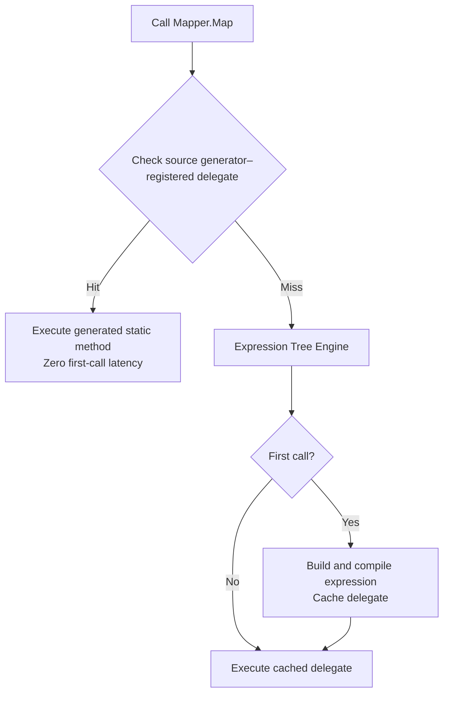

> [!WARNING]
> This documentation has been machine-translated from Chinese source comments and may contain inaccuracies. Please refer to the original Chinese IntelliSense documentation or the source code for authoritative descriptions.

---
wiki-id: explanation/dual-engine
Related Diagnostic Codes:
Library Version: v1.0.0+
Last Updated: 2026-08-19
---

# Dual-Engine Architecture Principles

## Overview

NCMapper provides two declaration channels for mapping definitions: the `[MapFrom]` attribute applied to DTO classes, and Fluent-style chained declarations (e.g., `cfg.For<TSource, TTarget>()...`) inside a class marked with `[MapperConfig]`. Declarations from both channels are merged at compile time into a single *mapping snapshot*, which is then processed by two complementary engines: a **compile-time source generator**, and a **runtime expression tree compiler**. This article explains why a dual-engine design is necessary, how the two declaration channels integrate with the two engines, and which execution path your code actually takes.

Implementation details of the source generator are covered in [explanation Source Generator](./source-generator.md); the semantics of the dual-channel declaration model are described in [explanation Dual-Channel Architecture](./dual-channel.md). This article focuses on the design rationale and inter-engine collaboration.

---

## 1. Why Dual Engines Are Required

### 1.1 Limitations of a Sole Compile-Time Engine

The source generator emits static mapping code at compile time—delivering optimal performance—but only processes declarations visible at compile time: type pairs annotated with `[MapFrom]`, and Fluent chains declared inside the `static void M(FluentMappingConfig cfg)` method of a `[MapperConfig]` class. The following scenarios fall outside its scope:

| Scenario | Issue |
|----------|-------|
| Type pairs known only at runtime (e.g., plugin loading, dynamic types) | No declarations exist at compile time → no code can be generated |
| Ad-hoc mappings where you prefer not to write explicit declarations | Introducing `[MapFrom]` or a Fluent config class for a one-off mapping incurs excessive overhead |
| Reflection-driven generic scenarios | The set of involved types is determined only at runtime |

### 1.2 Cost of a Sole Runtime Engine

A runtime engine (based on `System.Linq.Expressions`) has no such limitations—but incurs compilation cost on first invocation and relies on `System.Linq.Expressions` for expression construction. For type pairs already declared at compile time, this compilation overhead is redundant.

### 1.3 Conclusion: Path Selection Per Type Pair

Each engine excels in distinct scenarios. The selection criterion is simple: **does the type pair have a compile-time declaration?** (Either via `[MapFrom]` or a Fluent chain.)

| Dimension | Source Generator (Compile-Time) | Expression Tree (Runtime) |
|-----------|----------------------------------|----------------------------|
| Timing | Compile time | First invocation |
| Coverage | Declared type pairs (`[MapFrom]` or Fluent chain) | All type pairs (fallback) |
| First-call latency | Zero | Compilation overhead on first call |
| Compile-time diagnostics | Yes (NCMAP0XX / NCMAP_FXX) | None |
| Performance | Direct static method call; eligible for JIT inlining | Delegate invocation |

The two engines are not competitors—they are collaborators:  
**The source generator delivers the optimal path for declared type pairs; the expression tree engine serves as a robust fallback for all others.**

---

## 2. How Two Declaration Channels Feed Into Two Engines

### 2.1 Source Generator: Compile-Time Construction

The source generator (`NCMapperSourceGenerator`, a Roslyn `IIncrementalGenerator`) uses two extractors—one per declaration channel—to populate a unified *mapping snapshot* (`MappingSnapshot`). A shared code emitter then produces the final output:

- **Attribute Channel**: `MappingExtractor` extracts mapping relationships and auto-flattening matches from `[MapFrom]` contexts.
- **Fluent Channel**: `FluentExtractor` locates the `static void M(FluentMappingConfig cfg)` method inside `[MapperConfig]` classes. `ChainCallParser` semantically unwinds Fluent chains like `cfg.For<S,T>().Map(...).Ignore(...)`; each node (`Map`, `Ignore`, `Mask`, `Convert`, `MapTree`, `NoAutoInclude`, `AfterMapping`, etc.) is materialized via `MappingSnapshotBuilder`. Crucially, it reuses the *same symbol traversal logic* (`MappingExtractor`’s materialization path) used for the attribute channel—ensuring identical snapshot structure across both channels.
- If the same type pair is declared via both channels, the compiler reports **NCMAP_F11** (mutually exclusive dual declaration) and halts generation. Different type pairs may freely mix declaration channels.

For each declared type pair, the generator emits:
- A static mapping method: direct property assignment for identically named members, `[MapProperty]`-driven name remapping, and `[Convert]`-invoked converters.
- An extension method family: e.g., `src.MapToXxxDto()` and `srcs.MapToXxxDtoList()`.
- Reverse extensions: e.g., `dto.MapToXxxEntity()` and `dtos.MapToXxxEntityList()` (DTO → Entity direction, symmetric to forward mapping).

Reverse list extensions apply the same reverse semantics element-wise across bulk DTO collections—including null-writeback clearing and ignore-list filtering—mirroring the behavior of forward `MapToXxxDtoList` ([explanation Reverse Mapping Semantics](./reverse-mapping-semantics.md)).

The `FluentMappingConfig` class and its terminal methods serve *only as compile-time syntactic anchors*: these methods are never invoked at runtime; they perform zero work. All semantic meaning is extracted, materialized, and embedded into generated code by the source generator.

Generated code is fully visible at compile time—enabling direct JIT inlining, with zero reflection and zero dictionary lookups.

### 2.2 Expression Tree Engine: Runtime Fallback

When `Mapper.Map` is invoked, it first checks the delegate cache populated by the source generator. On cache miss, it falls back to the expression tree engine: on the first call, it constructs an `Expression<Func<TSource, TTarget>>`, compiles it into a delegate, and caches it; subsequent calls execute the cached delegate directly. The expression tree construction logic shares the *exact same matching rules* (`PropertyMatcher`, `TypeConvertHelper`, etc.) as the source generator—guaranteeing identical output behavior.

---

## 3. Engine Selection Path

The actual execution flow for `Mapper.Map<TSource, TTarget>(src)`:

```text
Mapper.Map Entry Point
  ├─ Check source generator–registered delegate (registered via [ModuleInitializer]; exact type-pair match)
  │    ├─ Hit → Invoke generated static method (zero first-call latency; applies to all type pairs declared via attributes or Fluent)
  │    └─ Miss
  └─ Expression Tree Engine
       ├─ First call → Build + compile expression tree → cache delegate
       └─ Subsequent calls → Execute cached delegate
```

Selection is fully automatic—the caller need not be aware. The declaration channel (attribute vs. Fluent) does not affect routing: both channels merge into the same compile-time snapshot. Extension methods (e.g., `src.MapToXxxDto()`) and `Mapper.Map` share the *identical generated code*, differing only in entry point ([Basics of Declarative Mapping](../how-to/declarative/basics.md)).



| Invocation Style | Engine | Notes |
|------------------|--------|-------|
| `src.MapToXxxDto()` | Source generator (direct call) | Requires `using NCMapper.Generated` |
| `Mapper.Map<T, TDto>(src)` | Source generator first, expression tree fallback | Unified entry point |
| Type pair with *no declarations* | Expression tree | Compiles once, then caches |

---

## 4. Consistency Guarantees

Dual engines must produce *identical results*. Otherwise, the same mapping would behave differently depending on invocation style. Consistency is enforced via:

- **Shared Matching Logic**: Property matching (`PropertyMatcher`), type conversion (`TypeConvertHelper`), and ignore rules (`PropertyIgnoreChecker`) are reused by *both* engines—not reimplemented separately.
- **Unified Declaration Snapshot**: Both channels (attributes and Fluent) are materialized at compile time into structurally identical snapshots. Both the generator and runtime engine consume the *same declaration metadata*—eliminating any notion of “channel-specific semantics.”
- **Consistent Diagnostics**: Identical configuration issues (e.g., `[Convert]` not consumed in reverse mapping → NCMAP033; init-only property updates skipped → NCMAP032) trigger diagnostics at generation time *and* manifest corresponding runtime behavior—ensuring semantic alignment.

Mapping validation (`Mapper.Validate()`) scans *all declared type pairs* (from both channels). Both engines rely on the *same configuration validation result*.

---

## 5. Decision Table: Which Path Is Taken?

| Scenario | Actual Path | Recommendation |
|----------|-------------|----------------|
| Standard Entity → DTO (annotated with `[MapFrom]`) | Source generator | Default: declaration = optimal path |
| Type pair declared via Fluent chain (`[MapperConfig]` class) | Source generator | Same compile-time path as attribute channel; declaration = optimal |
| Runtime-dynamic type pairs | Expression tree | Accept first-call compilation cost |
| Ad-hoc mapping (no desire to add declarations) | Expression tree | Imperceptible for 1–2 calls; for high-frequency use, add a declaration (attribute or Fluent) |
| Need compile-time diagnostics (e.g., property mismatch, type incompatibility) | Source generator | No declaration → no compile-time safety net |
| Reverse mapping (DTO → Entity) | Source generator (generates reverse extensions) | Generated if declared |
| NativeAOT / Trimmed deployment | Prefer source generator | Runtime path requires `[RequiresDynamicCode]`; see [AOT](../how-to/aot/deployment.md) |

Key principle: **Declaration (`[MapFrom]` or Fluent chain) → compile-time optimal path; no declaration → runtime fallback.** For performance-sensitive scenarios (see [Performance](../how-to/infrastructure/performance.md)), ensure all relevant type pairs are declared.

---

## 6. Performance Characteristics

Performance differences between engines manifest primarily in *first-call* and *steady-state* phases:

| Phase | Source Generator | Expression Tree |
|-------|------------------|-----------------|
| First call | Zero latency (code pre-generated at compile time) | Expression construction + compilation overhead |
| Steady state | Direct static method call; JIT-inlinable | Cached delegate invocation |
| Memory footprint | No runtime cache structures | One cached delegate per type pair |

See [Performance](../how-to/infrastructure/performance.md) for benchmarks and optimization guidance. For declared type pairs, the source generator’s zero-first-call-latency advantage is most pronounced in cold-start scenarios (e.g., AOT or short-lived processes).

---

## 7. Frequently Asked Questions

**Why not use reflection as the fallback?**  
Reflection-based fallback incurs per-call overhead and cannot enforce compile-time validations for features like `[Convert]` or `[Mask]`. Expression tree fallback compiles once and caches—achieving steady-state performance close to generated code, while preserving flexibility and correctness.

**Are Fluent configuration methods invoked at runtime?**  
No. All terminal methods in `FluentMappingConfig` serve *only as compile-time syntactic anchors* and perform zero runtime work. The `cfg.For<S,T>()...` chain is fully unwound and materialized into the mapping snapshot *at compile time* by the source generator. At runtime, only the generated static code executes.

**Which is faster: extension methods or `Mapper.Map`?**  
They share the *exact same generated code*. The difference is merely one layer of delegate indirection—negligible in practice. Choose based on syntax preference ([Basics of Declarative Mapping](../how-to/declarative/basics.md)).

**Can undeclared type pairs receive compile-time diagnostics?**  
No. Compile-time diagnostics (NCMAP0XX / NCMAP_FXX) apply *only* to declared type pairs. For high-frequency ad-hoc mappings, add a declaration; for low-frequency cases, accept the runtime fallback.

**Do both engines ever execute simultaneously?**  
No. Each call follows *exactly one path*: hit the source generator delegate → execute generated code; miss → fall back to expression tree. There is *no overlap*, and *no “execute both and pick result”* path. `Mapper.Validate()` validates the *same configuration snapshot*, yielding identical conclusions regardless of engine.

---

## Quick Reference Table

| Concept | Description |
|---------|-------------|
| Declaration Channels | Two channels—attributes (`[MapFrom]`) and Fluent (`[MapperConfig]` + `FluentMappingConfig` chains)—merge at compile time into one snapshot. Dual declaration of the same type pair triggers NCMAP_F11. |
| Source Generator Engine | Generates static code at compile time for declared type pairs. Zero first-call latency. Enables compile-time diagnostics. |
| Expression Tree Engine | Compiles and caches delegates at runtime. Covers *all* type pairs (fallback). |
| Selection Rule | Source generator delegate is checked first; cache miss triggers expression tree fallback—fully automatic and transparent. |
| Consistency | Both engines share matching/conversion/ignore logic and consume the same snapshot—guaranteeing identical results. |
| Extension Methods | Share identical generated code with `Mapper.Map`; differ only in entry point. |
| Polymorphic Subtype Mapping | Symmetric support via `MapSubclass` (Fluent terminal + `[MapSubclass]` attribute). `isinst` dispatch chains are emitted at compile time by the source generator; the expression tree engine provides no subtype dispatch when falling back. |

This article answers *“Why two engines?”* and *“Which path runs?”*. Internal implementation details reside in the [Source Generator](./source-generator.md) article; performance data is in the [Performance](../how-to/infrastructure/performance.md) how-to.

---

## Related Documentation

- [explanation Dual-Channel Architecture](./dual-channel.md): How two declaration channels unify into one generated codebase  
- [explanation Adaptive Routing Mechanism](./adaptive-routing.md): High-level overview of automatic decision-making across components after declaration  
- [explanation Source Generator](./source-generator.md): Details of generated content and extension method implementation  
- [15-Minute Getting Started Tutorial](../getting-started/tutorial-15min.md): First use of the dual-engine system  
- [Performance](../how-to/infrastructure/performance.md): Benchmark data for both engines  
- [AOT Deployment](../how-to/aot/deployment.md): Engine selection guidance for AOT scenarios  
- [explanation ORM Degradation Mechanism](./orm-degradation.md): Engine collaboration along projection paths
