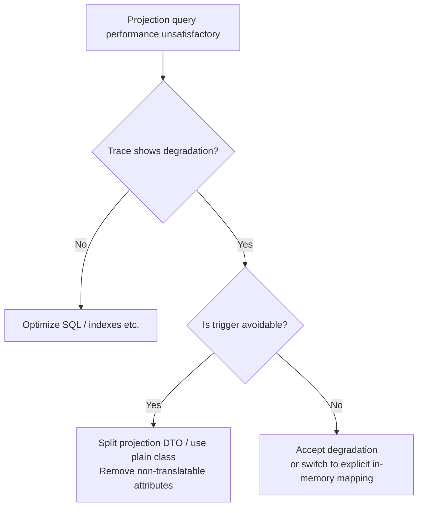

> [!WARNING]
> This documentation has been machine-translated from Chinese source comments and may contain inaccuracies. Please refer to the original Chinese IntelliSense documentation or the source code for authoritative descriptions.

---
wiki-id: explanation/orm-degradation
Related Diagnostic Codes:  
Library Version: v1.0.0+  
Last Updated: 2026-08-19  
---

# ORM Degradation Mechanism

## Overview

ORM projection (`AsDto`) translates mapping configurations into SQL, but SQL has inherent expressive limitations. When a mapping configuration exceeds what can be translated into SQL, NCMapper automatically degrades to a two-step execution path: “SQL query for entities + in-memory mapping.” This article explains why degradation exists, which conditions trigger it, what happens after degradation occurs, and how to avoid unnecessary degradation.

For implementation details of the automatic degradation mechanism, see [explanation ORM Projection](./orm-projection-design.md). This article focuses on design motivations and decisions.

---

## 1. Why Degradation Is Needed

### 1.1 SQL’s Expressive Boundaries

The goal of `AsDto()` is to generate an executable SQL projection expression. SQL can express only *simple column-to-property mappings*: same-name properties, `[MapProperty]`-declared name mismatches, implicit numeric conversions, and `JOIN`s for nested navigations.

Capabilities beyond this scope have no direct SQL equivalent:

| Capability | Expressible in SQL? | Reason |
|------------|---------------------|--------|
| Same-name property copy | Yes | `SELECT col AS prop` |
| `[MapProperty]` name-mismatch mapping | Yes | Column aliasing |
| Nested navigation (e.g., `Address.City`) | Yes | `JOIN` + column selection |
| `[Convert]` custom conversion | No | Converter is .NET code; cannot be invoked from SQL |
| `[Mask]` data masking | No | Masking logic is .NET code |
| `record` types (no parameterless constructor) | No | Projection expression cannot construct `MemberInit` |
| Pipeline `PostMap` post-processing | No | Callbacks are runtime behaviors |

### 1.2 Degradation Is a Design Trade-off, Not a Defect

NCMapper’s design choice is: **project when possible; degrade gracefully when not — guaranteeing full feature availability**. If NCMapper were to throw errors upon encountering non-translatable features, attributes like `[Convert]` or `[Mask]` would become unavailable in projection contexts — violating the core principle of “one configuration, works everywhere.” Degradation trades one extra round-trip for complete feature fidelity and zero awareness by callers.

---

## 2. Degradation Trigger Conditions

The degradation detector (`DegradationDetectorBase`) scans source/target types in a fixed order; any matched condition triggers degradation:

| Check | Description | Scope |
|-------|-------------|--------|
| Parameterless constructor missing on top-level DTO | Types like `record` cannot support projection expression construction | Top-level |
| Class-/property-level attribute with `RequiresDowngrade` | e.g., `[Convert]`, `[Mask]`, `[MapProperty(IsFromJson = true)]` | Class-/property-level |
| Unknown NCMapper attribute | Attributes without declared projection strategy fall back safely to degradation | Class-/property-level |
| Match against global ignore list | DTO property matches ignore list (bypassed if `OverrideIgnore = true`) | Top-level |
| Non-projectable collection type | e.g., `T[]`, `HashSet<T>` | EFCore-specific |
| Collection navigation / cross-table nested access | FreeSql translation limitation (conservative policy) | FreeSql-specific |
| Parameterless constructor missing on nested DTO | Nested levels impose same constructibility requirement | Nested |
| Pipeline `PostMap` registered | `HasPostMapFor` returns `true` | Top-level/nested |
| Nesting depth exceeded | EFCore = 8, FreeSql = 3 | Nested |

Degradation strategy differences across ORM extension packages:

| Dimension | EFCore | FreeSql |
|-----------|--------|---------|
| Max nesting depth | 8 | 3 |
| Collection projection | Supports projectable collections | Any collection element triggers degradation |
| ORM-specific checks | Non-projectable collections | Global ignore list / collection navigation / cross-table nested access |

These differences stem from varying SQL translation capabilities: FreeSql adopts a conservative limit (depth 3), while EFCore is more aggressive (depth 8). Dapper has no degradation detector and always uses full in-memory mapping (user fully controls `SELECT`; no SQL-side projection capability).

### 2.1 Detection Order and Caching

The degradation detector executes checks in fixed order (`DegradationDetectorBase.Evaluate`):

```text
Top-level parameterless constructor → Class-level attributes → Property-level attributes → ORM-specific checks → Nested recursion → PostMap
```

Results are cached using the tuple `(source type, target type, pipeline version number)`. Pipeline registration of new callbacks invalidates the cache automatically. Caching avoids repeated reflection-based scanning per query; however, configuration changes require cache invalidation to take effect (ensured via pipeline version number).

> **Snapshot-First Semantics (Final-State Architecture)**: All detection reads go through `RuntimeSnapshotStore.TryGetMappingDetail` — registered pairs (compile-time emission or runtime registration) are classified precisely by declaration detail (zero reflection over attributes); unregistered pairs fall back to legacy attribute-scanning path. Cache invalidation is further gated by registry `ContentVersion`: any change — registration, merge, or cleanup — triggers recalculation, ensuring immediate effect of declaration updates.

### 2.2 External Attributes Do Not Trigger Degradation

Only attributes in the `NCMapper` namespace participate in degradation evaluation. External attributes (e.g., `[Required]` from `DataAnnotations`) do *not* trigger degradation. The safety net is strictly limited to the `NCMapper` namespace to prevent misinterpreting user-defined metadata as non-translatable.

### 2.3 Declaration-Level Branching in Fluent Channel

**Fluent channel** DTOs (declared via `[MapperConfig]`-based fluent API) also undergo degradation detection — refined into **per-declaration branching**, where `DegradationDetectorBase` retrieves precise declaration details via `RuntimeSnapshotStore.TryGetMappingDetail` (keyed by `(source, target)`), enabling three-way classification:

| Outcome | Behavior |
|---------|----------|
| **State ①**: Declaration detail hit (`Properties` or `ComposeMappings` non-empty) | Fluent DTO enters declaration-level classification (`ClassifyUntranslatableDeclaration`, aligned with table); attribute-channel entries (`Channel = MapFrom`) share unified consumption and isolation via detection sequence ordering |
| **State ②**: Entry hits unreachable detail (off-state identity key) | Conservative forced degradation (reason literal: `"off-state identity key / detail unreachable"` — no relaxation) |
| **State ③**: Miss (unregistered pair) | Falls back to legacy attribute-scanning path (pure runtime-mode semantics) |
| Purely translatable declaration (`Map`/`Ignore` equivalent) | **Projection restored** — name mismatches (`SourceName`), nested dot-path (`SourcePathNames`), and `Ignore` direction set differences are consumed by projection binding per declaration detail |
| Multi-source `FromSource` composition (`ComposeMappings`) | **Detail-level translatability check**: Translatable (plain fields/paths/indexes) → projection; non-translatable (cm-level `Mask`/`Convert`/`Format`/`FromJson`/`When`, or pair-level `AfterMapping`/`BeforeMapping`/`SubclassDispatch`) → degradation (reason includes category); `"declaration yields no output"` → conservative degradation |
| Nested Fluent sub-DTO contains non-translatable declaration | Nested level triggers degradation (nested declaration details consumed uniformly) |
| Snapshot switch off (`NCMapperEmitRuntimeSnapshot=off`) | Conservative degradation, no relaxation |

**Dual-Channel Equivalence Gatekeeping**: Attribute side declares downgrade conditions via `IProjectionPolicy.RequiresDowngrade`; Fluent side relies on registry-backed field-equivalence checks — both channels’ downgrade logic is mechanically aligned line-by-line (via assertions on `IProjectionPolicy` implementation reachability and reflection paths), preventing drift between channels.

---

## 3. What Happens After Degradation

Degradation is *not* failure — it is a fully observable, end-to-end execution path:

### 3.1 Execution Flow

```text
Normal path: SQL-side projection (single SQL → DTO)
Degraded path: SQL query for entities → auto `Include` navigations (FreeSql/EFCore) → `Mapper.MapList` in-memory mapping
```

Key behaviors of the degraded path:

- **Result consistency**: In-memory mapping applies *all* features (`[Convert]`, `[Mask]`, `PostMap`) fully — identical to `Mapper.MapList` output.
- **Auto `Include`**: The degraded path automatically analyzes cross-table field dependencies in the DTO and appends required navigation `Include`s — eliminating N+1 queries ([see orm-projection-design Auto-Include Mechanism](./orm-projection-design.md#automatic-include-mechanism)).
- **One extra query**: Cost is two steps — SQL entity fetch + in-memory mapping — observable under high-volume scenarios.

### 3.2 Observability

Degradation emits diagnostics via `MapTracer`. Enable globally:

```csharp
MapTracer.GloballyEnabled = true;
```

Output includes terminal method name prefix (e.g., `[FreeSql AsDto] ToList degraded: <reason>`), with reason specifying the triggering check. To diagnose *why* degradation occurred, simply enable tracing.

Example output:

```text
[FreeSql AsDto] ToList degraded: Property CustomerName annotated with ConvertAttribute (requires degradation)
[EFCore AsDto] ToPagedList degraded: Pipeline.PostMap registered for (OrderEntity → OrderDetailDto)
```

### 3.3 Degradation vs. Error — The Design Trade-off

The degraded path is *not* a failure path — it is a first-class citizen equal in status to the normal path. The design trade-off:

| Approach | Behavior | Trade-off |
|----------|----------|-----------|
| Error (not adopted) | Throw exception on non-translatable features | Features unavailable in projection context — violates “one config, works everywhere” |
| Degradation (adopted) | Automatic two-step mapping, full feature coverage | One extra query traded for full feature integrity and zero caller awareness |

Rationale: Projection’s user value is “one SQL + full features”; degradation sacrifices one query to preserve the latter. This is reasonable for scenarios with controllable query volume. For extremely large batches where feature sacrifice is acceptable, consider splitting projection DTOs (see §4).

---

## 4. Avoiding Unnecessary Degradation

Degradation is not an error — but *unnecessary* degradation (incurring an extra query) should be eliminated. Recommendations ordered by cost:

| Trigger | Avoidable? | Recommendation |
|---------|------------|----------------|
| `[Convert]` / `[Mask]` on projection DTO | Business-dependent | Keep projection DTOs pure (properties only); move transformation logic to presentation layer |
| `record` DTO | Yes | Use plain class DTOs (with parameterless constructors) in projection contexts |
| Nesting depth exceeded | Yes | Split nested DTOs, or accept degradation |
| `PostMap` registered | Business-dependent | Accept degradation when post-processing is explicitly required for that type |
| Misapplied unknown NCMapper attributes | Yes | Remove irrelevant NCMapper attributes |

Assess optimization need: Degradation adds only one query — impact on typical list pages is minimal; prioritize normal path only for high-volume, high-frequency queries.

### 4.1 Decision Flow



First confirm degradation cause (via Trace), then assess whether the trigger is avoidable. If unavoidable, accepting degradation is a reasonable and intentional choice — no need to force workarounds.

---

## 5. Frequently Asked Questions

**Are results after degradation identical to the normal path?**

Yes — mapping results are identical (same configuration), but execution differs: degraded path first fetches entities, then maps in memory (extra round-trip); auto-included navigation data enables nested mapping entirely in memory.

**How do I know whether a given query degraded?**

Enable `MapTracer.GloballyEnabled = true`; degraded queries emit diagnostic lines with reasons (§3.2). You may also assert degradation reasons in tests.

**Do all ORM extension packages support degradation?**

FreeSql and EFCore include degradation detectors; Dapper has *no* detector and always uses full in-memory mapping (`SELECT` fully controlled by user — no SQL-side projection capability).

**Does degradation affect transactions or pagination?**

No. Degradation occurs inside terminal methods (query execution phase); pagination parameters (e.g., `ToPagedList`) execute normally in SQL — only the mapping step from query result to DTO changes.

**What happens if `GroupBy` appears in the `AsDto` chain?**

Compile-time error (not runtime): `NCMapperFreeSqlGuardExtensions` marks incompatible chains like `GroupBy` with `[Obsolete(error: true)]`. Error messages directly suggest alternatives. See [freesql-single-table](../how-to/orm/freesql-single-table.md) (“Misuse 2: GroupBy + AsDto”) and [freesql-advanced](../how-to/orm/freesql-advanced.md) (“Misuse 1: GroupBy + AsDto”) (source anchor: `NCMapperFreeSqlGuardExtensions.cs:15`).

**What about EF Core’s equivalent interception?**

Same pattern: `NCMapperEFCoreGuardExtensions` marks `AsDto` chains following `GroupBy` (and those already outside `IQueryable` domain) with `[Obsolete(error: true)]`, causing compile-time errors. See [efcore-projection §7 GroupBy Compile-Time Interception](../how-to/orm/efcore-projection.md) (source anchor: `NCMapperEFCoreGuardExtensions.cs:14`).

---

## Quick Reference Table

| Concept | Description |
|---------|-------------|
| Degradation definition | Automatic fallback to two-step mapping (SQL entity query + in-memory mapping) when SQL translation fails |
| Trigger conditions | Missing parameterless constructor / `[Convert]` / `[Mask]` / global ignore list match / collections / nesting depth / `PostMap` |
| ORM differences | EFCore max depth = 8, FreeSql max depth = 3, Dapper has no detector |
| Degradation behavior | Result-consistent + auto `Include` + trace-observable |
| Observation method | Set `MapTracer.GloballyEnabled = true` to view degradation reasons |
| Avoidance tips | Keep projection DTOs pure, prefer plain classes, split nested DTOs |

---

## Related Documentation

- [explanation ORM Projection](./orm-projection-design.md): Degradation detection & auto-`Include` implementation  
- [explanation Dual-Engine Architecture](./dual-engine.md): How two engines collaborate  
- [explanation Adaptive Routing Mechanism](./adaptive-routing.md): Projection/degradation as automatic routing decision points  
- [ORM Projection Scenario Walkthrough](../tutorials/orm-projection-tutorial.md): Real-world degradation behavior  
- [Validation & Diagnostics](../how-to/infrastructure/validation.md): `Trace` usage guide  
- [Mapping Rules (Semantics)](./semantics/mapping-rules.md): Ignore list and mapping rule semantics  

Runnable demonstration of Fluent DTO dual-state behavior (purely translatable projection vs. `Mask`-forced degradation) — Scenario 501:

[!code-csharp[Fluent DTO × ORM AsDto Dual-State Four Forms](~/samples/NCMapper.Samples/05-Orm/FxScenarios.cs#OrmProjection_FluentDualMode)]

[!code-csharp[Fluent DTO × ORM AsDto Dual-State Four Forms · ECoreFluentMaskDowngrade](~/samples/NCMapper.Samples/05-Orm/FxScenarios.cs#OrmProjection_FluentDualMode_ECoreFluentMaskDowngrade)]

[!code-csharp[Fluent DTO × ORM AsDto Dual-State Four Forms · FreeSqlFluentProjection](~/samples/NCMapper.Samples/05-Orm/FxScenarios.cs#OrmProjection_FluentDualMode_FreeSqlFluentProjection)]

[!code-csharp[Fluent DTO × ORM AsDto Dual-State Four Forms · FreeSqlFluentMaskDowngrade](~/samples/NCMapper.Samples/05-Orm/FxScenarios.cs#OrmProjection_FluentDualMode_FreeSqlFluentMaskDowngrade)]
