```mermaid
flowchart TD
    A[Primary Source: OrderEntity] --> D[ComposeRuntime]
    B[Secondary Source: CustomerEntity] --> D
    C[Secondary Source: ProductEntity] --> D
    D --> E[Primary Source Field Mapping]
    D --> F[Secondary Source Field Mapping]
    E --> G[Composition into Target DTO]
    F --> G
    G --> H{Has Action Callback?}
    H -->|Yes| I[Execute Action&#40;tgt&#41;]
    H -->|No| J[Skip]
    I --> K{Has PostMap?}
    J --> K
    K -->|Yes| L[Trigger Pipeline PostMap]
    K -->|No| M[Skip]
    L --> N[Return Composed DTO]
    M --> N
```

> [!WARNING]
> This documentation has been machine-translated from Chinese source comments and may contain inaccuracies. Please refer to the original Chinese IntelliSense documentation or the source code for authoritative descriptions.

---
wiki-id: how-to/compose/compose
Diagnostic Code: NCMAP034
Library Version: v1.0.0+
Last Updated: 2026-09-15
---

# Multi-Source Composition with Compose

## Overview

`Compose` merges fields from multiple source objects (two or more) into a single DTO. The primary source is declared via `[MapFrom]`, while secondary sources are marked using `[MapProperty(typeof(SecondarySource), ...)]`. Multi-source composition is a distinguishing capability of NCMapper — most comparable mapping libraries do not support it.

In addition to the attribute-based configuration, the **Fluent declarative API** also supports cross-source composition: `For<TSource, TTarget>().FromSource<TSubSource>(...)` provides a shorthand and grouping block (within which `Map`/`Convert` calls bind sub-source fields to the DTO across sources). At runtime, these bindings are processed by the same `Mapper.Compose` composition engine (the main pipeline `Mapper.Map` leaves such fields unassigned by default; composition fills them in). For details, see the dedicated *FromSource* section in [fluent/basics](../fluent/basics.md).

Core APIs:
- `Mapper.Compose<TTarget>(primarySource, secondarySource, ...)` (unbounded number of source objects)
- `Mapper.Compose<TTarget>(Action<TTarget>, primarySource, secondarySource, ...)` (callback as the first parameter)

---

## 1. Two-Source Composition

### Usage

One `OrderEntity` (primary source) + one `CustomerEntity` (secondary source) → `OrderDetailDto`.

```csharp
[MapFrom(typeof(OrderEntity))]
public class OrderDetailDto
{
    // Primary source field: from OrderEntity
    [MapProperty(typeof(OrderEntity), nameof(OrderEntity.OrderId))]
    public int OrderId { get; set; }

    [MapProperty(typeof(OrderEntity), nameof(OrderEntity.OrderNo))]
    public string OrderNumber { get; set; } = "";

    // Secondary source field: from CustomerEntity
    [MapProperty(typeof(CustomerEntity), nameof(CustomerEntity.Name))]
    public string CustomerName { get; set; } = "";

    [MapProperty(typeof(CustomerEntity), nameof(CustomerEntity.Phone))]
    public string CustomerPhone { get; set; } = "";
}
```

[!code-csharp[Two-source compose invocation](~/samples/NCMapper.Samples/03-Compose/ComposeScenarios.cs#Compose_BasicCompose)]

**Key Points**:

- `[MapFrom(typeof(OrderEntity))]` declares the primary source type.
- `[MapProperty(typeof(CustomerEntity), ...)]` marks fields sourced from secondary sources.
- The primary source is identified by the type specified in `[MapFrom]` (**position is unrestricted — it need not be the first argument**); all other arguments are matched to secondary sources by type.
- Properties *not* annotated with `[MapProperty]` are matched by name from the primary source only.

### Execution Flow

```
Mapper.Compose<OrderDetailDto>(order, customer)
    → ComposeRuntime construction
    → Primary source 'order' field mapping → OrderId / OrderNumber
    → Secondary source 'customer' field mapping → CustomerName / CustomerPhone
    → PostMap callback execution (if present)
    → Return composed DTO
```



---

## 2. Three-Source Composition

### Usage

`OrderEntity` + `CustomerEntity` + `ProductEntity` → `ReportDto`.

```csharp
[MapFrom(typeof(OrderEntity))]
public class ReportDto
{
    [MapProperty(typeof(OrderEntity), nameof(OrderEntity.OrderNo))]
    public string OrderNumber { get; set; } = "";

    [MapProperty(typeof(CustomerEntity), nameof(CustomerEntity.Name))]
    public string CustomerName { get; set; } = "";

    [MapProperty(typeof(ProductEntity), nameof(ProductEntity.Name))]
    public string ProductName { get; set; } = "";

    [MapProperty(typeof(ProductEntity), nameof(ProductEntity.Price))]
    public decimal ProductPrice { get; set; }
}
```

[!code-csharp[Three-source compose invocation](~/samples/NCMapper.Samples/03-Compose/ComposeScenarios.cs#Compose_BasicCompose_MultiSourceCompose)]

**Key Points**:

- Number of source objects is unbounded: `Compose<TTarget>(params object[] sources)`. This example uses three sources.
- Each `[MapProperty]`’s generic argument explicitly specifies which source provides the field.
- Fields from the primary and secondary sources may coexist freely within the same DTO.

---

## 3. Compose + Action Callback

### Usage

Modify the target immediately after composition — no second conversion needed.

[!code-csharp[Basic two-source composition](~/samples/NCMapper.Samples/03-Compose/ComposeScenarios.cs#Compose_BasicCompose)]

**Key Points**:

- The callback is the **first parameter**: signature is `Compose<TTarget>(Action<TTarget>? action, params object[] sources)`. Source objects follow it. Writing “sources first, callback last” will fail binding — lambdas cannot be implicitly converted to `object`.
- Callback signature is `Action<TTarget>` (**note**: `Compose` has no `TSource` type parameter; the callback receives only the target object).
- The action executes *after* composition completes but *before* returning.
- It may modify any target property — including those mapped from both primary and secondary sources.
- Registered `PostMap` callbacks (via the pipeline) also execute at the end of `Compose`, via `MapPipeline.ExecutePostMapNonGeneric`.

> ⚠️ The `Compose` callback signature is `Action<TTarget>`, unlike `Mapper.Map`’s `PostMap` signature `Action<TSource, TTarget>`. This is a deliberate design constraint: since `Compose` accepts multiple sources, a single `TSource` type parameter cannot represent them all.

---

## 4. List-Based Composition (`ComposeList`)

### Usage

Batch composition of multiple groups of source objects:

[!code-csharp[Batch multi-source composition with ComposeList](~/samples/NCMapper.Samples/03-Compose/ComposeScenarios.cs#Compose_ComposeList)]

**Key Points**:

- `ComposeList<TTarget>(params object[][] sourceGroups)`: each outer array element corresponds to one DTO; its inner array contains *all* source objects for that DTO (primary + secondary sources).
- All groups should use consistent source types and counts. If a group lacks a required secondary source, corresponding fields remain unfilled. Empty inner arrays cause that DTO to be skipped — resulting count may be less than the number of groups.
- Internally invokes `Compose<TTarget>` per group — each DTO is composed independently.
- Overload `ComposeList<TTarget>(Action<TTarget>? action, params object[][] sourceGroups)` is also available: the callback runs once per composed DTO (again, as the first parameter).

---

## 5. Interaction Between Compose and PostMap

At the end of execution, `Compose` triggers registered `PostMap` callbacks (if type-pair matches):

[!code-csharp[PostMap triggered at Compose end after registration](~/samples/NCMapper.Samples/03-Compose/ComposeScenarios.cs#Compose_ComposeWithPostMap)]

**Key Points**:

- `PostMap` is triggered during `Compose` if the registered type pair (primary source → target) matches the current `Compose` operation.
- Execution order: primary source mapping → secondary source mapping → action callback → `PostMap` (pipeline).
- `PostMap` is invoked at the end of `Compose` via `MapPipeline.ExecutePostMapNonGeneric`.

---

## 5.1 Reverse Mapping (DTO → Entity) for DTOs Declaring Cross-Table Secondary Source Fields

DTOs declaring cross-table secondary source fields (e.g., via `[MapProperty(typeof(CustomerEntity), ...)]`) generate reverse extension methods (same six overloads as standard DTOs). However, reverse mapping affects *only primary source fields*:

```csharp
[MapFrom(typeof(OrderEntity))]
public class OrderDetailDto
{
    [MapProperty(typeof(OrderEntity), nameof(OrderEntity.Id))]
    public int OrderId { get; set; }

    [MapProperty(typeof(CustomerEntity), nameof(CustomerEntity.Name))]
    public string CustomerName { get; set; } = "";   // Secondary source field
}
```

[!code-csharp[Compose reverse mapping writes only primary source](~/samples/NCMapper.Samples/03-Compose/ComposeScenarios.cs#Compose_L83)]

**Semantic Boundaries**:

- **Reverse mapping writes only primary source fields**: reverse extensions write back *only* properties mapped from the `[MapFrom]`-declared primary source type (`PropertyMappings`). Cross-table secondary source fields (`ComposeMappings`) are **excluded from reverse writeback**, because the secondary source objects are not retained as references on the DTO.
- **XML Documentation Hint**: Generated reverse extension XML comments include a note like “This DTO contains N secondary source fields (from Xxx), which are excluded from reverse writeback”, visible on IDE hover.
- **Relationship to Compose**: `Mapper.Compose` performs *forward-only* composition (multi-source → DTO); it does *not* support reverse operations. Reverse mapping from DTO → primary entity is handled uniformly by `[MapFrom]`-based reverse capabilities — independent of `Compose`.

> ⚠️ **NCMAP034 Integration**: During reverse writeback, properties marked with `[Mask]` have their masked values written *as-is* into the entity (lossy), triggering diagnostic `NCMAP034`. This applies equally to primary source fields in such DTOs.

---

## 5.2 `[Mask]` and `[MapProperty(IsFromJson = true)]` on Secondary Source Fields (Fully Supported)

Per-property attributes applied to secondary source fields (i.e., properties marked with `[MapProperty(typeof(SecondarySource), ...)]` targeting non-primary types) are honored **during source generator code generation**, matching behavior for primary source fields and the runtime engine:

```csharp
[MapFrom(typeof(OrderEntity))]
public class OrderDetailDto
{
    [MapProperty(typeof(CustomerEntity), nameof(CustomerEntity.Phone))]
    [Mask(typeof(MaskPhone))]                    // ✅ Secondary source masking (consistent across generator & runtime)
    public string CustomerPhone { get; set; } = "";

    [MapProperty(typeof(CustomerEntity), nameof(CustomerEntity.AddressJson), IsFromJson = true)]
    public AddressDto CustomerAddress { get; set; } = new();   // ✅ JSON deserialization (string ↔ object)
}
```

**Behavior Details**:

- **`[Mask]` Masking**: During `Compose`, secondary source fields are masked before being written to the DTO (e.g., `__mask_X.Mask(src.Field)`), identical in structure to primary source masking. When `[Convert]` and `[Mask]` coexist, **conversion occurs before masking**, i.e., masking input is the converted value.
- **`[MapProperty(IsFromJson = true)]`**: Secondary source fields undergo JSON serialization/deserialization (string ↔ object), consistent with primary source behavior. If either source or target is a non-string value type, the field is discarded (matching primary source value-type guard behavior).
- **Validation**: Invalid secondary source `[Mask]` usage (e.g., target not `string` → `NCMAP015`; mask type not implementing `IMask` → `NCMAP014`) emits existing diagnostics at compile time.
- **`null` Semantics**: `[Mask]` is wrapped without null guards — `Mask(null)` is passed directly to the masker implementation (e.g., `MaskPhone` returns `""`), matching runtime engine and primary source behavior. Pure `[Convert]` (without `[Mask]`) on secondary source fields retains the existing N-1 semantics (a `null` conversion result → leaf is not written).

---

## Common Misuses

### Misuse 1: Secondary Source Field Missing `[MapProperty]`

```csharp
// ❌ Incorrect: Without [MapProperty], secondary source fields won’t be matched
// CustomerName lacks [MapProperty(typeof(CustomerEntity), ...)]
// Result: CustomerName = null (no matching property named 'CustomerName' in primary source OrderEntity)

// ✅ Correct: Secondary source fields must be explicitly declared with [MapProperty]
[MapProperty(typeof(CustomerEntity), nameof(CustomerEntity.Name))]
public string CustomerName { get; set; } = "";
```

### Misuse 2: Confusing Primary and Secondary Sources

```csharp
// ❌ Incorrect: [MapFrom] declares *exactly one* primary source
// Multiple [MapProperty] attributes pointing to different types are *all* secondary sources
[MapFrom(typeof(OrderEntity))]  // Primary source
public class OrderDetailDto
{
    [MapProperty(typeof(CustomerEntity), ...)]  // Secondary source #1
    public string CustomerName { get; set; }

    [MapProperty(typeof(ProductEntity), ...)]   // Secondary source #2
    public string ProductName { get; set; }
}

// ✅ Correct: One [MapFrom] declares the primary source; multiple [MapProperty] attributes declare secondary sources
```

### Misuse 3: Incorrect `Compose` Callback Signature

```csharp
// ❌ Misuse: The `Compose` callback expects only the `source` parameter.
var dto = Mapper.Compose<OrderDetailDto>((src, tgt) =>
//                                        ↑ Compilation error: `Compose` callbacks are `Action<TTarget>`
{
    tgt.CustomerName = $"[VIP] {src.Name}";
}, order, customer);

// ✅ Correct: The `Compose` callback receives only the `target` (`Action<TTarget>`), and the callback is the first argument.
var dto = Mapper.Compose<OrderDetailDto>((tgt) =>
{
    tgt.CustomerName = $"[VIP] {tgt.CustomerName}";  // Use the already-composed `target` value.
}, order, customer);
```

> If you need access to the original `source` data inside the callback, capture it in a local variable *before* calling `Compose`, rather than relying on callback parameters.

### Misuse 4: Treating `ComposeList` as “Pairing Two Parallel Lists by Index”

```csharp
// ❌ Misuse: Passing two separate lists is interpreted as “two source groups, each containing one full array” — not index-wise pairing.
var orders = new[] { order1, order2 };
var customers = new[] { customer1, customer2 };
var dtos = Mapper.ComposeList<OrderDetailDto>(orders, customers);
// Actually produces 2 DTOs: Group 0 source = entire `orders` array; Group 1 source = entire `customers` array.
// Source grouping is *not* the expected `(order1, customer1)`, `(order2, customer2)`.

// ✅ Correct: Pass an “array of arrays”, where each inner array provides *all sources* for that DTO.
var sourceGroups = new[]
{
    new object[] { orders[0], customers[0] },
    new object[] { orders[1], customers[1] },
};
var dtos = Mapper.ComposeList<OrderDetailDto>(sourceGroups);
// dtos.Count == 2
```

---

## 6. AOT Fallback Behavior (Important for NativeAOT Deployment)

> List-based `Compose` mapping falls back to runtime `Mapper.MapList` when the Pipeline is enabled—  
> triggering `PostMap` per element (hence IL2026/IL3050 warnings).  
> These warnings are already suppressed in generated code via precise `#pragma` directives with explanatory comments.  
> This section describes the **actual behavior** when this fallback occurs under AOT—and how to avoid it.

### 6.1 P1: List Fallback When Pipeline Is Enabled (Semantically Required)

List-based `Compose` mapping (`MapTo...List`) falls back to runtime `Mapper.MapList` when `MapPipeline.IsPipelineEnabled` is `true`—because **triggering `PostMap` per element is a semantic requirement of the Pipeline**, and generated code cannot statically inline this behavior. This fallback is **unavoidable**.

- **Behavior under AOT**: The fallback path uses runtime reflection. Although `RequiresUnreferencedCode`/`RequiresDynamicCode` warnings are suppressed, runtime reflection may fail under trimming/AOT (e.g., expression tree compilation or reflection-based scanning used by `Mapper.MapList` may be unavailable).
- **Mitigation strategies**:
  - **Pipeline disabled**: List mapping uses generated code (zero reflection) → AOT-safe.
  - **Pipeline required**: Annotate the element type with `[MapFrom]` so element-level mapping uses source-generated code. Internally, `Mapper.MapList` then hits the `RegisterGeneratedList` delegate (Layer 1), **bypassing expression tree compilation**—only list assembly runs at runtime; element mapping remains compile-time code.

### 6.2 AOT Behavior for Single-Object and Update Mapping

Single-object `MapTo...` (including `Action` overloads) and update-style `MapTo...(dst)` **do not fall back** when the Pipeline is enabled (`RunPostMap` is inlined directly into generated code). They always use source-generated paths—making them AOT-safe with no additional handling required.

---

## Summary

| Capability | API | Feature |
|---|---|---|
| Dual-source composition | `Mapper.Compose<T>(primary, secondary)` | Primary source + 1 secondary source |
| Triple-source composition | `Mapper.Compose<T>(p, s1, s2)` | Primary source + 2 secondary sources |
| Arbitrary source count | `Mapper.Compose<T>(params object[] sources)` | No upper limit; examples in this doc show up to three sources |
| Callback customization | `Mapper.Compose<T>(Action<TTarget>, sources...)` | Modify target *after* composition (callback is first argument) |
| List composition | `Mapper.ComposeList<T>(sourceGroups)` | `object[][]`; each inner array supplies all sources for one DTO |
| `PostMap` interaction | Automatically triggered for registered `PostMap` handlers in Pipeline | Triggered when type pair matches |

---

## Companion Examples

```bash
cd samples/NCMapper.Samples
dotnet run --scenario 301
```

Core example source (single-point same-source; runnable via `dotnet run --scenario`):

[!code-csharp[Basic Composition](~/samples/NCMapper.Samples/03-Compose/ComposeScenarios.cs#Compose_BasicCompose)]

[!code-csharp[Basic Composition · MultiSourceCompose](~/samples/NCMapper.Samples/03-Compose/ComposeScenarios.cs#Compose_BasicCompose_MultiSourceCompose)]

[!code-csharp[Basic Composition · ComposeWithAction](~/samples/NCMapper.Samples/03-Compose/ComposeScenarios.cs#Compose_BasicCompose_ComposeWithAction)]

Full source lives in `samples/NCMapper.Samples/03-Compose/ComposeScenarios.cs`, covering four sub-scenarios: dual-source composition, triple-source composition, composition with callback, and list composition.

---

## Further Reading

- Related topics: [declarative/basics](../declarative/basics.md) · [Mapping Rules (Semantics)](../../explanation/semantics/mapping-rules.md) · [fluent/basics](../fluent/basics.md) · [infrastructure/pipeline](../infrastructure/pipeline.md)
- Deep technical documentation: [Multi-Source Composition (`Compose`)](../../explanation/compose.md) (original technical spec §10)
- `Compose` source code: `src/NCMapper/Mapper.Compose.cs`
