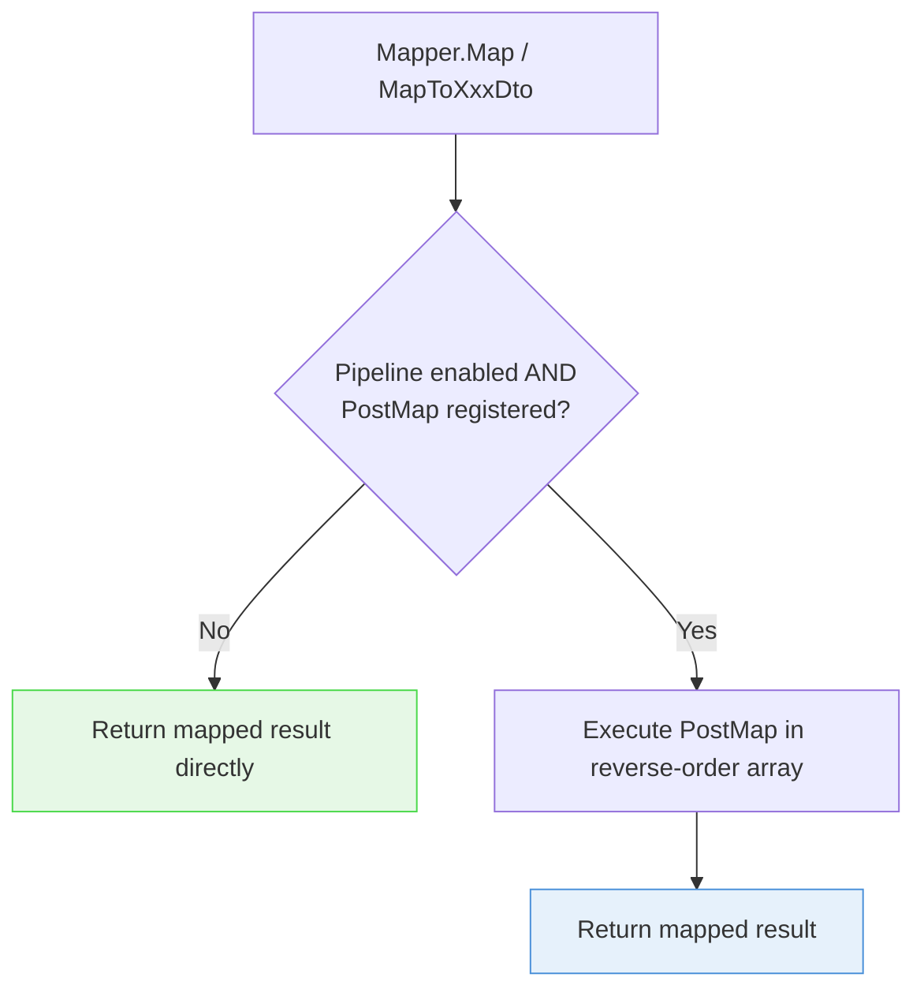

> [!WARNING]
> This documentation has been machine-translated from Chinese source comments and may contain inaccuracies. Please refer to the original Chinese IntelliSense documentation or the source code for authoritative descriptions.

---
wiki-id: how-to/infrastructure/pipeline
Diagnostic codes involved: (none)  
Library version: v1.0.0+  
Last updated: 2026-09-15  
---

# Pipeline

## Overview

The NCMapper Pipeline executes `PostMap` callbacks after the core mapping completes, enabling post-processing tasks such as appending audit information, formatting output, or logging. `PostMap` callbacks execute in reverse registration order (the “onion model”), and support type filtering and a global enable/disable switch.

Core APIs: `Mapper.Pipeline.AddPostMap<TSource, TTarget>(Action)` / `Mapper.Pipeline.Clear()` / `Mapper.Pipeline.IsEnabled`

---

## 1. Basic Usage of PostMap

### Usage

[!code-csharp[Register PostMap to append audit info after mapping](~/samples/NCMapper.Samples/06-Infrastructure/PipelineScenarios.cs#Pipeline_PostMapAudit)]

**Key points**:

- `PostMap` executes *after* the core mapping logic completes but *before* the result is returned.
- Callback signature is `Action<TSource, TTarget>` (receives both source and target objects).
- Type filtering: `AddPostMap<TSource, TTarget>` applies *only* to that specific source/target type pair.
- You may modify any property of the target object.

### Timing of PostMap Execution

```
Mapper.Map<UserEntity, UserDto>(entity)
    → Core mapping (property assignment)
    → PostMap callbacks execute (in reverse onion-model order)
    → Return mapped result
```

---

## 2. Onion-Model Execution Order

`PostMap` callbacks execute in reverse registration order (last registered → first executed), forming an onion-like layered execution model.

### Usage

[!code-csharp[Multi-layer PostMap onion-model execution order](~/samples/NCMapper.Samples/06-Infrastructure/PipelineScenarios.cs#Infra_Pipeline_PostMapOrder)]

**Key points**:

- Execution order: Core mapping → `PostMap₂` (registered later) → `PostMap₁` (registered earlier).
- The onion model suits “wrapping” scenarios: inner layers perform core transformations; outer layers handle wrapping, auditing, etc.
- Each additional layer incurs one delegate invocation overhead — typically negligible.

### Onion Model Diagram

```
Core mapping
    ↓
PostMap₃ (registered last, executed first)  ← innermost layer
    ↓
PostMap₂
    ↓
PostMap₁ (registered first, executed last)  ← outermost layer
    ↓
Return result
```


---

## 3. Pipeline Control

### Temporarily Disable Pipeline (`Clear()` / `AddPostMap`-driven)

```csharp
// Disable Pipeline (skip all PostMap): IsEnabled becomes false after Clear()
Mapper.Pipeline.Clear();

var dto = Mapper.Map<UserEntity, UserDto>(entity);
// No PostMap will execute

// Re-enable: re-register PostMap (AddPostMap automatically enables the pipeline)
Mapper.Pipeline.AddPostMap<UserEntity, UserDto>((s, t) => t.Name = $"{t.Name} [audit]");
```

### Clear All Registered PostMap

[!code-csharp[Clear all registered PostMap](~/samples/NCMapper.Samples/06-Infrastructure/PipelineScenarios.cs#Infra_Pipeline_ClearAll)]

### Type Filtering

`PostMap` only applies to the exact source/target type pair specified at registration:

```csharp
// Applies only to UserEntity → UserDto
Mapper.Pipeline.AddPostMap<UserEntity, UserDto>((s, t) => { ... });

// Applies only to OrderEntity → OrderDto (independent PostMap)
Mapper.Pipeline.AddPostMap<OrderEntity, OrderDto>((s, t) => { ... });

// Mapping UserEntity → UserDto triggers only the first PostMap.
// Mapping OrderEntity → OrderDto triggers only the second PostMap.
```

> **Related APIs**:  
> `MapPipeline.IsPipelineEnabled` — A static read-only property reflecting the pipeline’s enabled state (used by source-generated extension methods for guard checks; always delegates to the global `Mapper.Pipeline` instance).  
> `MapPipeline.RunPostMap<TSource, TTarget>(source, target)` — The direct entry point used by source-generated code to invoke PostMap (called at the end of generated extension methods). (Source anchor: `MapPipeline.cs`:241/246)

---

## 4. Interaction Between PostMap and Compose

`Compose` also triggers registered `PostMap` callbacks at its final step — provided the registered type pair matches the main source→target types:

[!code-csharp[Compose triggers registered PostMap at end](~/samples/NCMapper.Samples/03-Compose/ComposeScenarios.cs#Compose_ComposeWithPostMap)]

**Key points**:

- `PostMap` is triggered during `Compose` *only if* the registered type pair matches the primary source→target type pair used in `Compose`.
- Execution order: primary source mapping → secondary source mapping → `Compose` action callback → `PostMap` (from Pipeline).
- `PostMap` is invoked at the end of `Compose` via `MapPipeline.ExecutePostMapNonGeneric`.

---

## 5. Difference Between PostMap and Action Callbacks

| Dimension | PostMap (Pipeline) | Action Callback (Map/Compose parameter) |
|---|---|---|
| Registration | `Mapper.Pipeline.AddPostMap<T,S>()` | `Mapper.Map<T,S>(src, action)` |
| Scope | Global (triggers for *all* mappings of matching type pair) | Per-call only |
| Lifetime | Must be manually cleared (`Clear()`) | Automatically cleaned up when call ends |
| Execution order | Reverse registration order (onion model) | Executes immediately after core mapping |
| Signature | `Action<TSource, TTarget>` | `Action<TSource, TTarget>` (for `Map`) / `Action<TTarget>` (for `Compose`) |
| Typical use case | Global cross-cutting concerns: auditing, logging, uniform formatting | One-off custom modifications |

---

## 6. Zero-Cost Pipeline Mechanism

When no `PostMap` is registered, the Pipeline imposes *no observable overhead* on hot mapping paths.

**Zero-cost principles**:

- **Volatile bool short-circuit check**: Before each mapping, two `volatile bool` flags are checked — `Pipeline.IsEnabled` and whether *any* `PostMap` has been registered. If none is registered, execution skips `PostMap` entirely. This check costs ~1 ns.
- **Reverse-order cached array avoids `ToArray` allocation**: On the first `PostMap` registration, the callback list is pre-built into a reverse-ordered array and cached. Subsequent mappings reuse this array — eliminating per-call `ToArray()` allocations.
- **Generated extension methods trigger Pipeline too**: Source-generated methods like `src.MapToXxxDto()` also invoke the Pipeline at the end (using the same shared callback list as `Mapper.Map`) — no extra branching cost.

**Key points**:

- An empty pipeline adds negligible overhead (~1 ns `volatile` read); you can safely retain `Pipeline` registration code on hot paths.
- Delegate invocation overhead occurs *only* when `PostMap` callbacks are actually registered (see §2, Onion Model).
- After `Pipeline.Clear()`, the callback list is emptied, restoring zero-cost behavior.



---

## Common Misuses

### Misuse 1: Treating Global PostMap as a One-Time Callback (Use `Action` or `Convert` Instead)

```csharp
// ❌ Misuse: Registering global PostMap just for this one call, then clearing it
Mapper.Pipeline.AddPostMap<UserEntity, UserDto>((s, t) =>
{
    t.Name = $"[VIP] {t.Name}";
});

var dto = Mapper.Map<UserEntity, UserDto>(entity);

Mapper.Pipeline.Clear();  // Restoring global state — redundant and concurrency-risky
```

**Problems**:

- `Mapper.Pipeline` is a process-level singleton (`static readonly`; see `Mapper.Pipeline.cs`). Once registered, a `PostMap` remains active for *all subsequent* `UserEntity → UserDto` mappings until explicitly `Clear()`ed. It is inherently a *global cross-cutting concern* mechanism — not a local or one-time callback.
- Using “register + clear” for a single call violates design intent: using mutable global state for what should be local work — requiring manual cleanup.
- Concurrency hazard: Between registration and `Clear()`, other threads performing `UserEntity → UserDto` mapping will unexpectedly trigger this callback. Also, `Clear()` may inadvertently remove `PostMap`s registered by other parts of the system.
- See §5: `Action` callbacks have *automatic per-call lifetime*, while `PostMap` requires *manual `Clear()`*. This lifetime mismatch is why `PostMap` is unsuitable for one-off scenarios.

**✅ Correct approaches**:

```csharp
// Option A (recommended, one-time customization): Action callback — auto-cleaned, no global pollution
var dto = Mapper.Map<UserEntity, UserDto>(entity, (s, t) =>
{
    t.Name = $"[VIP] {t.Name}";
});

// Option B (stable, global, part of mapping config): Convert
// Declare static conversion method in mapping config; registered at compile time, fixed for process lifetime — no runtime Clear needed
[Convert(typeof(VipNameConverter), nameof(VipNameConverter.Convert))]
public class UserDto { /* ... */ }
```

**When *should* you use PostMap?** — Only when the transformation must be *globally and persistently* applied (e.g., auditing, logging, unified formatting). In such cases, register *once* at startup and *leave it enabled for the entire process lifetime* — never `Clear()`:

[!code-csharp[Cross-cutting concern: register once at startup](~/samples/NCMapper.Samples/06-Infrastructure/PipelineScenarios.cs#Infra_Pipeline_CrossCutOnce)]

> ⚠️ The *only* valid exception requiring `Clear()` is a **controlled scope**, e.g., unit tests: wrap “register” and “clear” symmetrically using fixtures or `IDisposable` (e.g., setup registers, teardown disposes/clears), preventing leakage across tests. This is test-isolation discipline — *not* typical application code practice.

### Misuse 2: Modifying the Source Object Inside PostMap

```csharp
// ❌ Misuse: Modifying source inside PostMap (violates immutability expectations)
Mapper.Pipeline.AddPostMap<UserEntity, UserDto>((s, t) =>
{
    s.Name = "Modified";  // Mutates source object!
});

// ✅ Correct: Modify only the target inside PostMap
Mapper.Pipeline.AddPostMap<UserEntity, UserDto>((s, t) =>
{
    t.Name = $"{s.Name} [processed]";  // Read-only source, write-only target
});
```

---

## Summary

| Capability | API | Characteristics |
|---|---|---|
| Register PostMap | `Mapper.Pipeline.AddPostMap<T,S>(Action)` | `Action<TSource, TTarget>` |
| Onion model | Executes in reverse registration order | Last registered → first executed |
| Type filtering | `AddPostMap<T,S>` | Applies only to the specified type pair |
| Enable/disable control | `Clear()` disables / `AddPostMap` re-enables (`IsEnabled` is read-only; no writable toggle) | Paired operations drive lifecycle |
| Clear all | `Mapper.Pipeline.Clear()` | Removes all registered PostMap |
| Compose interaction | Automatically triggered at Compose end | Only if type pair matches |

---

## Companion Examples

```bash
cd samples/NCMapper.Samples
dotnet run --scenario 601
```

Core example source (single-source-of-truth; runnable via `dotnet run --scenario`):

[!code-csharp[PostMap audit](~/samples/NCMapper.Samples/06-Infrastructure/PipelineScenarios.cs#Pipeline_PostMapAudit)]

Full source: `samples/NCMapper.Samples/06-Infrastructure/PipelineScenarios.cs`, covering audit, audit trail, onion model, and `Action` callback sub-scenarios.

---

## Further Reading

- Related topics: [Validation & Diagnostics](validation.md) · [Compose](../compose/compose.md)  
- Deep dive: [Core API Reference](../../reference/core-api.md) §4.6 Mapping Pipeline  
- Pipeline source code: `src/NCMapper/MapPipeline.cs` · `src/NCMapper/Mapper.Pipeline.cs`
