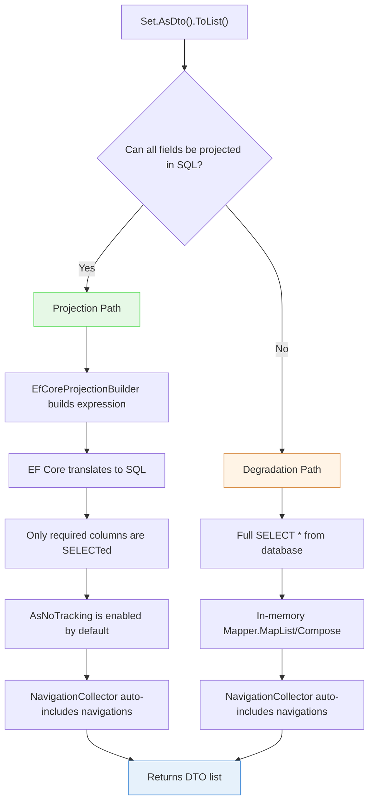

> [!WARNING]
> This documentation has been machine-translated from Chinese source comments and may contain inaccuracies. Please refer to the original Chinese IntelliSense documentation or the source code for authoritative descriptions.

---
wiki-id: how-to/orm/efcore-projection
Diagnostic codes involved: (none)
Library version: v1.0.0+
Last updated: 2026-09-15
---

# EF Core Projection

## Overview

NCMapper integrates with EF Core to project `IQueryable<T>` into DTOs via the `.AsDto()` extension method. This integration follows the same API design philosophy as the FreeSql integration: `.AsDto()` serves as the terminal operator entry point, after which various terminal methods can be chained.

EF Core automatically translates the projection into SQL, selecting only the columns required by the DTO.

Core API: `db.Set<T>().Where(...).AsDto().ToList<TDto>()`

---

## 1. Basic Usage

### Usage

[!code-csharp[EF Core Projection: using NCMapper.EFCore and AsDto on a single table](~/samples/NCMapper.Samples/05-Orm/EFCoreScenarios.cs#OrmProjection_SingleTableAsDto)]

SQL generated by EF Core:

```sql
SELECT u.Id, u.Name, u.Age, u.Email
FROM Users AS u
WHERE u.Age > 20
ORDER BY u.Age
```

**Key points**:

- `.AsDto()` is the terminal operator entry point; subsequent calls include `.ToList<TDto>()`, `.First<TDto>()`, etc.
- EF Core automatically translates the query into SQL projection (selecting only columns needed by the DTO).
- `.AsNoTracking()` is enabled by default (read-only projection; change tracking is unnecessary).
- The namespace `NCMapper.EFCore` must be imported.

> **Related API**: The return type of `.AsDto()` is `EFCoreDtoSelector<TSource>`, which hosts all terminal methods such as `.ToList()`, `.First()`, `.ToPagedList()`, etc. (Source anchor: NCMapperEFCoreExtensions.cs:62).

---

## 2. Terminal Methods

After `.AsDto()`, the following terminal methods can be chained:

| Method | Description | Return Type |
|---|---|---|
| `.ToList<TDto>()` | Returns all matching rows | `List<TDto>` |
| `.First<TDto>()` | Returns the first row | `TDto` |
| `.FirstOrDefault<TDto>()` | Returns the first row or default value | `TDto?` |
| `.ToChunkDto<TDto>(size, action)` | Batched callback | `void` |
| `.ToLookup<TKey, TDto>(keySelector)` | Grouped lookup | `ILookup<TKey, TDto>` |
| `.ToDictionary<TKey, TDto>(keySelector)` | Dictionary mapping | `Dictionary<TKey, TDto>` |
| `.ToListAsync<TDto>()` | Asynchronous list | `Task<List<TDto>>` |
| `.ToPagedList<TDto>(page, pageSize)` | Pagination (both `COUNT` and `SKIP/TAKE` are executed on the SQL side; an asynchronous variant `ToPagedListAsync` is also available) (Source anchor: NCMapperEFCoreExtensions.cs:348/:379) | `PagedList<TDto>` |

### ToLookup Example

[!code-csharp[EF Core ToLookup grouped lookup](~/samples/NCMapper.Samples/05-Orm/EFCoreScenarios.cs#OrmProjection_ToLookup)]

### ToDictionary Example

[!code-csharp[EF Core ToDictionary dictionary projection](~/samples/NCMapper.Samples/05-Orm/EFCoreScenarios.cs#OrmProjection_ToDictionary)]

---

## 3. Projection Path vs. Degradation Path

Similar to the FreeSql integration, the EF Core integration supports two execution paths:

### 3.1 Projection Path (SQL-side)

When all DTO fields can be mapped entirely on the SQL side, the projection path is used:

```
IQueryable<T>.AsDto().ToList<TDto>()
    → EfCoreProjectionBuilder builds SQL-side expression
    → EF Core translates to SQL
    → Database executes
    → Result set is directly mapped to TDto
```

Characteristics:
- Column trimming occurs on the SQL side.
- Navigation properties are automatically included (collected via `EfCoreNavigationCollector`).

### 3.2 Degradation Path

When certain DTO fields cannot be mapped on the SQL side, `EfCoreDegradationDetector` detects and triggers degradation:

```
IQueryable<T>.AsDto().ToList<TDto>()
    → EfCoreDegradationDetector performs detection
    → Degradation: full SELECT from database
    → In-memory mapping via Mapper.MapList / Mapper.Compose
```

Characteristics:
- Degradation is triggered automatically.
- Navigation properties are automatically included during degradation (same behavior as in the projection path — avoids N+1 queries; previous statement “not auto-included” was incorrect).



---

## 4. Automatic Navigation Property Inclusion

The EF Core integration uses `EfCoreNavigationCollector` to automatically collect navigation properties required by the DTO and generate appropriate `Include` chains:

```csharp
public class OrderEntity
{
    public int OrderId { get; set; }
    public CustomerEntity? Customer { get; set; }  // Navigation property
}

[MapFrom(typeof(OrderEntity))]
public class OrderDto
{
    public int OrderId { get; set; }

    [MapProperty(typeof(OrderEntity), nameof(OrderEntity.Customer))]
    public string? CustomerName { get; set; }
}
```

[!code-csharp[EF Core AsDto automatic navigation projection](~/samples/NCMapper.Samples/05-Orm/EFCoreScenarios.cs#OrmProjection_NestedCrossTable)]

### Disabling Automatic Include

```csharp
[MapFrom(typeof(OrderEntity))]
public class OrderDto
{
    // Attribute applied at property level (only property-level annotation is supported; class-level annotation causes CS0592 at compile time)
    [MapNoAutoInclude]
    public CustomerInfoDto Customer { get; set; } = null!;
    // ...
}
```

[!code-csharp[EF Core manual Include for navigation resolution](~/samples/NCMapper.Samples/05-Orm/EFCoreScenarios.cs#OrmProjection_NoAutoIncludeManual)]

---

## 5. `ToChunkDto`: Batched Reading

### Usage

[!code-csharp[EF Core batched reading with ToChunkDto (requires stable ORDER BY)](~/samples/NCMapper.Samples/05-Orm/EFCoreScenarios.cs#OrmProjection_SingleTableAsDto_ToChunkDto)]

**Key points**:

- Controls memory usage when handling large datasets.
- Internal implementation: pagination + repeated `ToList` queries.
- An asynchronous counterpart `ToChunkDtoAsync` is available.

---

## 6. Hierarchical Queries: `ToTreeList` / `ToTreeListAsync`

EF Core does not natively support hierarchical/tree queries. NCMapper implements this via *"flat query + in-memory tree building"*: First, flat rows are retrieved via standard projection (either projection or degradation path is automatically selected), then the core library’s `TreeBuilder` assembles nested trees based on `Id`/`ParentId`, matching the semantics of Dapper’s `ToTreeList` exactly.

### DTO Contract

```csharp
[MapFrom(typeof(CategoryEntity))]   // Required for projection path
[MapTree("Id", "ParentId", "Children")]   // Optional — defaults to Id/ParentId/Children; all three names are customizable
public class CategoryDto
{
    public int Id { get; set; }
    public int? ParentId { get; set; }
    public List<CategoryDto> Children { get; set; } = new();  // Tree mount point: never populated during mapping/projection; filled exclusively by TreeBuilder
}
```

**Key points**:

- `Children` is a **tree mount point**: it is never populated during mapping or projection (to prevent double-mounting — duplicate appearance of the same child node); population is handled exclusively by `TreeBuilder`.
- Field initializer `= new()` is optional (`TreeBuilder` lazily creates it as fallback).
- A `MapConfigurationException` is thrown if any of the three tree-contract criteria fail (existence, self-referencing collection, and writability).
- **If the entity contains a self-referencing navigation property (e.g., `CategoryEntity.Children`) and you want the tree mount point to be resolved cleanly, the DTO must explicitly declare `[MapTree]`**. DTOs without `[MapTree]` still build trees using the default contract, but identically named navigation collections will be pre-filled via nested projection (and thus fall outside the resolution protection scope).

### Usage

```csharp
// Synchronous: primary projection path (single SQL flat query) → TreeBuilder constructs tree
var roots = db.Categories
    .Where(c => c.Status == 1)
    .AsDto()
    .ToTreeList<CategoryDto>();
// roots[0].Children[0].Children[0] → nested tree (only root nodes appear in returned list)

// Asynchronous (true async, supports cancellation token)
var rootsAsync = await db.Categories
    .AsDto()
    .ToTreeListAsync<CategoryDto>(cancellationToken);
```

### Dual-path Behavior & Tree Mount Point Semantics

| Path | Flat Source | `Children` (mount point) |
|------|-------------|---------------------------|
| Projection (default) | SQL-side flat projection | Binding skipped by projection builder → always empty → populated by `TreeBuilder` |
| Degradation (automatically triggered when translation fails) | Entity query + `MapList` | **Tree mount point navigation is NOT included** (avoids Cartesian explosion due to self-reference) + defensively cleared → populated by `TreeBuilder` |

- Degradation trigger conditions match those for `.ToList()` (e.g., presence of non-translatable collection types).
- Tree results are identical across both paths (same data source yields identical nested structure).
- For `[MapTree]` DTOs, `Children` remains empty even in EF Core `.ToList()` (intentional behavior; see CHANGELOG).

---

## 7. Compile-time `GroupBy` Interception

```csharp
// ❌ Misuse: GroupBy + AsDto is unsupported
// EF Core's GroupBy returns IQueryable<IGrouping<TKey, TSource>> (grouped aggregates), not individual entities
// → No entity-to-DTO property mapping possible; NCMapper blocks this usage at compile time using [Obsolete(error:true)]
var dtos = db.Set<UserEntity>()
    .GroupBy(u => u.Age)
    .AsDto()  // Compile error!
    .ToList<UserAgeGroupDto>();
```

**Alternative approaches (two paths)**:

[!code-csharp[EF Core GroupBy alternative path A: native SQL aggregation](~/samples/NCMapper.Samples/05-Orm/EFCoreScenarios.cs#OrmProjection_GroupByNativeAggregate)]
[!code-csharp[EF Core GroupBy alternative path B: in-memory grouping (not recommended)](~/samples/NCMapper.Samples/05-Orm/EFCoreScenarios.cs#OrmProjection_GroupByInMemoryLinq)]

> ⚠️ **Path B is not recommended**: It requires pulling the entire dataset (or filtered subset) into memory first, then performing client-side grouping. This incurs **significant performance overhead**, including unnecessary full materialization and loss of SQL-side `GROUP BY` pushdown and index acceleration. If the aggregation (count, sum, average, etc.) can be expressed in SQL, **prefer path A**. Path B should only be considered as a last resort when SQL-based aggregation is truly impossible — choose carefully based on actual performance budgets.

> ℹ️ **Reason for interception**: `GroupBy` returns `IQueryable<IGrouping<TKey, TSource>>`, whose elements are groups—not individual entities—so there is no entity structure for NCMapper to perform property matching against. NCMapper blocks this chain at compile time using `[Obsolete(error:true)]`, and includes both alternative paths directly in the compiler error message.

---

## Common Misuses

### Misuse 1: Calling `.ToList()` before `.AsDto()` (full-load anti-pattern)

```csharp
// ❌ Misuse: Full-load via .ToList() before AsDto
var entities = db.Set<UserEntity>().ToList();  // SELECT *, full load
var dtos = Mapper.MapList<UserEntity, UserDto>(entities);  // In-memory mapping

// ✅ Correct: Projection happens on SQL side via AsDto
var dtos = db.Set<UserEntity>().AsDto().ToList<UserDto>();  // Only required columns are SELECTed
```

### Misuse 2: Missing `NCMapper.EFCore` namespace import

```csharp
// ❌ Misuse: Missing 'using NCMapper.EFCore'; AsDto extension is invisible
// var dtos = db.Set<UserEntity>().AsDto().ToList<UserDto>();  // Compile error

// ✅ Correct: Import the namespace
using NCMapper.EFCore;
var dtos = db.Set<UserEntity>().AsDto().ToList<UserDto>();
```

### Misuse 3: Incorrect Use of `AsNoTracking`

```csharp
// ❌ Incorrect: Projection queries do not require change tracking, but `AsNoTracking` is not enabled.
var dtos = db.Set<UserEntity>()
    .AsDto()
    .ToList<UserDto>();
// NCMapper enables `AsNoTracking` by default for projections; however, manually adding `AsTracking()` will override this behavior.

// ✅ Correct: `AsDto` in NCMapper enables `AsNoTracking` by default—no manual addition is needed.
// If change tracking *is* required (rare), add `AsTracking()` *before* `AsDto()`.
```

> **Related API**: `NCMapperEFCoreExtensions.EFCoreProjectionAsNoTrackingDefault` — A global toggle controlling whether projections default to no-tracking (`public static bool` property, default value is `true`; set it to `false` to globally disable this behavior, and explicitly enable tracking per query using `AsTracking()`). (Source anchor: `NCMapperEFCoreExtensions.cs:43`)

---

## Summary

| Capability | API | Feature |
|---|---|---|
| Single-table projection | `Set<T>().AsDto().ToList<TDto>()` | Column pruning on the SQL side |
| Grouped lookup | `.ToLookup<TKey, TDto>(keySelector)` | Produces an `ILookup` |
| Dictionary | `.ToDictionary<TDto>(keySelector)` | Key selector applied to DTOs |
| Chunked reading | `.ToChunkDto<TDto>(size, action)` | Controlled processing for large datasets |
| Asynchronous support | `.ToListAsync<TDto>()` | Asynchronous variants |
| Automatic `Include` | Navigation properties automatically included | Via `NavigationCollector` |
| Disabling automatic `Include` | `[MapNoAutoInclude]` | Manual `Include` only |
| Fallback path | Triggered automatically | Full SQL result → in-memory mapping |
| `GroupBy` interception | `[Obsolete(error:true)]` | Compile-time prevention |

---

## Current Status of Fluent DTO Support

Consistent with the FreeSql-side semantics described in this article: Fluent DTOs undergo **per-declaration translation evaluation**, powered by a runtime snapshot registry. Snapshot-first evaluation means registration entries are matched precisely against declared mappings (zero reflection overhead); unregistered mappings fall back to reflection-based resolution, preserving pure runtime behavior. Purely translatable declarations (`Map`/`Ignore`) are projected directly on the SQL side (aliased names and nested dot-path expressions are consumed by snapshot details); `Mask`/`Convert`/`FromJson`/`AfterMapping`/`FromSource` always force fallback to full in-memory mapping. In “off” state (i.e., identity key without detailed declaration), conservative fallback applies. Channel isolation: evaluation is distinguished by `Channel=Fluent`; attribute-based entries (e.g., `[MapFrom]`) are excluded from Fluent routing and retain unchanged behavior.

Runnable demonstrations (EF Core projection mode vs. fallback mode) are available in the companion examples under scenario `07-fx-*`.

---

Runnable demonstration on this page (Scenario 501, EF Core in-memory database):

[!code-csharp[Tree projection: `ToTreeList` (via `\[MapTree\]` attribute channel)](~/samples/NCMapper.Samples/05-Orm/EFCoreScenarios.cs#OrmProjection_TreeList)]

[!code-csharp[Fluent tree query: `Tree()` registration + `ToTreeList`](~/samples/NCMapper.Samples/05-Orm/EFCoreScenarios.cs#OrmProjection_FluentTree)]

---

## Companion Examples

```bash
cd samples/NCMapper.Samples
dotnet run --scenario 501
```

Core example source code (single-source, verifiable via `dotnet run --scenario`):

[!code-csharp[Single-table `AsDto`](~/samples/NCMapper.Samples/05-Orm/EFCoreScenarios.cs#OrmProjection_SingleTableAsDto)]

[!code-csharp[Single-table `AsDto` · `SingleTableFirst`](~/samples/NCMapper.Samples/05-Orm/EFCoreScenarios.cs#OrmProjection_SingleTableAsDto_SingleTableFirst)]

[!code-csharp[Single-table `AsDto` · `SingleTableSingle`](~/samples/NCMapper.Samples/05-Orm/EFCoreScenarios.cs#OrmProjection_SingleTableAsDto_SingleTableSingle)]

[!code-csharp[Single-table `AsDto` · `ToChunkDto`](~/samples/NCMapper.Samples/05-Orm/EFCoreScenarios.cs#OrmProjection_SingleTableAsDto_ToChunkDto)]

Full source is located at `samples/NCMapper.Samples/05-Orm/EFCoreScenarios.cs`, covering sub-scenarios such as single-table `AsDto`, `ToChunkDto`, `ToLookup`, etc.

---

## Further Reading

- [FreeSql (Part I)](freesql-single-table.md) · [Dapper (Part I)](dapper-query.md)
- Technical documentation: [EF Core and Dapper Extension Packages](../../explanation/orm-efcore-dapper.md) §11.3
- Extension source code: `src/NCMapper.EFCore/NCMapperEFCoreExtensions.cs`
