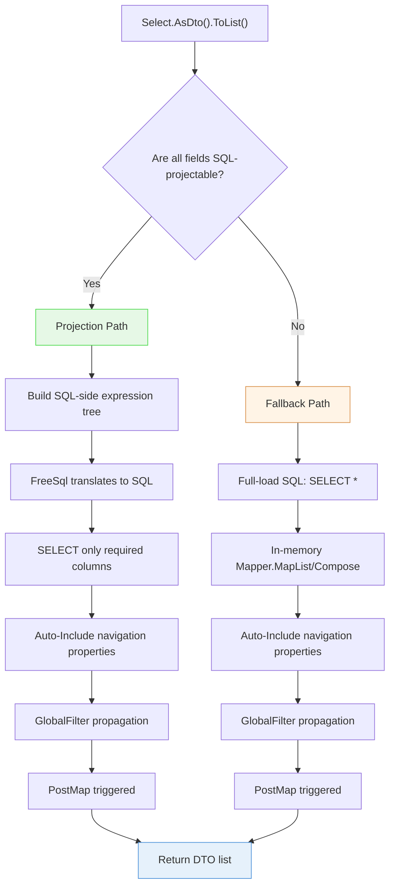

> [!WARNING]
> This documentation has been machine-translated from Chinese source comments and may contain inaccuracies. Please refer to the original Chinese IntelliSense documentation or the source code for authoritative descriptions.

---
wiki-id: how-to/orm/freesql-single-table
Diagnostic codes involved: NCMAP017, NCMAP018  
Library version: v1.0.0+  
Last updated: 2026-09-15  
---

# FreeSql Projection (I): Single-Table AsDto

## Overview

NCMapper integrates with FreeSql and enables SQL projection mapping via `.ToList<TDto>()` after `ISelect<T>.AsDto()`. The generated SQL selects only the columns required by the DTO—never `SELECT *`—reducing network transfer volume and memory consumption.

Core API: `fsql.Select<T>().Where(...).AsDto().ToList<TDto>()`

---

## 1. Basic Usage

### Usage

[!code-csharp[FreeSql Single-Table Projection (using and basic AsDto)](~/samples/NCMapper.Samples/05-Orm/FreeSqlScenarios.cs#OrmProjection_SingleTableAsDto)]

Generated SQL (selects only DTO-required columns):

```sql
SELECT a.Id, a.Name, a.Age, a.Email
FROM Users a
WHERE a.Age > 20
ORDER BY a.Age
```

**Key points**:

- `AsDto()` is the entry point for terminal operators; subsequent calls include `.ToList<TDto>()`, `.First<TDto>()`, `.ToPagedList<TDto>()`, etc.
- SQL projection columns are automatically inferred from DTO properties (columns not represented in the DTO are omitted).
- All standard FreeSql query operators (`Where`, `OrderBy`, `Skip`, `Take`, `WhereIf`, etc.) may be used freely before `AsDto()`.
- Namespace `NCMapper.FreeSql` must be imported.

> **Related API**: `AsDto()` returns `FreeSqlDtoSelector<TSource>` (all terminal methods such as `ToList`, `First`, and `ToPagedList` are hosted on this type) (source anchor: NCMapperFreeSqlExtensions.cs:58).

---

## 2. Terminal Methods

The following terminal methods can be chained after `AsDto()`:

| Method | Description | Return Type |
|---|---|---|
| `.ToList<TDto>()` | Returns all matching rows | `List<TDto>` |
| `.First<TDto>()` | Returns the first row; returns default value if empty | `TDto` |
| `.FirstOrDefault<TDto>()` | Returns the first row or default value | `TDto?` |
| `.ToPagedList<TDto>(page, size)` | Database-level pagination | `PagedList<TDto>` |
| `.ToChunkDto<TDto>(size, action)` | Callback-based batch reading | `void` |
| `.ToDictionary<TDto>(keySelector)` | Builds dictionary | `Dictionary<TKey, TDto>` |
| `.ToListAsync<TDto>()` | Asynchronous list | `Task<List<TDto>>` |
| `.ToDictionaryAsync<TKey, TDto>()` | Asynchronous dictionary | `Task<Dictionary<TKey, TDto>>` |

### Pagination Example

[!code-csharp[FreeSql Pagination with ToPagedList (Database-Level Pagination)](~/samples/NCMapper.Samples/05-Orm/FreeSqlScenarios.cs#OrmProjection_SingleTablePaged)]

### Batch Reading Example

[!code-csharp[FreeSql Single-Table Batch Reading with ToChunkDto](~/samples/NCMapper.Samples/05-Orm/FreeSqlScenarios.cs#OrmProjection_ToChunkDto)]

---

## 3. Projection Path vs. Fallback Path

NCMapper’s FreeSql integration follows two execution paths:

### 3.1 Projection Path (SQL-Side Expression Tree)

When all DTO fields can be mapped entirely on the SQL side, the projection path is taken:

```
ISelect<T>.AsDto().ToList<TDto>()
    → Builds SQL-side expression tree (Select(expr))
    → FreeSql translates to SQL (selecting only required columns)
    → Database executes SQL
    → Result set maps directly to TDto
```

Characteristics:
- Column pruning occurs at the SQL level — no extraneous data transferred.
- Best performance (projection performed by database engine).
- Navigation properties are automatically LEFT JOINed (automatic `Include`).

### 3.2 Fallback Path (Full Load → In-Memory Mapping)

When certain DTO fields cannot be projected on the SQL side (e.g., runtime computation, `Convert`, etc.), automatic fallback occurs:

```
ISelect<T>.AsDto().ToList<TDto>()
    → Detects non-projectable fields
    → Fallback: full-load SQL (`SELECT *`)
    → In-memory mapping via `Mapper.MapList` / `Mapper.Compose`
    → Returns DTO list
```

Characteristics:
- Fallback is triggered automatically — no user intervention required.
- Navigation properties are automatically `Include`d (same behavior as projection path; avoids N+1; previous “no auto-include” description has been corrected).
- `PostMap` behavior is identical across both paths.

> **`Include` Behavior in Fallback Path**: Navigation properties are automatically `Include`d (FreeSql uses `IncludeByPropertyName`; EF Core uses navigation collectors), eliminating need for manual `.Include()`. `[MapNoAutoInclude]` excludes specific navigation properties.



---

## 4. Automatic Include

FreeSql navigation properties are automatically `Include`d during `AsDto` projection — navigation fields referenced in the DTO trigger automatic `LEFT JOIN`:

```csharp
public class OrderEntity
{
    public int OrderId { get; set; }
    public CustomerEntity? Customer { get; set; }  // Navigation property
}

[MapFrom(typeof(OrderEntity))]
public class OrderDto
{
    public int OrderId { get; set; }

    [MapProperty(typeof(OrderEntity), nameof(OrderEntity.Customer))]
    public string? CustomerName { get; set; }  // Reads Customer.Name
}
```

[!code-csharp[FreeSql AsDto Auto-Include Navigation](~/samples/NCMapper.Samples/05-Orm/FreeSqlScenarios.cs#OrmProjection_IncludeNavigation)]

### `MapNoAutoInclude`: Disable Automatic Include

```csharp
[MapFrom(typeof(OrderEntity))]
public class OrderDto
{
    // Property-level attribute only (class-level usage triggers CS0592 at compile time)
    [MapNoAutoInclude]
    public CustomerInfoDto Customer { get; set; } = null!;
    // ...
}
```

[!code-csharp[FreeSql Manual Include for Collection Navigation](~/samples/NCMapper.Samples/05-Orm/FreeSqlScenarios.cs#OrmProjection_NoAutoIncludeGroup)]

**Key points**:

- `MapNoAutoInclude` is intended for conditional `Include` scenarios (e.g., loading navigation only under certain conditions).
- After disabling auto-include, navigation properties require explicit `.Include()`.
- For collection navigation (`IncludeMany`), column selection is determined by the DTO’s collection property definition.

### 4.1 NCMAP017 Diagnostic

Applying `[MapNoAutoInclude]` to a **reference navigation property** (non-collection) is typically meaningless — excluding auto-`Include` for a single reference yields negligible benefit and risks omitting necessary navigation data. NCMapper issues **NCMAP017 (Info-level)** diagnostic for such cases:

```csharp
[MapFrom(typeof(OrderEntity))]
public class OrderDto
{
    // ⚠️ NCMAP017: Annotation on reference navigation property is typically meaningless
    [MapNoAutoInclude]
    [MapProperty(typeof(OrderEntity), nameof(OrderEntity.Customer))]
    public string? CustomerName { get; set; }
}
```

**Valid use cases** (meaningful only on collection navigation properties):

- Large collections (e.g., hundreds of order items): exclude auto-`Include` to avoid loading massive datasets.
- Lazy-loading scenarios: manually control `.Include()` on demand.
- Circular reference risk: prevent infinite recursive joins.

**Invalid use cases**:

- Reference navigation (single item) incurs minimal overhead: excluding auto-`Include` provides negligible benefit but increases manual `.Include()` burden.
- In projection path, reference navigation is already auto-`LEFT JOIN`ed: adding `[MapNoAutoInclude]` forces manual `.Include()`.

> NCMAP017 is an Info-level diagnostic — it does not block compilation, only warns of potential misuse. Full diagnostic code index: [Diagnostic Code Index](../../diagnostics/rules.md).

---

## 5. GlobalFilter Propagation

FreeSql’s `GlobalFilter` (e.g., soft delete, tenant isolation) automatically propagates to both `AsDto` projection and fallback paths:

```csharp
// Register global filter
fsql.GlobalFilter.Apply<ISoftDelete>("SoftDelete", e => e.IsDeleted == false);

// All subsequent AsDto queries automatically append WHERE IsDeleted = false
var dtos = fsql.Select<UserEntity>()
    .AsDto()
    .ToList<UserDto>();
// SQL: SELECT ... FROM Users WHERE IsDeleted = false
```

**Key points**:

- `GlobalFilter` applies identically in both projection and fallback paths.
- Filter names support later `.Enable(name)` / `.Disable(name)` control.

---

## 6. `WithSql`: Custom SQL

For complex SQL (multi-table `JOIN`, subqueries, CTEs, etc.), use `WithSql` to supply custom SQL:

[!code-csharp[FreeSql WithSql Custom SQL Data Source](~/samples/NCMapper.Samples/05-Orm/FreeSqlScenarios.cs#OrmProjection_WithSqlAsDto)]

**Key points**:

- `WithSql` SQL must return columns matching the entity type (e.g., `u.*`).
- For multi-table `WithSql`, the `sqlT2` parameter is mandatory (specifies SQL for the second table).

---

## 7. Full Query Pattern Compatibility

All FreeSql query operators are supported before `AsDto`. Below are commonly used compatible patterns in projection scenarios:

| Pattern | Example | Description |
|---|---|---|
| Conditional `WHERE` | `.WhereIf(cond, u => u.Age > 18)` | Appends `WHERE` only when condition is true |
| Count + Pagination | `.Count()` / `.AsDto().ToPagedList(p, sz)` | Independent or combined count & pagination |
| Sorting | `.OrderBy(u => u.Age).OrderByDescending(...)` | Multi-field sorting |
| Subquery Filtering | `.Where(u => fsql.Select<Order>().Any(o => o.UserId == u.Id))` | `EXISTS` semantics |
| `IN` Filtering | `.Where(u => ids.Contains(u.Id))` | Use `List<int>` instead of array (see Misuse #3 for net10) |
| Navigation Join | `.Include(o => o.Customer)` | Explicit navigation `Include` |
| Collection Navigation | `.IncludeMany(o => o.Items)` | Load child collections via `IncludeMany` |
| Cascading Filter | `.WhereCascade(...)` | `WHERE` applied to navigation properties |
| Custom SQL | `.WithSql(...)` | Complex `JOIN` / subquery / CTE |

**`WhereIf` Conditional Query**:

[!code-csharp[FreeSql `WhereIf` Dynamic Condition Assembly](~/samples/NCMapper.Samples/05-Orm/FreeSqlScenarios.cs#OrmProjection_WhereIfFilter)]

**`EXISTS` Subquery (Subquery Filtering)**:

[!code-csharp[FreeSql `EXISTS` Subquery Filtering](~/samples/NCMapper.Samples/05-Orm/FreeSqlScenarios.cs#OrmProjection_AnySubquery)]

**`IncludeMany` Collection Navigation**:

[!code-csharp[`IncludeMany` Collection Loading Followed by `AsDto` Projection](~/samples/NCMapper.Samples/05-Orm/FreeSqlMultiTableScenarios.cs#FreeSqlMultiTable_IncludeManyNavigation)]

**Key points**:

- All above operators may be freely composed before `AsDto`; NCMapper only intervenes at the terminal operator.
- Both projection and fallback paths behave identically for these operators (`GlobalFilter` propagates in both).
- Navigation join / `IncludeMany` is **automatically triggered in projection path**, but requires **manual `.Include()` in fallback path** (see §3.2).

---

## Common Misuses

### Misuse 1: Calling `ToList` Before `AsDto` (Full Load into Memory)

```csharp
// ❌ Misuse: `.ToList()` before `AsDto` (full load into memory, then map)
var entities = fsql.Select<UserEntity>().ToList();  // SELECT *, full load
var dtos = Mapper.MapList<UserEntity, UserDto>(entities);  // In-memory mapping

// ✅ Correct: Use `AsDto` to project at SQL level
var dtos = fsql.Select<UserEntity>().AsDto().ToList<UserDto>();  // SELECT only required columns
```

### Misuse 2: `GroupBy` + `AsDto`

```csharp
// ❌ Misuse: `GroupBy` + `AsDto` is not supported.
// After `GroupBy`, FreeSql returns `ISelectGrouping<TKey, TValue>` (grouped aggregates), no longer an entity query.
// → Entity-to-DTO property mapping is impossible; NCMapper blocks this usage at compile time using `[Obsolete(error: true)]`.
var dtos = fsql.Select<UserEntity>()
    .GroupBy(u => u.Age)
    .AsDto()  // Compile-time error!
    .ToList<UserDto>();
```

> ⚠️ **Alternative (Not Recommended): Load into memory first, then group with LINQ**
>
> Since the `AsDto` pipeline does not support chained `GroupBy`, the *only* way to perform grouping within the NCMapper projection system is to first call `.AsDto().ToList()` to materialize objects into memory, then use LINQ’s `.GroupBy()` for grouping:
>
> ```csharp
> // Provided solely as "a way to achieve GROUP BY", not as a recommended practice.
> var rows = fsql.Select<UserEntity>()
>     .AsDto()
>     .ToList<UserDto>();           // Loads full dataset into memory.
> var grouped = rows
>     .GroupBy(d => d.Age)          // Groups in-memory by Age.
>     .Select(g => new
>     {
>         Age = g.Key,
>         Count = g.Count(),
>         AvgNameLen = g.Average(d => d.Name.Length)
>     })
>     .ToList();
> ```
>
> **Why this is discouraged**: It requires calling `.ToList()` to load the entire (or filtered) dataset into memory before performing grouping and aggregation on the client side — resulting in **significant performance degradation**, both from the overhead of one-time full-data transfer/materialization and from losing SQL-side `GROUP BY` pushdown and index acceleration.
>
> **Better approach**: If the grouping and aggregation can be expressed in SQL (e.g., counting, summing, averaging), prefer FreeSql’s native aggregation syntax to execute it on the database side, avoiding moving all detail records into memory:
>
> ```csharp
> // ✅ Recommended: Native FreeSql aggregation — `GROUP BY` pushed down to SQL.
> var stats = fsql.Select<UserEntity>()
>     .GroupBy(u => u.Age)
>     .ToList(g => new { Age = g.Key, Count = g.Count() });
> ```
>
> This in-memory grouping example is provided **only as a fallback when SQL-based aggregation is truly infeasible**. Choose it carefully based on your actual performance budget. A full comparison of both approaches is available in [09-FreeSql-Advanced](freesql-advanced.md#misuse-1-groupby--asdto).

### Misuse 3: `Array.Contains` throws in .NET 10

```csharp
// ❌ Misuse: In .NET 10, `T[].Contains` binds to `MemoryExtensions.Contains`.
// FreeSql throws `NotSupportedException` (detected as NCMAP018).
var ids = new[] { 1, 2, 3 };
var dtos = fsql.Select<UserEntity>()
    .Where(u => ids.Contains(u.Id))  // Fails at runtime in .NET 10.
    .AsDto()
    .ToList<UserDto>();

// ✅ Correct: Use `List<int>` instead of array.
var ids = new List<int> { 1, 2, 3 };
var dtos = fsql.Select<UserEntity>()
    .Where(u => ids.Contains(u.Id))  // `List.Contains` translates correctly.
    .AsDto()
    .ToList<UserDto>();
```

---

## Summary

| Capability | API | Feature |
|---|---|---|
| Single-table projection | `Select<T>().AsDto().ToList<TDto>()` | Column pruning at SQL level |
| Pagination | `.ToPagedList<TDto>(page, size)` | SQL-level pagination |
| Chunked reading | `.ToChunkDto<TDto>(size, action)` | Controlled large-volume reads |
| Dictionary mapping | `.ToDictionary<TDto>(keySelector)` | Key selector support |
| Asynchronous execution | `.ToListAsync<TDto>()` | Async variants |
| Automatic `Include` | Automatic `LEFT JOIN` for DTO navigation properties | On-demand JOINs |
| Disable automatic `Include` | `[MapNoAutoInclude]` | Manual `Include` control |
| Global filter propagation | Automatic propagation | Works in both projection and fallback paths |
| Custom SQL | `.WithSql(...)` | For complex queries |
| Fallback path | Automatically triggered | Full-data SQL → in-memory mapping |

## Fluent DTO Support Status

The projection capabilities described here also apply to DTOs declared via the **Fluent pipeline**: Before `AsDto` executes, the runtime snapshot registry performs **per-declaration translation analysis** (snapshot-first — registration is based on declaration details; zero reflection for registered types; fallback to reflection for unregistered ones):

- **Purely translatable declarations** (e.g., `Map`, `Ignore`, etc.): Projection occurs at the SQL level. Aliased mappings (`SourceName`) and nested dot-path expressions (`SourcePathNames`) are consumed by the projection binder. `Ignore` declarations filter projected columns per direction.
- **Non-translatable declarations** (any cm-level `Mask`, `Convert`, `Format`, `FromJson`, `When`, or class-level `AfterMapping`, `BeforeMapping`, `MapSubclass`): Forces fallback to in-memory mapping, preserving full semantics (e.g., `Mask` ensures sensitive data remains masked, converters and callbacks execute fully). Multi-source composition via `FromSource` is already evaluated for translatability per declaration (translatable cases proceed with projection — see the “Fluent Compose Unlock” section in [FreeSql Multi-Table Queries](freesql-multi-table.md)).
- When snapshotting is disabled (`NCMapperEmitRuntimeSnapshot=off`), conservative fallback applies — no relaxation of translatability checks.

A runnable demo (comparing both projection and fallback states) is available in the companion sample scenarios `07-fx-*`.

---

## Companion Samples

```bash
cd samples/NCMapper.Samples
dotnet run --scenario 501
```

Core sample source code (single-point, same-source; verifiable via `dotnet run --scenario`):

[!code-csharp[Single-table AsDto](~/samples/NCMapper.Samples/05-Orm/FreeSqlScenarios.cs#OrmProjection_SingleTableAsDto)]

[!code-csharp[Single-table AsDto · SingleTableFirst](~/samples/NCMapper.Samples/05-Orm/FreeSqlScenarios.cs#OrmProjection_SingleTableAsDto_SingleTableFirst)]

Full source resides in `samples/NCMapper.Samples/05-Orm/FreeSqlScenarios.cs`, covering sub-scenarios including single-table `AsDto`, pagination, `ToChunkDto`, and `WithSql`.

---

## Further Reading

- [FreeSql (II): Multi-Table Queries](freesql-multi-table.md) · [FreeSql (III): Advanced Terminal Methods](freesql-advanced.md)
- Technical documentation: [NCMapper.FreeSql Extension Package](../../explanation/orm-freesql.md) §11.2
- Extension source code: `src/NCMapper.FreeSql/NCMapperFreeSqlExtensions.cs`
