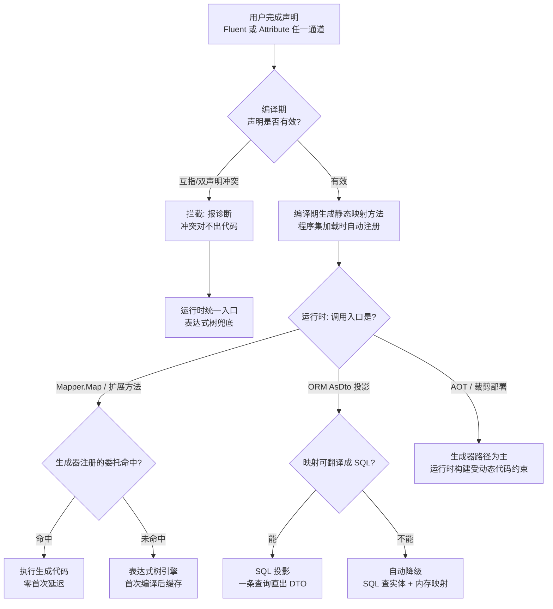

# 自适应路由机制

## 概述

用户的工作只有一件事：**声明映射**（用 Fluent 链式声明，或在 DTO 上标注特性，见 [双通道架构](./dual-channel.md)）。声明完成之后，映射请求实际走哪条执行路径，全部由组件在编译期和运行时的**若干决策点自动选择**——用户不需要写 `if` 判断环境、不需要手动切换引擎、也不需要在 ORM 查询里手动分派"投影还是内存映射"。

本篇是这些决策点的**总览图**：每个决策点判断什么、依据是什么、选出来的路径通向哪里。各决策点的实现细节分别在专篇展开，本篇不重复。

---

## 1. 决策点总图

一次映射请求从声明到执行，经过的自动选路点如下：

全部决策点汇总：

| # | 决策点 | 判断依据 | 结果 | 详情 |
|---|--------|---------|------|------|
| 1 | 编译期：声明可生成性 | 声明是否互指/双声明（025 / F11 / F16） | 有效→生成并注册；冲突→不出代码，报诊断 | [双通道架构 §4](./dual-channel.md) |
| 2 | 运行时：引擎选择 | 生成器注册的委托是否命中该类型对 | 命中→生成代码直调；未命中→表达式树首次编译后缓存 | [双引擎架构 §3](./dual-engine.md) |
| 3 | ORM 投影：翻译能力 | 映射声明能否翻译成 SQL（特性可翻译性、构造器、嵌套深度等） | 能→SQL 投影；不能→自动降级二步执行 | [ORM 降级机制](./orm-degradation.md) |
| 4 | 部署环境：动态代码可用性 | 目标环境是否支持运行时代码生成 | AOT/裁剪环境以生成器路径为主 | [AOT 部署](../how-to/aot/deployment.md) |

Dapper 集成没有决策点：SQL 完全由用户控制，无 SQL 侧投影能力，始终走内存映射全管道。

---

## 2. 编译期：先拦冲突，再发代码

源生成器处理声明时有两个出口：

- **声明有效**：为每个类型对生成静态映射方法，并在程序集加载时自动注册到运行时缓存。此后所有运行时决策点都以"注册过了"为前提。
- **声明冲突**（同一对互指、双通道双声明等）：该对**不出代码**、报编译期诊断。这样设计的考虑是"冲突的两条声明可能不一致，与其猜一个，不如让用户删到只剩一个"。不出代码不等于不可用——运行时统一入口仍会兜底（见下一节），但编译告警必须处理，否则得不到生成路径的性能与编译期检查。

---

## 3. 运行时：统一入口自动选引擎

`Mapper.Map<TSource, TTarget>` 是所有映射请求的统一入口。入口内部的选路规则很简单：

1. 先查源生成器注册的委托——命中就执行编译期生成的静态方法，零首次延迟；
2. 未命中（类型对运行时才出现、或临时不想声明）就交给表达式树引擎——首次调用把映射逻辑构建成表达式并编译成方法缓存，后续调用直接执行缓存结果。

选路对调用方完全透明：调用方写的代码不因走哪个引擎而不同。扩展方法（`src.MapToXxxDto()`）与统一入口共用同一份生成代码，差异只是调用入口的写法。这条选路的性能含义与细节见 [双引擎架构 §3](./dual-engine.md)。

---

## 4. ORM 投影：能翻译就翻译，翻译不动就降级

ORM 扩展包（FreeSql / EF Core）的 `AsDto` 投影是第二类自动选路：组件尝试把映射声明**翻译成 SQL**（让数据库直接吐出 DTO）；遇到 SQL 表达不了的能力（自定义转换器、脱敏、record 目标类型、嵌套过深等）时，**自动切换为二步执行**——先查实体，再在内存里用完整映射管道出 DTO。

两个要点：

- **降级不是失败**，是与投影对等的正常路径：特性全量生效、结果一致，代价只是多一次查询往返。
- **Fluent 声明参与同一套判定**：纯可翻译声明恢复投影，含不可翻译能力的声明按声明分流强制降级——两条通道在投影场景同样共享判定逻辑，且有门禁防止判定漂移。

触发条件全表、降级后的执行细节与避免建议见 [ORM 降级机制](./orm-degradation.md)；为什么对降级判定设门禁，见该文 §2.3 的双通道等价口径。

---

## 5. 部署环境：AOT 与裁剪的约束

NativeAOT 或裁剪发布的程序不支持（或限制）运行时代码生成，表达式树路径在这类环境需要显式标注动态代码能力。因此：

- AOT 场景的推荐做法是**让类型对都走声明**（任一通道均可），使全部映射在编译期生成、运行时零动态代码；
- 未声明的类型对在 AOT 下仍可工作，但需要按 [AOT 部署指南](../how-to/aot/deployment.md) 处理动态代码标注。

这仍是同一个路由模型：组件按环境能力选路，用户通过"是否声明"控制可选路径的范围。

---

## 6. 可观测性：自动选的路，看得见

自动路由的前提是**每个决策都能被看见**：

- **编译期**：诊断码直接出现在 IDE 错误列表（冲突拦截、声明错误），见 [诊断码体系模型](./semantics/diagnostics-model.md)。
- **运行时投影**：开启 `MapTracer.GloballyEnabled = true` 后，降级查询输出带原因的日志行（如"属性 X 标注了 ConvertAttribute（需要降级）"），见 [ORM 降级机制 §3.2](./orm-degradation.md)。
- **配置体检**：`Mapper.Validate()` 扫描全部声明类型对，把潜在问题在运行前集中暴露，见 [映射验证](./validation.md)。

---

## 7. 为什么"自动"而不是"用户指定"

| 方案 | 行为 | 取舍 |
|------|------|------|
| 用户显式指定路径（当前未采用） | 每次调用声明"用生成代码 / 用表达式树 / 用投影 / 用降级" | 调用方代码与执行细节耦合；换部署环境或换 ORM 要改调用代码 |
| 组件自动路由（当前采用） | 用户只声明一次，组件按类型对、环境、翻译能力自动选路 | 调用方零感知；路径选择有固定规则且可观测 |

自动路由的代价是"用户对实际路径的默认不知情"，因此可观测性（第 6 节）是这个设计的必要组成部分，而不是附加功能。**一套声明处处生效**——同一份映射配置，在普通调用、ORM 查询、AOT 部署下都由组件自动匹配到当前场景的最优可行路径。

---

## 速查表

| 概念 | 说明 |
|------|------|
| 自适应路由 | 声明完成后，组件在编译期/运行时的各决策点自动选择执行路径，调用方零感知 |
| 决策点 1（编译期） | 声明冲突拦截（不出代码 + 诊断）；有效声明生成并自动注册 |
| 决策点 2（运行时） | 生成器委托命中走生成代码，未命中走表达式树（首次编译后缓存） |
| 决策点 3（ORM 投影） | 可翻译成 SQL 则投影，否则自动降级为"查实体 + 内存映射" |
| 决策点 4（部署环境） | AOT/裁剪下以生成器路径为主，运行时构建受动态代码约束 |
| 可观测性 | 编译期诊断码 + `MapTracer` 降级原因日志 + `Mapper.Validate()` 配置体检 |
| 设计取舍 | 用"自动 + 可观测"换"调用方零感知、一套声明处处生效" |

---

## 常见疑问

**我怎么知道某次调用实际走了哪条路径？**

普通映射无需关心（两条引擎路径结果一致，仅性能特征不同）；投影场景开 `MapTracer` 即可看到是否降级及原因。

**自动选路会不会"悄悄"变慢？**

会变化的只有两处且均可观测：未声明类型对的首次调用（表达式树编译，一次性）；投影触发的降级（多一次查询，Trace 有日志行）。其余路径选择不引入额外开销。

**能强制某次调用不走降级吗？**

不能在调用侧强制——降级判定依据的是声明本身的翻译能力。想让投影生效，按 [ORM 降级机制 §4](./orm-degradation.md) 的建议调整声明（投影 DTO 保持纯属性、用普通类等）。

---

## 相关文档

- [双通道架构](./dual-channel.md)：路由的输入——两条声明通道如何汇成一份生成代码
- [双引擎架构](./dual-engine.md)：决策点 2 的引擎分工与性能特征
- [ORM 降级机制](./orm-degradation.md)：决策点 3 的触发条件与降级后行为
- [AOT 部署](../how-to/aot/deployment.md)：决策点 4 的部署约束与标注方法
- [性能优化机制](./performance.md)：各路径的性能数据与优化建议
