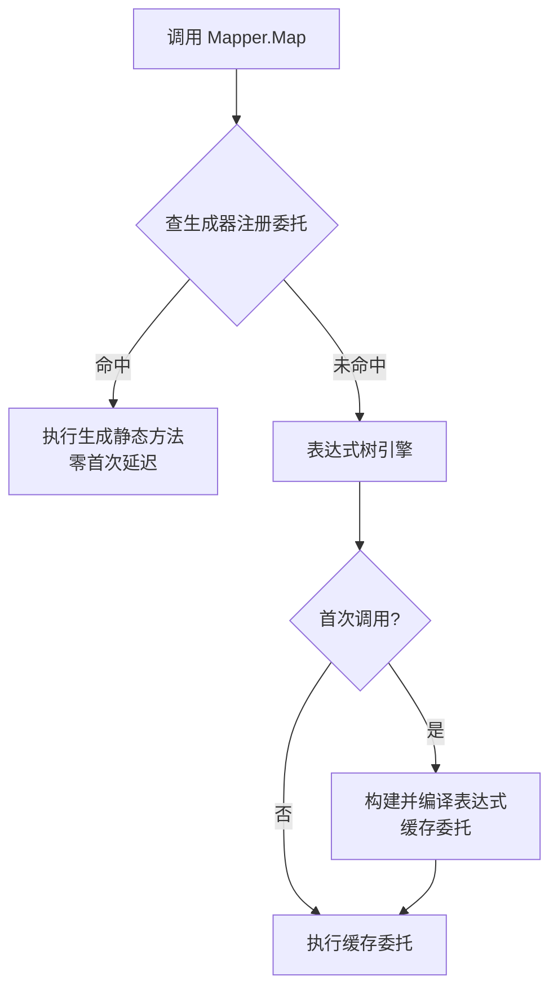

# 双引擎架构原理

## 概述

NCMapper 的映射声明有两条通道——DTO 类上的 `[MapFrom]` 特性，与 `[MapperConfig]` 配置类里的 Fluent 链式声明（`cfg.For<TSource, TTarget>()...`）。两条通道的声明在编译期汇入同一份映射快照，由两个引擎执行：编译期的源生成器与运行时的表达式树。本篇文章解释为什么需要双引擎、两通道与两引擎如何协作、以及你的代码实际走哪条路径。

源生成器的实现细节见 [explanation 源生成器](./source-generator.md)，双通道的声明语义见 [explanation 双通道架构](./dual-channel.md)，本篇聚焦设计动机与协作关系。

---

## 1. 为什么需要双引擎

### 1.1 单一编译时引擎的局限

源生成器在编译期生成静态映射代码，性能最优，但只处理**编译期可见的声明**：`[MapFrom]` 标注的类型对，以及 `[MapperConfig]` 类内 `static void M(FluentMappingConfig cfg)` 方法中的 Fluent 链。以下场景生成器无法覆盖：

| 场景 | 问题 |
|------|------|
| 运行时才知道类型对（插件加载、动态类型） | 编译期没有任何声明，无代码可生成 |
| 不想写声明的临时映射 | 为一次映射引入 `[MapFrom]` 或 Fluent 配置类成本过高 |
| 反射驱动的通用场景 | 类型集合在运行时才确定 |

### 1.2 单一运行时引擎的代价

运行时引擎（表达式树编译）没有上述限制，但首次调用需要编译表达式并缓存，且依赖 `System.Linq.Expressions` 构建。对已声明的类型对来说，这份编译成本是多余的。

### 1.3 结论：按类型对选择路径

两个引擎各有适用面，选择依据是类型对是否有编译期声明（特性或 Fluent 皆可）：

| 维度 | 源生成器（编译时） | 表达式树（运行时） |
|------|------------------|------------------|
| 生成时机 | 编译期 | 首次调用 |
| 覆盖范围 | 已声明（`[MapFrom]` 或 Fluent 链）的类型对 | 全部类型对（兜底） |
| 首次延迟 | 零 | 首次编译开销 |
| 编译期诊断 | 有（NCMAP0XX / NCMAP_FXX） | 无 |
| 性能 | 静态方法直调，可内联 | 委托调用 |

两者不是竞争关系，是互补关系：**生成器解决已声明场景的最优路径，表达式树兜底其余场景**。

---

## 2. 两通道如何汇入双引擎

### 2.1 源生成器：编译期构建

源生成器（`NCMapperSourceGenerator`，Roslyn `IIncrementalGenerator`）对两条声明通道各有一个提取器，产物汇入同一份映射快照（`MappingSnapshot`），再由同一代码生成器发射：

- **特性通道**：`MappingExtractor` 从 `[MapFrom]` 特性上下文提取映射关系与自动扁平化匹配。
- **Fluent 通道**：`FluentExtractor` 定位 `[MapperConfig]` 类内的 `static void M(FluentMappingConfig cfg)` 方法，`ChainCallParser` 把 `cfg.For<S,T>().Map(...).Ignore(...)` 链式调用按语义顺序展开，各链节点（Map / Ignore / Mask / Convert / MapTree / NoAutoInclude / AfterMapping 等）经 `MappingSnapshotBuilder` 物化——复用与特性通道同一套符号遍历（`MappingExtractor` 的物化路径），两通道的快照结构完全同型。
- 同一类型对若被两通道同时声明，编译期报 **NCMAP_F11**（双声明互斥）阻断生成；不同类型对可自由混用通道。

每个类型对生成静态映射方法，并通过 `[ModuleInitializer]` 在程序集加载时自动注册委托。生成物包括：

- 类型对级静态映射方法：同名属性直接赋值、`[MapProperty]` 异名映射、`[Convert]` 转换器调用
- 扩展方法族：`src.MapToXxxDto()` / `srcs.MapToXxxDtoList()` 等
- 反向扩展：`dto.MapToXxxEntity()` / `dtos.MapToXxxEntityList()`（DTO → 实体方向，与正向对称）

反向列表扩展对批量 DTO 逐元素应用同一反向语义（含 null 写回清空、忽略清单过滤），与正向 `MapToXxxDtoList` 行为对称（[explanation 反向映射语义](./reverse-mapping-semantics.md)）。

Fluent 通道的 `FluentMappingConfig` 及其终端方法只是**编译期语法锚点**——配置方法本身不会被调用，所有终端方法不做任何运行时工作；声明的全部语义由源生成器物化后交由生成的代码承担。

生成代码在编译期可见，JIT 可直接内联，零反射、零字典查找。

### 2.2 表达式树：运行时兜底

`Mapper.Map` 调用时，先查生成器注册的委托缓存；未命中则走表达式树引擎：首次调用时构建 `Expression<Func<TSource, TTarget>>` 并编译为委托缓存，后续调用直接执行编译结果。表达式树构建逻辑与生成器共享同一套匹配规则（`PropertyMatcher`、`TypeConvertHelper`），保证两个引擎产出相同结果。

---

## 3. 引擎选择路径

一次 `Mapper.Map<TSource, TTarget>(src)` 的实际调用流程：

```text
Mapper.Map 入口
  ├─ 查源生成器注册委托（ModuleInitializer 注册，类型对精确匹配）
  │    ├─ 命中 → 调用生成静态方法（零首次延迟；特性或 Fluent 声明的类型对皆在此命中）
  │    └─ 未命中
  └─ 表达式树引擎
       ├─ 首次调用 → 构建 + 编译表达式树 → 缓存
       └─ 后续调用 → 执行缓存的编译委托
```

选择是自动的，调用方不需要感知；声明来自哪条通道也不影响选路——两通道的声明在编译期已是同一份快照。扩展方法（`src.MapToXxxDto()`）与 `Mapper.Map` 走同一份生成代码，仅调用入口不同（[基础映射](../how-to/declarative/basics.md)）。



| 调用方式 | 引擎 | 说明 |
|---------|------|------|
| `src.MapToXxxDto()` | 源生成器直调 | 需 `using NCMapper.Generated` |
| `Mapper.Map<T, TDto>(src)` | 生成器优先，表达式树兜底 | 统一入口 |
| 无任何声明的类型对 | 表达式树 | 首次编译后缓存 |

---

## 4. 一致性保证

双引擎必须产出相同结果，否则同一映射在两种调用方式下行为不一致。一致性由以下机制保证：

- **同一套匹配规则**：属性匹配（`PropertyMatcher`）、类型转换（`TypeConvertHelper`）、忽略规则（`PropertyIgnoreChecker`）被两个引擎共享，不是各写一套
- **同一份声明快照**：两通道（特性与 Fluent）在编译期物化为同型快照，生成端与运行时端消费同一份声明明细，不存在"两通道各自一套语义"
- **诊断码双端一致**：同一配置问题（如 `[Convert]` 反向不消费 NCMAP033、init-only 更新跳过 NCMAP032）在生成端报诊断、在运行时走对应行为，语义对齐

映射验证（`Mapper.Validate()`）会扫描全部已声明类型对（两通道皆在内），两个引擎共享同一份配置校验结果。

---

## 5. 决策表：何时走哪条

| 场景 | 实际路径 | 建议 |
|------|---------|------|
| 标准实体 → DTO（已标 `[MapFrom]`） | 源生成器 | 默认方式，声明即最优 |
| Fluent 链声明的类型对（`[MapperConfig]` 配置类） | 源生成器 | 与特性通道同一编译期路径，声明即最优 |
| 运行时动态类型对 | 表达式树 | 接受首次编译开销 |
| 临时映射（不想加声明） | 表达式树 | 一两次调用无感知；高频调用建议补声明（特性或 Fluent 皆可） |
| 需要编译期诊断（字段错配、类型不兼容） | 源生成器 | 无声明则缺失编译期守护 |
| 反向映射（DTO → 实体） | 源生成器（生成反向扩展） | 已声明即生成 |
| NativeAOT / Trimmed 部署 | 源生成器优先 | 运行时路径需标注 `[RequiresDynamicCode]`，见 [AOT](../how-to/aot/deployment.md) |

判断要点：**声明（`[MapFrom]` 或 Fluent 链）就获得编译期最优路径；不声明就交给运行时兜底**。性能敏感场景（见 [性能](../how-to/infrastructure/performance.md)）确保类型对已声明。

---

## 6. 性能特征

两引擎的性能差异集中在首次调用与稳态两个阶段：

| 阶段 | 源生成器 | 表达式树 |
|------|---------|---------|
| 首次调用 | 零延迟（编译期已生成） | 构建 + 编译表达式树开销 |
| 稳态 | 静态方法直调，JIT 可内联 | 缓存委托调用 |
| 内存 | 无运行时缓存结构 | 每类型对缓存委托 |

性能基准与优化建议见 [性能](../how-to/infrastructure/performance.md)。对已声明的类型对，生成器路径的首次延迟优势最明显（冷启动场景，如 AOT 或短生命周期进程）。

---

## 7. 常见疑问

**为什么不用反射做兜底？**

反射兜底每次调用都有开销，且无法处理 `[Convert]`、`[Mask]` 等特性的编译期校验。表达式树兜底首次编译后缓存，稳态性能接近生成代码，兼顾灵活与性能。

**Fluent 配置方法会在运行时被调用吗？**

不会。`FluentMappingConfig` 的终端方法全部是编译期语法锚点，不做任何运行时工作；`cfg.For<S,T>()...` 链由源生成器在编译期展开并物化为快照，运行时执行的是生成的静态代码。

**扩展方法和 `Mapper.Map` 哪个快？**

同一份生成代码，差异仅一层委托间接，可忽略。按语法偏好选择即可（[基础映射](../how-to/declarative/basics.md)）。

**未声明的类型对能获得编译期诊断吗？**

不能。编译期诊断（NCMAP0XX / NCMAP_FXX）只对已声明类型对生效。临时映射建议高频场景补声明，低频场景接受运行时兜底。

**双引擎会同时执行吗？**

不会。每次调用只走一条路径：生成器委托命中则执行生成代码，否则表达式树。两个引擎不叠加，也不存在"都执行再取结果"的路径。`Mapper.Validate()` 验证的也是同一份配置，不会因引擎不同给出不同结论。

---

## 速查表

| 概念 | 说明 |
|------|------|
| 声明通道 | 特性（`[MapFrom]`）与 Fluent（`[MapperConfig]` + `FluentMappingConfig` 链）两条，编译期汇入同一份快照；同类型对双声明报 NCMAP_F11 |
| 源生成器引擎 | 编译期为已声明类型对生成静态代码，零首次延迟，编译期诊断 |
| 表达式树引擎 | 运行时首次编译并缓存，覆盖全部类型对 |
| 选择规则 | 生成器委托优先，未命中回退表达式树，自动且透明 |
| 一致性 | 双引擎共享匹配/转换/忽略规则与同一份快照，结果对齐 |
| 扩展方法 | 与 `Mapper.Map` 同代码，仅入口不同 |
| 多态子类型映射 | `MapSubclass` 双侧对称（Fluent 终端 + `[MapSubclass]` 特性）；isinst 分派链由源生成器引擎编译期发射，表达式树引擎兜底时不做子类分派 |

本篇文章解决了"为什么有两个引擎、走哪条路径"的问题；引擎内部的实现细节见源生成器篇，性能数据见性能 how-to。

---

## 相关文档

- [explanation 双通道架构](./dual-channel.md)：两条声明通道如何汇成同一份生成代码
- [explanation 自适应路由机制](./adaptive-routing.md)：声明完成后组件在各决策点自动选路的总览
- [explanation 源生成器](./source-generator.md)：生成内容与扩展方法实现细节
- [15 分钟上手教程](../getting-started/tutorial-15min.md)：双引擎的首次使用
- [性能](../how-to/infrastructure/performance.md)：两引擎性能数据
- [AOT 部署](../how-to/aot/deployment.md)：AOT 场景的引擎选择
- [explanation ORM 降级机制](./orm-degradation.md)：投影路径的引擎协作
