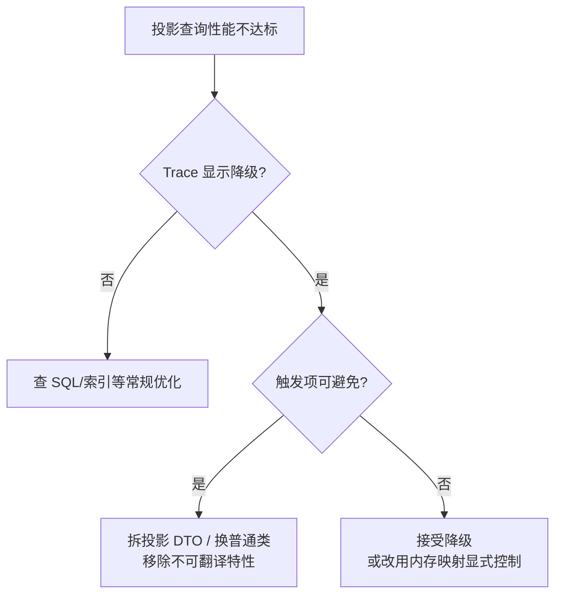

# ORM 降级机制

## 概述

ORM 投影（`AsDto`）能把映射翻译成 SQL，但 SQL 有表达能力边界。当映射配置超出翻译范围时，NCMapper 自动降级为"SQL 查实体 + 内存映射"二步执行。本篇文章解释为什么存在降级、哪些条件触发降级、降级后发生了什么、以及如何避免不必要的降级。

自动降级机制的实现细节见 [explanation ORM Projection](./orm-projection-design.md)，本篇聚焦设计动机与决策。

---

## 1. 为什么需要降级

### 1.1 SQL 的表达能力边界

`AsDto()` 的目标是生成一条可执行的 SQL 投影表达式。SQL 能翻译的是"列到属性的简单映射"：同名属性、`[MapProperty]` 异名声明、隐式数值转换、嵌套导航的 `JOIN`。

超出这个范围的能力，SQL 没有对应语法：

| 能力 | SQL 能否表达 | 原因 |
|------|-------------|------|
| 同名属性复制 | 能 | `SELECT col AS prop` |
| `[MapProperty]` 异名映射 | 能 | 列别名 |
| 嵌套导航（`Address.City`） | 能 | `JOIN` + 列 |
| `[Convert]` 自定义转换 | 不能 | 转换器是 .NET 代码，SQL 无法调用 |
| `[Mask]` 脱敏 | 不能 | 脱敏算法是 .NET 代码 |
| record 类型（无无参构造器） | 不能 | 投影表达式无法构建 `MemberInit` |
| Pipeline PostMap 后处理 | 不能 | 回调是运行时行为 |

### 1.2 降级是设计取舍，不是缺陷

NCMapper 的选择是：**能投影就投影，不能投影就降级，保证所有特性全量生效**。如果遇到不可翻译特性直接报错，`[Convert]`、`[Mask]` 在投影场景就不可用，违背"一套配置处处生效"的设计。降级用多一次查询换取了特性完整性与调用方零感知。

---

## 2. 降级触发条件

降级检测器（`DegradationDetectorBase`）按固定顺序扫描源/目标类型，命中任一条件即降级：

| 检测项 | 说明 | 级别 |
|--------|------|------|
| 顶层 DTO 无无参构造器 | record 等类型无法构建投影表达式 | 顶层 |
| 类级/属性级特性 `RequiresDowngrade` | `[Convert]`、`[Mask]`、`[MapProperty(IsFromJson=true)]` | 类级/属性级 |
| 未知 NCMapper 特性 | 未声明投影策略的特性，安全兜底降级 | 类级/属性级 |
| 全局忽略清单命中 | DTO 属性命中忽略清单（`OverrideIgnore=true` 豁免） | 顶层 |
| 集合类型不可投影 | `T[]` / `HashSet<T>` 等 | EFCore 特有 |
| 集合导航 / 嵌套跨表 | FreeSql 翻译能力限制（保守策略） | FreeSql 特有 |
| 嵌套 DTO 无无参构造器 | 嵌套层同样要求可构建 | 嵌套 |
| Pipeline PostMap 注册 | `HasPostMapFor` 为 true | 顶层/嵌套 |
| 嵌套深度超限 | EFCore=8 / FreeSql=3 | 嵌套 |

两个 ORM 扩展包的降级策略差异：

| 维度 | EFCore | FreeSql |
|------|--------|---------|
| 嵌套深度上限 | 8 | 3 |
| 集合投影 | 支持可投影集合 | 集合元素即降级 |
| 特有检查 | 不可投影集合 | 全局忽略 / 集合导航 / 嵌套跨表 |

差异来自两个 ORM 的 SQL 翻译能力不同，FreeSql 保守（深度 3）、EFCore 激进（深度 8）。Dapper 无降级检测器，始终走内存映射全管道。

### 2.1 检测顺序与缓存

降级检测器按固定顺序执行判定（`DegradationDetectorBase.Evaluate`）：

```text
顶层无参构造器 → 类级特性 → 属性级特性 → ORM 特有检查 → 嵌套递归 → PostMap
```

判定结果按 (源类型, 目标类型, Pipeline 版本号) 缓存，Pipeline 注册新回调后缓存自动失效。缓存避免每次查询重复反射扫描，代价是配置变更后需要缓存失效才能反映（Pipeline 版本号机制保证）。

> **快照优先语义（终态架构）**：检测器取数统一经 `RuntimeSnapshotStore.TryGetMappingDetail`——注册对（编译期发射或运行时注册）按声明明细分类判定（零特性反射扫描）；未注册对回退既有特性扫描路径。判定缓存另受注册表 `ContentVersion` 门控：注册/合并/清理任一内容变更即失效重算，声明变更即时生效。

### 2.2 外部特性不触发降级

只有 NCMapper 命名空间的特性参与判定。外部特性（如 `DataAnnotations` 的 `[Required]`）不触发降级，安全网仅限 NCMapper 命名空间，避免把用户自己的元数据特性误判为不可翻译。

### 2.3 Fluent 通道的声明级分流

**Fluent 通道**（`[MapperConfig]` 链式声明）的 DTO 同样进入降级判定，且细化为**逐声明分流**（`DegradationDetectorBase` 经 `RuntimeSnapshotStore.TryGetMappingDetail` 按 (源, 目标) 精确对读取声明明细，三态分流）：

| 判定 | 行为 |
|------|------|
| 三态① 明细命中（Properties 或 ComposeMappings 非空） | Fluent DTO 进入声明级分类（`ClassifyUntranslatableDeclaration` 对齐表）；特性通道条目（`Channel=MapFrom`）同门面统一消费、通道隔离由判定序承载 |
| 三态② 条目命中明细不可达（off 态身份键） | 保守强制降级（reason 逐字："off 态身份键/明细不可达"——不放宽） |
| 三态③ miss（未注册对） | 落特性扫描路径兜底（纯运行时模式现状语义） |
| 纯可翻译声明（`Map`/`Ignore` 等价） | **恢复投影**——异名（`SourceName`）、嵌套点路径（`SourcePathNames`）、`Ignore` 方向差集由投影绑定按声明明细消费 |
| 多源 `FromSource` 合成（ComposeMappings） | **明细可译性判定**：可译（纯字段/路径/索引）走投影；不可译（cm 级 Mask/Convert/Format/FromJson/When 或对级 AfterMapping/BeforeMapping/SubclassDispatch）维持降级（reason 细化类别）；"声明有产出无"保守降级 |
| 嵌套 Fluent 子 DTO 含不可翻译声明 | 嵌套层同样触发降级（嵌套链声明明细统一消费） |
| 快照开关 off（`NCMapperEmitRuntimeSnapshot=off`） | 保守降级，不放宽判定 |

**双通道等价口径（门禁保障）**：特性侧由 `IProjectionPolicy.RequiresDowngrade` 自声明降级条件；Fluent 侧由注册表承载字段等价判定——两条通道的降级承载经机械面门禁逐行对应（`IProjectionPolicy` 实现与承载路径反射可达断言），防止通道间判定漂移。

---

## 3. 降级后发生了什么

降级不是"失败"，是一段完整可观测的执行路径：

### 3.1 执行流程

```text
正常路径：SQL 侧投影（一条 SQL 直出 DTO）
降级路径：SQL 查实体 → 自动 Include 导航（FreeSql/EFCore）→ Mapper.MapList 内存映射
```

降级路径的关键行为：

- **结果一致**：内存映射执行全部特性（`[Convert]`、`[Mask]`、PostMap 全量生效），与 `Mapper.MapList` 结果相同
- **自动 Include**：降级路径自动分析 DTO 的跨表字段依赖并追加导航 `Include`，避免 N+1 查询（[orm-projection-design 自动 Include](./orm-projection-design.md#自动-include-机制)）
- **多一次查询**：代价是 SQL 查实体 + 内存映射两步，数据量大时可观测

### 3.2 可观测性

降级通过 `MapTracer` 输出诊断，开启方式：

```csharp
MapTracer.GloballyEnabled = true;
```

输出带终端方法名前缀的降级行（如 `[FreeSql AsDto] ToList 降级: <原因>`），原因包含命中的检测项。排查"为什么降级了"时，打开 Trace 即可看到具体原因。

示例输出：

```text
[FreeSql AsDto] ToList 降级: 属性 CustomerName 标注了 ConvertAttribute（需要降级）
[EFCore AsDto] ToPagedList 降级: 已为 (OrderEntity → OrderDetailDto) 注册了 Pipeline.PostMap
```

### 3.3 降级与报错的取舍

降级路径不是失败路径，是与正常路径对等的一等公民。设计上的取舍：

| 方案 | 行为 | 取舍 |
|------|------|------|
| 报错（当前未采用） | 遇到不可翻译特性抛异常 | 特性在投影场景不可用，违背"一套配置处处生效" |
| 降级（当前采用） | 自动二步映射，特性全量生效 | 多一次查询，换取特性完整性与调用方零感知 |

取舍依据：投影的用户价值是"一条 SQL + 全特性"，降级牺牲一次查询换取后者；对查询量可控的场景是合理的。批量极大且可接受牺牲特性时，可考虑拆投影 DTO（见第 4 节）。

---

## 4. 避免不必要的降级

降级不是错误，但"不必要的降级"值得消除（多一次查询）。按成本排序的建议：

| 触发项 | 是否可避免 | 建议 |
|--------|-----------|------|
| `[Convert]` / `[Mask]` 在投影 DTO 上 | 视业务 | 投影 DTO 尽量保持纯属性；转换逻辑后移到页面层 |
| record DTO | 可避免 | 投影场景用普通类 DTO（无参构造器） |
| 嵌套深度超限 | 可避免 | 拆分嵌套 DTO，或接受降级 |
| PostMap 注册 | 视业务 | 明确该类型对需要后处理时，接受降级 |
| 未知特性误标 | 可避免 | 移除无关 NCMapper 特性标注 |

判断是否值得优化：降级路径只多一次查询，对常规列表页影响有限；批量大、频率高的查询才需要优先走正常路径。

### 4.1 判断流程



先确认降级原因（Trace），再判断触发项是否可避免。避免不了时，接受降级是合理选择，不必强行绕开。

---

## 5. 常见疑问

**降级后结果和正常路径完全一样吗？**

映射结果一致（同一套映射配置），但执行路径不同：降级路径先查实体再内存映射，多一次查询往返；自动 Include 加载导航数据后，嵌套映射在内存完成。

**如何知道某个查询是否降级了？**

开启 `MapTracer.GloballyEnabled = true`，降级查询输出带原因的诊断行（§3.2）。也可在测试中对降级原因做断言。

**所有 ORM 扩展包都有降级吗？**

FreeSql 与 EFCore 有降级检测器；Dapper 无检测器，始终走内存映射全管道（`SELECT` 完全由用户控制，无 SQL 侧投影能力）。

**降级会影响事务或分页吗？**

不影响。降级发生在终端方法内部（查询执行阶段），分页参数（`ToPagedList`）在 SQL 侧正常执行，降级只影响查询结果到 DTO 的映射方式。

**`AsDto` 链上写了 `GroupBy` 会怎样？**

编译即报错（不是运行时异常）：`NCMapperFreeSqlGuardExtensions` 对 GroupBy 等不兼容链路标注了 `[Obsolete(error: true)]`，编译错误消息内直接给出替代写法。写法勘误见 [freesql-single-table](../how-to/orm/freesql-single-table.md) 的「误用 2：GroupBy + AsDto」与 [freesql-advanced](../how-to/orm/freesql-advanced.md) 的「误用 1：GroupBy + AsDto」（源码锚：NCMapperFreeSqlGuardExtensions.cs:15）。

**EF Core 侧的同类拦截呢？**

同型：`NCMapperEFCoreGuardExtensions` 对 `GroupBy` 后与已脱离 `IQueryable` 域的 `AsDto` 链标注 `[Obsolete(error: true)]`，编译即报错。详见 [efcore-projection §7 GroupBy 编译期拦截](../how-to/orm/efcore-projection.md)（源码锚：NCMapperEFCoreGuardExtensions.cs:14）。

---

## 速查表

| 概念 | 说明 |
|------|------|
| 降级定义 | SQL 无法翻译时自动切二步映射（SQL 查实体 + 内存映射） |
| 触发条件 | 无参构造器缺失 / `[Convert]` / `[Mask]` / 忽略清单 / 集合 / 深度 / PostMap |
| ORM 差异 | EFCore 深度 8、FreeSql 深度 3、Dapper 无检测器 |
| 降级行为 | 结果一致 + 自动 Include + Trace 可观测 |
| 观测方式 | `MapTracer.GloballyEnabled = true` 查看降级原因 |
| 避免建议 | 投影 DTO 保持纯属性、用普通类、拆分嵌套 |

---

## 相关文档

- [explanation ORM Projection](./orm-projection-design.md)：降级检测与自动 Include 实现
- [explanation 双引擎架构](./dual-engine.md)：两引擎协作原理
- [explanation 自适应路由机制](./adaptive-routing.md)：投影/降级作为自动选路决策点的总览视角
- [ORM 投影场景演练](../tutorials/orm-projection-tutorial.md)：降级在业务场景中的表现
- [验证与诊断](../how-to/infrastructure/validation.md)：Trace 使用说明
- [映射规则（语义）](./semantics/mapping-rules.md)：忽略清单与映射规则

Fluent DTO 双态（纯可翻译投影 / Mask 强制降级）的可运行演示（场景 501）：

[!code-csharp[Fluent DTO × ORM AsDto 双态四形态](~/samples/NCMapper.Samples/05-Orm/FxScenarios.cs#OrmProjection_FluentDualMode)]

[!code-csharp[Fluent DTO × ORM AsDto 双态四形态 · ECoreFluentMaskDowngrade](~/samples/NCMapper.Samples/05-Orm/FxScenarios.cs#OrmProjection_FluentDualMode_ECoreFluentMaskDowngrade)]

[!code-csharp[Fluent DTO × ORM AsDto 双态四形态 · FreeSqlFluentProjection](~/samples/NCMapper.Samples/05-Orm/FxScenarios.cs#OrmProjection_FluentDualMode_FreeSqlFluentProjection)]

[!code-csharp[Fluent DTO × ORM AsDto 双态四形态 · FreeSqlFluentMaskDowngrade](~/samples/NCMapper.Samples/05-Orm/FxScenarios.cs#OrmProjection_FluentDualMode_FreeSqlFluentMaskDowngrade)]
