```mermaid
flowchart TD
    A[主源 OrderEntity] --> D[ComposeRuntime]
    B[副源 CustomerEntity] --> D
    C[副源 ProductEntity] --> D
    D --> E[主源字段映射]
    D --> F[副源字段映射]
    E --> G[合成到目标 DTO]
    F --> G
    G --> H{有 Action 回调?}
    H -->|是| I[执行 Action&#40;tgt&#41;]
    H -->|否| J[跳过]
    I --> K{有 PostMap?}
    J --> K
    K -->|是| L[触发 Pipeline PostMap]
    K -->|否| M[跳过]
    L --> N[返回合成 DTO]
    M --> N
```

# Compose 多源合成

## 概述

Compose 将多个源对象（2 个及以上）的字段合成到一个 DTO 中。主源通过 `[MapFrom]` 声明，副源通过 `[MapProperty(typeof(副源), ...)]` 标记。Compose 是 NCMapper 的差异化能力，同类映射库通常不支持多源合成。

除特性通道外，**Fluent 声明式通道**同样提供跨源组合：`For<TSource, TTarget>().FromSource<TSubSource>(...)` 速记与分组块（块内 `Map`/`Convert`）把子源字段跨源绑定到 DTO，运行时经相同的 `Mapper.Compose` 合成（主链面 `Mapper.Map` 该字段保持默认、合成面填充），详见 [fluent/basics](../fluent/basics.md) 的 FromSource 专节。

核心 API：`Mapper.Compose<TTarget>(primarySource, secondarySource, ...)`（源对象数量不设上限）/ `Mapper.Compose<TTarget>(Action<TTarget>, primarySource, secondarySource, ...)`（回调居首）

---

## 1. 双源合成

### 用法

一个 OrderEntity（主源）+ 一个 CustomerEntity（副源）→ OrderDetailDto。

```csharp
[MapFrom(typeof(OrderEntity))]
public class OrderDetailDto
{
    // 主源字段：来自 OrderEntity
    [MapProperty(typeof(OrderEntity), nameof(OrderEntity.OrderId))]
    public int OrderId { get; set; }

    [MapProperty(typeof(OrderEntity), nameof(OrderEntity.OrderNo))]
    public string OrderNumber { get; set; } = "";

    // 副源字段：来自 CustomerEntity
    [MapProperty(typeof(CustomerEntity), nameof(CustomerEntity.Name))]
    public string CustomerName { get; set; } = "";

    [MapProperty(typeof(CustomerEntity), nameof(CustomerEntity.Phone))]
    public string CustomerPhone { get; set; } = "";
}

```

[!code-csharp[Compose 两源合成调用](~/samples/NCMapper.Samples/03-Compose/ComposeScenarios.cs#Compose_BasicCompose)]

**要点**：

- `[MapFrom(typeof(OrderEntity))]` 声明主源类型
- `[MapProperty(typeof(CustomerEntity), ...)]` 标记副源字段
- 主源由 `[MapFrom]` 声明的类型定位（**位置不限，不必是第一个参数**），其余参数按类型对号入座为副源
- 未标注 `[MapProperty]` 的属性按同名从主源匹配

### 执行流程

```
Mapper.Compose<OrderDetailDto>(order, customer)
    → ComposeRuntime 构建
    → 主源 order 字段映射 → OrderId / OrderNumber
    → 副源 customer 字段映射 → CustomerName / CustomerPhone
    → PostMap 回调执行（如有）
    → 返回合成后的 DTO
```



---

## 2. 三源合成

### 用法

OrderEntity + CustomerEntity + ProductEntity → ReportDto。

```csharp
[MapFrom(typeof(OrderEntity))]
public class ReportDto
{
    [MapProperty(typeof(OrderEntity), nameof(OrderEntity.OrderNo))]
    public string OrderNumber { get; set; } = "";

    [MapProperty(typeof(CustomerEntity), nameof(CustomerEntity.Name))]
    public string CustomerName { get; set; } = "";

    [MapProperty(typeof(ProductEntity), nameof(ProductEntity.Name))]
    public string ProductName { get; set; } = "";

    [MapProperty(typeof(ProductEntity), nameof(ProductEntity.Price))]
    public decimal ProductPrice { get; set; }
}

```

[!code-csharp[Compose 三源合成调用](~/samples/NCMapper.Samples/03-Compose/ComposeScenarios.cs#Compose_BasicCompose_MultiSourceCompose)]

**要点**：

- 源对象数量不设上限：`Compose<TTarget>(params object[] sources)`，本文以三源为例
- 每个 `[MapProperty]` 的泛型参数指明从哪个源取字段
- 主源与各副源的字段可以混合出现在同一个 DTO 中

---

## 3. Compose + Action 回调

### 用法

合成后立即修改目标，无需二次转换。

[!code-csharp[双源合成基础形态](~/samples/NCMapper.Samples/03-Compose/ComposeScenarios.cs#Compose_BasicCompose)]

**要点**：

- 回调是**第一个参数**：签名 `Compose<TTarget>(Action<TTarget>? action, params object[] sources)`，源对象随其后（写成"源在前、回调在后"无法绑定，lambda 不能隐式转换为 `object`）
- Action 签名是 `Action<TTarget>`（注意：Compose 没有 TSource 类型参数，回调只接收目标对象）
- Action 在合成完成后、返回前执行
- 可以修改任意目标属性，包括主源和副源字段
- PostMap（Pipeline 注册的）也会在 Compose 末尾执行（通过 `MapPipeline.ExecutePostMapNonGeneric`）

> ⚠️ Compose 回调签名是 `Action<TTarget>`，与 `Mapper.Map` 的 PostMap 回调签名 `Action<TSource, TTarget>` 不同。这是设计约束：Compose 有多个源，无法用单一 TSource 类型参数表示。

---

## 4. Compose 列表合成

### 用法

批量合成多个源对象列表：

[!code-csharp[ComposeList 批量多源合成](~/samples/NCMapper.Samples/03-Compose/ComposeScenarios.cs#Compose_ComposeList)]

**要点**：

- `ComposeList<TTarget>(params object[][] sourceGroups)`：外层数组每个元素对应一个 DTO，内层数组是该 DTO 的全部源对象（主源 + 副源）
- 组间源对象类型与数量应保持一致，否则该组成员缺失的副源字段不被填充；内层数组为空时该元素被跳过，结果条数会少于组数
- 内部循环调用 `Compose<TTarget>`，每个元素独立合成
- 另有 `ComposeList<TTarget>(Action<TTarget>? action, params object[][] sourceGroups)` 重载，回调对每个合成后的 DTO 执行（回调同样居首）

---

## 5. Compose 与 PostMap 的交互

Compose 执行末尾会触发 Pipeline 注册的 PostMap 回调（如果类型对匹配）：

[!code-csharp[注册 PostMap 后 Compose 末尾触发](~/samples/NCMapper.Samples/03-Compose/ComposeScenarios.cs#Compose_ComposeWithPostMap)]

**要点**：

- Compose 的 PostMap 触发条件：Pipeline 中注册的类型对与 Compose 的主源→目标类型对匹配
- 执行顺序：主源映射 → 副源映射 → Action 回调 → PostMap（Pipeline）
- Compose 末尾通过 `MapPipeline.ExecutePostMapNonGeneric` 触发 PostMap

---

## 5.1 声明跨表子源字段的 DTO 的反向（DTO → Entity）

声明跨表子源字段的 DTO 同样生成反向扩展方法（与普通 DTO 同构 6 重载），反向只覆盖主源字段：

```csharp
[MapFrom(typeof(OrderEntity))]
public class OrderDetailDto
{
    [MapProperty(typeof(OrderEntity), nameof(OrderEntity.Id))]
    public int OrderId { get; set; }

    [MapProperty(typeof(CustomerEntity), nameof(CustomerEntity.Name))]
    public string CustomerName { get; set; } = "";   // 副源字段
}

```

[!code-csharp[Compose 反向直调仅写回主源](~/samples/NCMapper.Samples/03-Compose/ComposeScenarios.cs#Compose_L83)]

**语义边界**：

- **反向只覆盖主源字段**：反向扩展只写回 `[MapFrom]` 主源类型的字段（PropertyMappings）；跨表子源字段（ComposeMappings）**不参与反向写回**——子源字段的数据源（子源对象）不在 DTO 上留存引用
- **XML 注释提示**：生成的反向扩展 XML 注释含"本 DTO 含 N 个子源字段（来自 Xxx），不参与反向写回"说明，IDE 悬停可见
- **与 Compose 的关系**：`Mapper.Compose` 仅正向合成（多源 → DTO），不做反向；DTO → 主源实体的反向直调是 `[MapFrom]` 统一反向能力，与 Compose 无关

> ⚠️ **NCMAP034 联动**：反向写回时，带 `[Mask]` 的属性脱敏值原样写入实体（有损），报 NCMAP034 警示——此类 DTO 的写回主源字段同样适用。

---

## 5.2 副源字段上的 [Mask] 与 [MapProperty(IsFromJson = true)]（已生效）

副源字段（`[MapProperty(typeof(副源), ...)]` 指向非主源类型的属性）上标注的 per-property 特性在**源生成器生成侧**同样被消费（与主源字段/运行时引擎行为一致）：

```csharp
[MapFrom(typeof(OrderEntity))]
public class OrderDetailDto
{
    [MapProperty(typeof(CustomerEntity), nameof(CustomerEntity.Phone))]
    [Mask(typeof(MaskPhone))]                    // ✅ 副源字段脱敏（生成/运行时双引擎一致）
    public string CustomerPhone { get; set; } = "";

    [MapProperty(typeof(CustomerEntity), nameof(CustomerEntity.AddressJson), IsFromJson = true)]
    public AddressDto CustomerAddress { get; set; } = new();   // ✅ JSON 反序列化（string → 对象）
}
```

**行为说明**：

- **[Mask] 脱敏**：Compose 合成时副源字段经脱敏后写入 DTO（`__mask_X.Mask(src.Field)` 形态，与主源字段同构）；`[Convert]` 与 `[Mask]` 共存时**先转换后脱敏**（转换输出作为脱敏输入）
- **[MapProperty(IsFromJson = true)]**：副源字段按 JSON 转换处理（string ↔ 对象互转，与主源字段同构）；源/目标含非 string 值类型时该字段被丢弃（与主源值类型守卫一致）
- **校验**：无效的副源 `[Mask]`（目标非 string → NCMAP015；类型未实现 `IMask` → NCMAP014）在编译期报既有诊断
- **null 语义**：`[Mask]` 包装为直包（无 null 守卫）——`Mask(null)` 按脱敏器实现处理（如 `MaskPhone` 返回 `""`），与运行时引擎及主源字段行为一致；纯 `[Convert]`（无 [Mask]）副源字段维持既有 N-1 语义（转换输出 null → 不写叶）

---

## 常见误用

### 误用 1：副源字段未标注 [MapProperty]

```csharp
// ❌ 误用：副源字段如果没有 [MapProperty]，不会从副源匹配
// CustomerName 没有标注 [MapProperty(typeof(CustomerEntity), ...)]
// 结果：CustomerName = null（主源 OrderEntity 没有同名属性）

// ✅ 正确：副源字段必须用 [MapProperty] 显式声明
[MapProperty(typeof(CustomerEntity), nameof(CustomerEntity.Name))]
public string CustomerName { get; set; } = "";
```

### 误用 2：混淆主源与副源

```csharp
// ❌ 误用：[MapFrom] 只能标注一个主源
// 如果有多个 [MapProperty] 指向不同源类型，它们都是副源
[MapFrom(typeof(OrderEntity))]  // 主源
public class OrderDetailDto
{
    [MapProperty(typeof(CustomerEntity), ...)]  // 副源 1
    public string CustomerName { get; set; }

    [MapProperty(typeof(ProductEntity), ...)]   // 副源 2
    public string ProductName { get; set; }
}

// ✅ 正确：一个 [MapFrom] 声明主源，多个 [MapProperty] 指向副源
```

### 误用 3：Compose 回调签名错误

```csharp
// ❌ 误用：Compose 回调期望接收 source 参数
var dto = Mapper.Compose<OrderDetailDto>((src, tgt) =>
//                                        ↑  编译错误：Compose 回调是 Action<TTarget>
{
    tgt.CustomerName = $"[VIP] {src.Name}";
}, order, customer);

// ✅ 正确：Compose 回调只接收 target（Action<TTarget>），且回调是第一个参数
var dto = Mapper.Compose<OrderDetailDto>((tgt) =>
{
    tgt.CustomerName = $"[VIP] {tgt.CustomerName}";  // 使用已合成的 target 值
}, order, customer);
```

> 如果回调中需要访问原始 source 数据，应在 Compose 调用前通过局部变量捕获，而非依赖回调参数。

### 误用 4：把 ComposeList 当成"两个平行列表按索引配对"

```csharp
// ❌ 误用：传入两个列表，被解释为"两组、每组一个源数组"，不是按索引配对
var orders = new[] { order1, order2 };
var customers = new[] { customer1, customer2 };
var dtos = Mapper.ComposeList<OrderDetailDto>(orders, customers);
// 实际得到 2 个 DTO：第 0 组源 = orders 整个数组，第 1 组源 = customers 整个数组，
// 源组合不是期望的 (order1, customer1)、(order2, customer2)

// ✅ 正确：传"数组的数组"，每个内层数组给出该 DTO 的全部源
var sourceGroups = new[]
{
    new object[] { orders[0], customers[0] },
    new object[] { orders[1], customers[1] },
};
var dtos = Mapper.ComposeList<OrderDetailDto>(sourceGroups);
// dtos.Count == 2
```

---

## 6. AOT 回退行为（NativeAOT 部署须知）

>Compose 列表映射在 Pipeline 启用时降级到运行时
> `Mapper.MapList`（为逐元素触发 PostMap），触发 IL2026/IL3050 警告
> （已由生成代码中的精确 `#pragma` 抑制并附原因注释）。
> 本节说明 AOT 下触发降级时的**实际行为**与规避方式。

### 6.1 P1：Pipeline 启用时的列表降级（语义必需）

Compose 列表映射（`MapTo...List`）在 `MapPipeline.IsPipelineEnabled` 时降级到运行时
`Mapper.MapList`——因为**逐元素触发 PostMap 是 Pipeline 的语义要求**，生成代码无法
静态内联该行为，此降级**不可规避**。

- **AOT 下行为**：降级路径调用运行时反射，`RequiresUnreferencedCode`/`RequiresDynamicCode`
  警告已被抑制——但运行时反射在裁剪/AOT 下可能失败（`Mapper.MapList` 的表达式树编译
  或反射扫描不可用）。
- **规避方式**：
  - **未启用 Pipeline**：列表映射走生成代码路径（零反射），AOT 安全；
  - **必须启用 Pipeline**：为元素类型标注 `[MapFrom]` 使元素映射走源生成路径，
    `Mapper.MapList` 内部命中 `RegisterGeneratedList` 委托（层 1）而**避免表达式树编译**
    ——仅列表装配本身在运行时完成，元素映射仍为编译时代码。

### 6.2 单对象与更新映射的 AOT 行为

单对象 `MapTo...`（含 Action 重载）与更新 `MapTo...(dst)` 在 Pipeline 启用时**不降级**
（`RunPostMap` 在生成代码内联调用），始终走源生成路径——AOT 安全，无需额外处理。

---

## 小结

| 能力 | API | 特性 |
|---|---|---|
| 双源合成 | `Mapper.Compose<T>(primary, secondary)` | 主源 + 1 副源 |
| 三源合成 | `Mapper.Compose<T>(p, s1, s2)` | 主源 + 2 副源 |
| 源对象数量 | `Mapper.Compose<T>(params object[] sources)` | 不设上限，本文示例至三源 |
| 回调 | `Mapper.Compose<T>(Action<TTarget>, sources...)` | 合成后修改目标（回调居首） |
| 列表合成 | `Mapper.ComposeList<T>(sourceGroups)` | `object[][]`，每组对应一个 DTO |
| PostMap 交互 | Pipeline 注册的 PostMap 自动触发 | 类型对匹配时触发 |

---

## 配套示例

```bash
cd samples/NCMapper.Samples
dotnet run --scenario 301
```

核心示例源码（单点同源，`dotnet run --scenario` 可运行验证）：

[!code-csharp[基础合成](~/samples/NCMapper.Samples/03-Compose/ComposeScenarios.cs#Compose_BasicCompose)]

[!code-csharp[基础合成 · MultiSourceCompose](~/samples/NCMapper.Samples/03-Compose/ComposeScenarios.cs#Compose_BasicCompose_MultiSourceCompose)]

[!code-csharp[基础合成 · ComposeWithAction](~/samples/NCMapper.Samples/03-Compose/ComposeScenarios.cs#Compose_BasicCompose_ComposeWithAction)]

代码见 `samples/NCMapper.Samples/03-Compose/ComposeScenarios.cs`，涵盖双源合成、三源合成、带回调合成、列表合成四个子场景。

---

## 进一步阅读

- 相关篇目：[declarative/basics](../declarative/basics.md) · [映射规则（语义）](../../explanation/semantics/mapping-rules.md) · [fluent/basics](../fluent/basics.md) · [infrastructure/pipeline](../infrastructure/pipeline.md)
- 技术文档深挖：[多源合成 Compose](../../explanation/compose.md)（原技术文档 §10）
- Compose 源码：`src/NCMapper/Mapper.Compose.cs`
