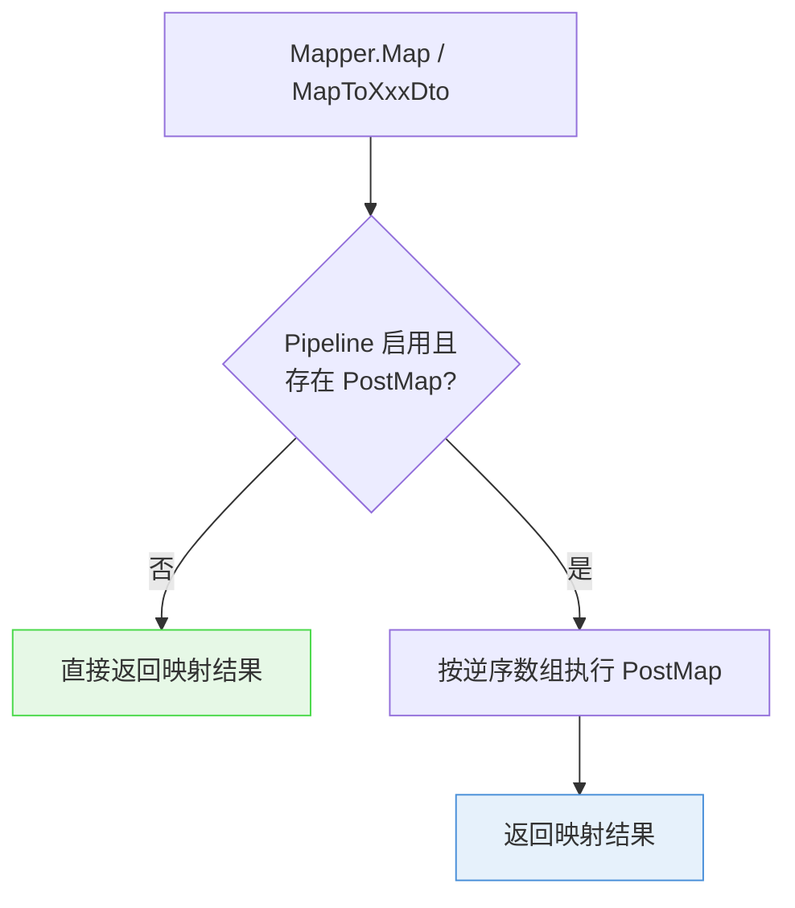

# Pipeline 管道

## 概述

NCMapper Pipeline 在映射完成后执行 PostMap 回调，用于追加审计信息、格式化输出、记录日志等后置处理。PostMap 按注册逆序执行（洋葱模型），支持类型过滤和全局开关。

核心 API：`Mapper.Pipeline.AddPostMap<TSource, TTarget>(Action)` / `Mapper.Pipeline.Clear()` / `Mapper.Pipeline.IsEnabled`

---

## 1. PostMap 基本用法

### 用法

[!code-csharp[注册 PostMap 映射后追加审计信息](~/samples/NCMapper.Samples/06-Infrastructure/PipelineScenarios.cs#Pipeline_PostMapAudit)]

**要点**：

- PostMap 在映射核心完成后、结果返回前执行
- 回调签名是 `Action<TSource, TTarget>`（同时接收源和目标对象）
- 类型过滤：`AddPostMap<TSource, TTarget>` 只对指定类型对生效
- 可修改目标对象的任何属性

### PostMap 执行时机

```
Mapper.Map<UserEntity, UserDto>(entity)
    → 映射核心（属性赋值）
    → PostMap 回调执行（按洋葱模型逆序）
    → 返回映射结果
```

---

## 2. 洋葱模型执行顺序

PostMap 按注册的逆序执行（后注册先执行），形成洋葱模型：

### 用法

[!code-csharp[多层 PostMap 洋葱模型执行顺序](~/samples/NCMapper.Samples/06-Infrastructure/PipelineScenarios.cs#Infra_Pipeline_PostMapOrder)]

**要点**：

- 执行顺序：映射核心 → PostMap₂（后注册） → PostMap₁（先注册）
- 洋葱模型适合"包裹式"处理：内层做核心变换，外层做包装/审计
- 层数越多开销越大（每层一个委托调用），但通常可忽略

### 洋葱模型图示

```
映射核心
    ↓
PostMap₃（最后注册，最先执行）  ← 内层
    ↓
PostMap₂
    ↓
PostMap₁（最先注册，最后执行）  ← 外层
    ↓
返回结果
```


---

## 3. Pipeline 控制

### 临时关闭 Pipeline（`Clear()` / `AddPostMap` 驱动）

```csharp
// 关闭 Pipeline（跳过所有 PostMap）：Clear() 后只读属性 IsEnabled 变为 false
Mapper.Pipeline.Clear();

var dto = Mapper.Map<UserEntity, UserDto>(entity);
// PostMap 不会执行

// 重新开启：重新注册 PostMap（AddPostMap 注册即自动置启用）
Mapper.Pipeline.AddPostMap<UserEntity, UserDto>((s, t) => t.Name = $"{t.Name} [audit]");
```

### 清空所有 PostMap

[!code-csharp[清空全部已注册 PostMap](~/samples/NCMapper.Samples/06-Infrastructure/PipelineScenarios.cs#Infra_Pipeline_ClearAll)]

### 类型过滤

PostMap 只对注册时指定的类型对生效：

```csharp
// 只对 UserEntity → UserDto 生效
Mapper.Pipeline.AddPostMap<UserEntity, UserDto>((s, t) => { ... });

// 对 OrderEntity → OrderDto 生效（独立的 PostMap）
Mapper.Pipeline.AddPostMap<OrderEntity, OrderDto>((s, t) => { ... });

// 映射 UserEntity → UserDto 时，只触发第一个 PostMap
// 映射 OrderEntity → OrderDto 时，只触发第二个 PostMap
```

> **相关 API**：`MapPipeline.IsPipelineEnabled`——管道启用状态的静态只读形态（供源生成扩展方法守卫读取，恒转发全局 `Mapper.Pipeline` 实例）；`MapPipeline.RunPostMap<TSource, TTarget>(source, target)`——源生成代码的直调入口（生成扩展方法末尾触发 PostMap 时使用）（源码锚：MapPipeline.cs:241/:246）。

---

## 4. PostMap 与 Compose 的交互

Compose 执行末尾也会触发 Pipeline 注册的 PostMap（如果类型对匹配）：

[!code-csharp[Compose 末尾触发已注册 PostMap](~/samples/NCMapper.Samples/03-Compose/ComposeScenarios.cs#Compose_ComposeWithPostMap)]

**要点**：

- Compose 的 PostMap 触发条件：Pipeline 中注册的类型对与 Compose 的主源→目标类型对匹配
- 执行顺序：主源映射 → 副源映射 → Compose Action 回调 → PostMap（Pipeline）
- Compose 末尾通过 `MapPipeline.ExecutePostMapNonGeneric` 触发 PostMap

---

## 5. PostMap 与 Action 回调的区别

| 维度 | PostMap（Pipeline） | Action 回调（Map/Compose 参数） |
|---|---|---|
| 注册方式 | `Mapper.Pipeline.AddPostMap<T,S>()` | `Mapper.Map<T,S>(src, action)` |
| 作用范围 | 全局（所有同类型对映射都触发） | 单次调用 |
| 生命周期 | 需手动 Clear | 随调用结束自动清理 |
| 执行顺序 | 洋葱模型逆序 | 映射后立即执行 |
| 签名 | `Action<TSource, TTarget>` | `Action<TSource, TTarget>`（Map）/ `Action<TTarget>`（Compose） |
| 典型场景 | 全局审计、日志、格式化 | 单次定制修改 |

---

## 6. 管道零开销机制

未注册 PostMap 时，Pipeline 对映射热路径几乎没有可观测开销。

**零开销原理**：

- **volatile bool 短路检查**：每次映射前检查 `Pipeline.IsEnabled` 与「是否注册了任何 PostMap」两个 `volatile bool`，未注册时直接跳过，单次检查约 1ns
- **逆序缓存避免 ToArray 分配**：首个 PostMap 注册时，将回调列表构建为逆序数组并缓存；后续复用该数组，避免每次映射都 `ToArray()` 分配
- **扩展方法同样触发**：`src.MapToXxxDto()` 等源生成扩展方法在映射末尾也会触发 Pipeline（与 `Mapper.Map` 走同一份回调列表），不额外增加分支

**要点**：

- 空管道开销可忽略（约 1ns 的 `volatile` 读取），热路径可放心保留 Pipeline 注册代码
- 仅当真正注册了 PostMap 时才有委托调用开销（见 §2 洋葱模型）
- `Pipeline.Clear()` 后回调列表清空，恢复零开销状态



---

## 常见误用

### 误用 1：误把全局 PostMap 当成单次回调使用（应改用 Action / Convert）

```csharp
// ❌ 误用：仅为这一次调用注册全局 PostMap，事后还要 Clear 还原
Mapper.Pipeline.AddPostMap<UserEntity, UserDto>((s, t) =>
{
    t.Name = $"[VIP] {t.Name}";
});

var dto = Mapper.Map<UserEntity, UserDto>(entity);

Mapper.Pipeline.Clear();  // 还原全局状态——既多余，又存在并发隐患
```

**问题**：

- `Mapper.Pipeline` 是进程级单例（`static readonly`，见 `Mapper.Pipeline.cs`），PostMap 一旦注册，对所有后续 `UserEntity → UserDto` 映射**永久生效，直至 Clear**。它天生是「全局横切关注点」机制，不是局部 / 单次回调。
- 仅为单次调用而「注册 + Clear」，违背设计初衷：用全局可变状态去做本该局部完成的事，还要手动还原。
- 并发隐患：注册与 `Clear` 之间若其它线程触发了同类型对映射，会意外带上该回调；`Clear` 本身还会清掉其它代码可能依赖的全局 PostMap。
- 参见 §5：`Action` 回调的生命周期是「随调用结束自动清理」，而 PostMap 是「手动 Clear」——这种生命周期差异正是 PostMap 不适合一次性场景的原因。

**✅ 正确做法**：

```csharp
// 方案 A（推荐，单次定制）：Action 回调——随调用结束自动清理，不污染全局
var dto = Mapper.Map<UserEntity, UserDto>(entity, (s, t) =>
{
    t.Name = $"[VIP] {t.Name}";
});

// 方案 B（稳定且全局、但属于映射配置的一部分）：Convert
// 在映射配置中声明静态转换方法，编译期注册、进程内固定生效，无需运行时 Clear
[Convert(typeof(VipNameConverter), nameof(VipNameConverter.Convert))]
public class UserDto { /* ... */ }
```

**何时才该用 PostMap？** —— 仅当该转换需要「全局、长期」生效（审计、日志、统一格式化）。此时**注册一次、进程生命周期内保留，不要 Clear**：

[!code-csharp[横切关注点启动时注册一次全程生效](~/samples/NCMapper.Samples/06-Infrastructure/PipelineScenarios.cs#Infra_Pipeline_CrossCutOnce)]

> ⚠️ 唯一需要 `Clear` 的例外是**受控作用域**（如单元测试）：用 fixture / `IDisposable` 把「注册」与「Clear」包成对称作用域（setup 注册、teardown Dispose Clear），避免泄漏污染其它测试。这属于测试隔离纪律，不是业务代码常态。

### 误用 2：在 PostMap 中修改源对象

```csharp
// ❌ 误用：在 PostMap 中修改 source（破坏不可变性预期）
Mapper.Pipeline.AddPostMap<UserEntity, UserDto>((s, t) =>
{
    s.Name = "Modified";  // 修改了源对象！
});

// ✅ 正确：PostMap 中只修改 target
Mapper.Pipeline.AddPostMap<UserEntity, UserDto>((s, t) =>
{
    t.Name = $"{s.Name} [processed]";  // 只读 source，只写 target
});
```

---

## 小结

| 能力 | API | 特性 |
|---|---|---|
| 注册 PostMap | `Mapper.Pipeline.AddPostMap<T,S>(Action)` | `Action<TSource, TTarget>` |
| 洋葱模型 | 按注册逆序执行 | 后注册先执行 |
| 类型过滤 | `AddPostMap<T,S>` | 只对指定类型对生效 |
| 启停驱动 | `Clear()` 停用 / `AddPostMap` 启用（`IsEnabled` 为只读查询，无可写开关） | 二者成对驱动启停 |
| 清空 | `Mapper.Pipeline.Clear()` | 清除所有 PostMap |
| Compose 交互 | Compose 末尾自动触发 | 类型对匹配时触发 |

---

## 配套示例

```bash
cd samples/NCMapper.Samples
dotnet run --scenario 601
```

核心示例源码（单点同源，`dotnet run --scenario` 可运行验证）：

[!code-csharp[PostMap 审计](~/samples/NCMapper.Samples/06-Infrastructure/PipelineScenarios.cs#Pipeline_PostMapAudit)]

代码见 `samples/NCMapper.Samples/06-Infrastructure/PipelineScenarios.cs`，涵盖 PostMap 审计、审计轨迹、洋葱模型、Action 回调等子场景。

---

## 进一步阅读

- 相关篇目：[验证与诊断](validation.md) · [Compose](../compose/compose.md)
- 技术文档深挖：[核心 API](../../reference/core-api.md) §4.6 映射管道
- Pipeline 源码：`src/NCMapper/MapPipeline.cs` · `src/NCMapper/Mapper.Pipeline.cs`
