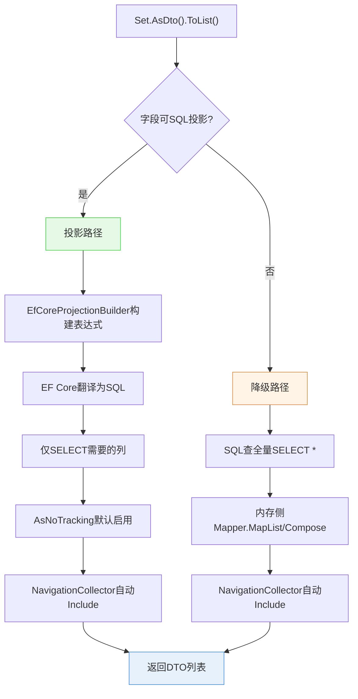

# EF Core 投影

## 概述

NCMapper 集成 EF Core，在 `IQueryable<T>.AsDto()` 后投影为 DTO。与 FreeSql 集成共享相同的 API 设计理念：`AsDto()` 作为终端算子入口，后续链接各种终端方法。EF Core 自动翻译为 SQL 投影，仅 SELECT DTO 需要的列。

核心 API：`db.Set<T>().Where(...).AsDto().ToList<TDto>()`

---

## 1. 基本用法

### 用法

[!code-csharp[EFCore 投影：using NCMapper.EFCore 与 AsDto 单表](~/samples/NCMapper.Samples/05-Orm/EFCoreScenarios.cs#OrmProjection_SingleTableAsDto)]

EF Core 生成的 SQL：

```sql
SELECT u.Id, u.Name, u.Age, u.Email
FROM Users AS u
WHERE u.Age > 20
ORDER BY u.Age
```

**要点**：

- `AsDto()` 是终端算子入口，后续链 `.ToList<TDto>()`、`.First<TDto>()` 等
- EF Core 自动翻译为 SQL 投影（仅 SELECT DTO 需要的列）
- 默认启用 `AsNoTracking`（只读投影，无需变更追踪）
- 需引入命名空间 `NCMapper.EFCore`

> **相关 API**：`AsDto()` 的返回类型为 `EFCoreDtoSelector<TSource>`（后续 `ToList`/`First`/`ToPagedList` 等终端方法均宿主于它）（源码锚：NCMapperEFCoreExtensions.cs:62）。

---

## 2. 终端方法

`AsDto()` 后可链式调用以下终端方法：

| 方法 | 说明 | 返回类型 |
|---|---|---|
| `.ToList<TDto>()` | 返回全部匹配行 | `List<TDto>` |
| `.First<TDto>()` | 第一条 | `TDto` |
| `.FirstOrDefault<TDto>()` | 第一条或默认值 | `TDto?` |
| `.ToChunkDto<TDto>(size, action)` | 分批回调 | `void` |
| `.ToLookup<TKey, TDto>(keySelector)` | 分组查找 | `ILookup<TKey, TDto>` |
| `.ToDictionary<TKey, TDto>(keySelector)` | 字典 | `Dictionary<TKey, TDto>` |
| `.ToListAsync<TDto>()` | 异步列表 | `Task<List<TDto>>` |
| `.ToPagedList<TDto>(page, pageSize)` | 分页（Count + Skip/Take 均在 SQL 侧；另有异步版 `ToPagedListAsync`）（源码锚：NCMapperEFCoreExtensions.cs:348/:379） | `PagedList<TDto>` |

### ToLookup 示例

[!code-csharp[EF Core ToLookup 分组查找](~/samples/NCMapper.Samples/05-Orm/EFCoreScenarios.cs#OrmProjection_ToLookup)]

### ToDictionary 示例

[!code-csharp[EF Core ToDictionary 字典投影](~/samples/NCMapper.Samples/05-Orm/EFCoreScenarios.cs#OrmProjection_ToDictionary)]

---

## 3. 投影路径与降级路径

与 FreeSql 集成类似，EFCore 集成也有两条执行路径：

### 3.1 投影路径（SQL 侧）

当 DTO 的所有字段都能在 SQL 侧完成映射时，走投影路径：

```
IQueryable<T>.AsDto().ToList<TDto>()
    → EfCoreProjectionBuilder 构建 SQL 侧表达式
    → EF Core 翻译为 SQL
    → 数据库执行
    → 结果集直接映射到 TDto
```

特点：
- SQL 侧完成列裁剪
- 导航属性自动 Include（通过 `EfCoreNavigationCollector` 收集）

### 3.2 降级路径

当 DTO 的某些字段无法在 SQL 侧完成映射时，`EfCoreDegradationDetector` 检测并降级：

```
IQueryable<T>.AsDto().ToList<TDto>()
    → EfCoreDegradationDetector 检测
    → 降级：SQL 查全量
    → 内存侧 Mapper.MapList / Mapper.Compose
```

特点：
- 降级路径自动触发
- 降级路径自动 Include（与投影路径一致，避免 N+1；原“不自动 Include”表述）



---

## 4. 导航属性自动 Include

EFCore 集成通过 `EfCoreNavigationCollector` 自动收集 DTO 需要的导航属性，生成 Include 链：

```csharp
public class OrderEntity
{
    public int OrderId { get; set; }
    public CustomerEntity? Customer { get; set; }  // 导航属性
}

[MapFrom(typeof(OrderEntity))]
public class OrderDto
{
    public int OrderId { get; set; }

    [MapProperty(typeof(OrderEntity), nameof(OrderEntity.Customer))]
    public string? CustomerName { get; set; }
}

```

[!code-csharp[EF Core AsDto 导航自动投影](~/samples/NCMapper.Samples/05-Orm/EFCoreScenarios.cs#OrmProjection_NestedCrossTable)]

### 关闭自动 Include

```csharp
[MapFrom(typeof(OrderEntity))]
public class OrderDto
{
    // 属性级标注（实现仅允许属性级，类级标注编译报 CS0592）
    [MapNoAutoInclude]
    public CustomerInfoDto Customer { get; set; } = null!;
    // ...
}

```

[!code-csharp[EF Core 手动 Include 补导航](~/samples/NCMapper.Samples/05-Orm/EFCoreScenarios.cs#OrmProjection_NoAutoIncludeManual)]

---

## 5. ToChunkDto：分批读取

### 用法

[!code-csharp[EF Core 分批读取 ToChunkDto（OrderBy 稳定排序前提）](~/samples/NCMapper.Samples/05-Orm/EFCoreScenarios.cs#OrmProjection_SingleTableAsDto_ToChunkDto)]

**要点**：

- 大数据量场景下控制内存占用
- 内部实现：Page + ToList 分轮查询
- 有异步版本 `ToChunkDtoAsync`

---

## 6. 树形查询：ToTreeList / ToTreeListAsync

EF Core 没有原生树查询——NCMapper 采用"平铺查询 + 内存建树"：先按普通投影查出平铺行（project 投影 / 降级双路径自动判定），再由核心库 `TreeBuilder` 按 Id/ParentId 组装嵌套树，与 Dapper `ToTreeList` 语义完全一致。

### DTO 契约

```csharp
[MapFrom(typeof(CategoryEntity))]   // 投影路径必需
[MapTree("Id", "ParentId", "Children")]   // 可省略——默认 Id/ParentId/Children，三属性均可自定义
public class CategoryDto
{
    public int Id { get; set; }
    public int? ParentId { get; set; }
    public List<CategoryDto> Children { get; set; } = new();  // 树挂载位：不参与映射，TreeBuilder 填充
}
```

**要点**：

- Children 为**树挂载位**：映射/投影恒不填充（防双挂载——同一子节点重复出现），由 `TreeBuilder` 统一挂载；
- 字段初始化器 `= new()` 可选（TreeBuilder 惰性创建兜底）；
- 树契约三判据（存在性 / 自引用集合 / 可写性）不满足时抛 `MapConfigurationException`；
- **实体含自引用导航（如 `CategoryEntity.Children`）且期望树挂载位消解时，DTO 须显式标注 `[MapTree]`**——无标注的 DTO 走默认契约仍可建树，但同名导航集合会被嵌套投影预填（不在消解保护面内）。

### 用法

```csharp
// 同步：project 投影主路径（单 SQL 平铺）→ TreeBuilder 建树
var roots = db.Categories
    .Where(c => c.Status == 1)
    .AsDto()
    .ToTreeList<CategoryDto>();
// roots[0].Children[0].Children[0] → 嵌套树（仅根节点在返回列表中）

// 异步（真异步，支持取消令牌）
var rootsAsync = await db.Categories
    .AsDto()
    .ToTreeListAsync<CategoryDto>(cancellationToken);
```

### 双路径与树挂载位行为

| 路径 | 平铺来源 | Children（挂载位）|
|------|----------|-------------------|
| project（默认）| SQL 侧投影平铺 | 投影构建器跳过绑定 → 恒空 → TreeBuilder 挂载 |
| 降级（无法翻译时自动触发）| 实体查询 + MapList | **不 Include 树挂载位导航**（规避自引用笛卡尔展开）+ 防御清空 → TreeBuilder 挂载 |

- 降级触发条件与 `ToList` 一致（如目标含不可翻译集合类型）；
- 双路径树结果一致（同一数据源产出相同嵌套结构）；
- `[MapTree]` DTO 在 EFCore `ToList` 中 Children 亦恒空（有意行为，详见 CHANGELOG）。

---

## 7. GroupBy 编译期拦截

```csharp
// ❌ 误用：GroupBy + AsDto 不受支持
// EF Core GroupBy 后返回 IQueryable<IGrouping<TKey, TSource>>（分组聚合），不再是单条实体查询
// → 无法做实体→DTO 属性映射，NCMapper 用 [Obsolete(error:true)] 编译期拦截此用法
var dtos = db.Set<UserEntity>()
    .GroupBy(u => u.Age)
    .AsDto()  // 编译错误！
    .ToList<UserAgeGroupDto>();
```

**替代写法（两条路径）**：

[!code-csharp[EF Core GroupBy 替代路径 A 原生聚合](~/samples/NCMapper.Samples/05-Orm/EFCoreScenarios.cs#OrmProjection_GroupByNativeAggregate)]
[!code-csharp[EF Core GroupBy 替代路径 B 内存分组（不推荐）](~/samples/NCMapper.Samples/05-Orm/EFCoreScenarios.cs#OrmProjection_GroupByInMemoryLinq)]

> ⚠️ **路径 B 不推荐**：必须先 `ToList` 把全量（或过滤后）数据拉进内存再客户端分组，**性能损失较大**，既多一次性全量物化开销，又失去 SQL 侧 `GROUP BY` 的下推与索引加速。若分组聚合可用 SQL 表达（计数/求和/均值等），**优先选用路径 A**；路径 B 仅作为确实无法用 SQL 聚合表达时的一种实现途径，请结合实际性能预算审慎选用。

> ℹ️ **拦截原因**：`GroupBy` 返回 `IQueryable<IGrouping<TKey, TSource>>`，元素是分组而非单条实体，不存在可供 NCMapper 做属性匹配的实体结构。NCMapper 以 `[Obsolete(error:true)]` 在编译期阻止该链式写法，并在错误信息中直接给出上述两条替代路径。

---

## 常见误用

### 误用 1：在 AsDto 前就 ToList 全量加载

```csharp
// ❌ 误用：在 AsDto 前就 .ToList() 全量加载
var entities = db.Set<UserEntity>().ToList();  // SELECT *，全量加载
var dtos = Mapper.MapList<UserEntity, UserDto>(entities);  // 内存映射

// ✅ 正确：AsDto 在 SQL 侧完成投影
var dtos = db.Set<UserEntity>().AsDto().ToList<UserDto>();  // 仅 SELECT 需要的列
```

### 误用 2：未引入 NCMapper.EFCore 命名空间

```csharp
// ❌ 误用：未 using NCMapper.EFCore，AsDto 扩展方法不可见
// var dtos = db.Set<UserEntity>().AsDto().ToList<UserDto>();  // 编译错误

// ✅ 正确：引入命名空间
using NCMapper.EFCore;
var dtos = db.Set<UserEntity>().AsDto().ToList<UserDto>();
```

### 误用 3：AsNoTracking 误用

```csharp
// ❌ 误用：投影查询不需要变更追踪，但未启用 AsNoTracking
var dtos = db.Set<UserEntity>()
    .AsDto()
    .ToList<UserDto>();
// NCMapper 默认已启用 AsNoTracking，但如果手动添加 AsTracking 会覆盖

// ✅ 正确：NCMapper 的 AsDto 默认启用 AsNoTracking，无需手动添加
// 如果需要变更追踪（少见），在 AsDto 前添加 AsTracking()
```

> **相关 API**：`NCMapperEFCoreExtensions.EFCoreProjectionAsNoTrackingDefault`——投影默认无跟踪的全局开关（`public static bool` 属性，默认 `true`；置 `false` 可全局关闭此行为，需要变更跟踪的查询单独用 `AsTracking()` 打开）（源码锚：NCMapperEFCoreExtensions.cs:43）。

---

## 小结

| 能力 | API | 特性 |
|---|---|---|
| 单表投影 | `Set<T>().AsDto().ToList<TDto>()` | SQL 侧列裁剪 |
| 分组查找 | `.ToLookup<TKey, TDto>(keySelector)` | ILookup 分组 |
| 字典 | `.ToDictionary<TDto>(keySelector)` | Key 作用于 DTO |
| 分批读取 | `.ToChunkDto<TDto>(size, action)` | 大数据量可控 |
| 异步 | `.ToListAsync<TDto>()` | 异步变体 |
| 自动 Include | 导航属性自动 Include | NavigationCollector |
| 关闭自动 Include | `[MapNoAutoInclude]` | 手动 Include |
| 降级路径 | 自动触发 | SQL 全量→内存映射 |
| GroupBy 拦截 | `[Obsolete(error:true)]` | 编译期阻止 |

## Fluent DTO 支持现状

与本篇 FreeSql 侧口径一致：Fluent DTO 经运行时快照注册表做**逐声明翻译判定**（快照优先——注册对按声明明细判定，零特性反射；未注册对反射解析兜底，纯运行时模式行为不变）——纯可翻译声明（`Map`/`Ignore`）走 SQL 侧投影（异名/嵌套点路径由快照明细消费）；`Mask`/`Convert`/`FromJson`/`AfterMapping`/`FromSource` 一律强制降级（内存映射全语义）；off 态（身份键无明细）保守降级。通道隔离：判定以 `Channel=Fluent` 区分，特性通道（`[MapFrom]`）条目不进 Fluent 分流、行为零变化。

可运行演示（EFCore 投影态/降级态）见配套示例的 `07-fx-*` 场景。

---


本页可运行演示（场景 501，EFCore 内存库）：

[!code-csharp[树形投影：ToTreeList（\[MapTree\] 特性通道）](~/samples/NCMapper.Samples/05-Orm/EFCoreScenarios.cs#OrmProjection_TreeList)]

[!code-csharp[Fluent 树查询：Tree() 注册表承载 + ToTreeList](~/samples/NCMapper.Samples/05-Orm/EFCoreScenarios.cs#OrmProjection_FluentTree)]

## 配套示例

```bash
cd samples/NCMapper.Samples
dotnet run --scenario 501
```

核心示例源码（单点同源，`dotnet run --scenario` 可运行验证）：

[!code-csharp[单表 AsDto](~/samples/NCMapper.Samples/05-Orm/EFCoreScenarios.cs#OrmProjection_SingleTableAsDto)]

[!code-csharp[单表 AsDto · SingleTableFirst](~/samples/NCMapper.Samples/05-Orm/EFCoreScenarios.cs#OrmProjection_SingleTableAsDto_SingleTableFirst)]

[!code-csharp[单表 AsDto · SingleTableSingle](~/samples/NCMapper.Samples/05-Orm/EFCoreScenarios.cs#OrmProjection_SingleTableAsDto_SingleTableSingle)]

[!code-csharp[单表 AsDto · ToChunkDto](~/samples/NCMapper.Samples/05-Orm/EFCoreScenarios.cs#OrmProjection_SingleTableAsDto_ToChunkDto)]

代码见 `samples/NCMapper.Samples/05-Orm/EFCoreScenarios.cs`，涵盖单表 AsDto、ToChunkDto、ToLookup 等子场景。

---

## 进一步阅读

- [FreeSql（一）](freesql-single-table.md) · [Dapper（一）](dapper-query.md)
- 技术文档：[EF Core 与 Dapper 扩展包](../../explanation/orm-efcore-dapper.md) §11.3
- 扩展源码：`src/NCMapper.EFCore/NCMapperEFCoreExtensions.cs`
