# FreeSql 投影（一）：单表 AsDto

## 概述

NCMapper 集成 FreeSql，在 `ISelect<T>.AsDto()` 后通过 `.ToList<TDto>()` 完成 SQL 投影映射。SQL 仅 SELECT DTO 需要的列，不做 `SELECT *`，减少网络传输和内存占用。

核心 API：`fsql.Select<T>().Where(...).AsDto().ToList<TDto>()`

---

## 1. 基本用法

### 用法

[!code-csharp[FreeSql 单表投影（using 与 AsDto 基础）](~/samples/NCMapper.Samples/05-Orm/FreeSqlScenarios.cs#OrmProjection_SingleTableAsDto)]

生成的 SQL（仅 SELECT DTO 需要的列）：

```sql
SELECT a.Id, a.Name, a.Age, a.Email
FROM Users a
WHERE a.Age > 20
ORDER BY a.Age
```

**要点**：

- `AsDto()` 是终端算子的入口，后续链 `.ToList<TDto>()`、`.First<TDto>()`、`.ToPagedList<TDto>()` 等
- SQL 投影列由 DTO 属性自动推导（忽略 DTO 不需要的列）
- `AsDto()` 前可正常使用 FreeSql 所有查询操作符（Where/OrderBy/Skip/Take/WhereIf 等）
- 需引入命名空间 `NCMapper.FreeSql`

> **相关 API**：`AsDto()` 的返回类型为 `FreeSqlDtoSelector<TSource>`（后续 `ToList`/`First`/`ToPagedList` 等终端方法均宿主于它）（源码锚：NCMapperFreeSqlExtensions.cs:58）。

---

## 2. 终端方法

`AsDto()` 后可链式调用以下终端方法：

| 方法 | 说明 | 返回类型 |
|---|---|---|
| `.ToList<TDto>()` | 返回全部匹配行 | `List<TDto>` |
| `.First<TDto>()` | 取第一条，空则默认值 | `TDto` |
| `.FirstOrDefault<TDto>()` | 第一条或默认值 | `TDto?` |
| `.ToPagedList<TDto>(page, size)` | SQL 级分页 | `PagedList<TDto>` |
| `.ToChunkDto<TDto>(size, action)` | 分批回调读取 | `void` |
| `.ToDictionary<TDto>(keySelector)` | 字典 | `Dictionary<TKey, TDto>` |
| `.ToListAsync<TDto>()` | 异步列表 | `Task<List<TDto>>` |
| `.ToDictionaryAsync<TKey, TDto>()` | 异步字典 | `Task<Dictionary<TKey, TDto>>` |

### 分页示例

[!code-csharp[FreeSql 分页 ToPagedList（SQL 级分页）](~/samples/NCMapper.Samples/05-Orm/FreeSqlScenarios.cs#OrmProjection_SingleTablePaged)]

### 分批读取示例

[!code-csharp[FreeSql 单表分批读取 ToChunkDto](~/samples/NCMapper.Samples/05-Orm/FreeSqlScenarios.cs#OrmProjection_ToChunkDto)]

---

## 3. 投影路径与降级路径

NCMapper FreeSql 集成有两条执行路径：

### 3.1 投影路径（SQL 侧表达式树）

当 DTO 的所有字段都能在 SQL 侧完成映射时，走投影路径：

```
ISelect<T>.AsDto().ToList<TDto>()
    → 构建SQL侧表达式树（Select(expr)）
    → FreeSql 翻译为 SQL（仅 SELECT 需要的列）
    → 数据库执行 SQL
    → 结果集直接映射到 TDto
```

特点：
- SQL 侧完成列裁剪，不传输多余数据
- 性能最优（数据库引擎完成投影）
- 导航属性自动 LEFT JOIN（自动 Include）

### 3.2 降级路径（SQL 查全量 → 内存映射）

当 DTO 的某些字段无法在 SQL 侧完成映射时（如需要运行时计算、Convert 等），自动降级：

```
ISelect<T>.AsDto().ToList<TDto>()
    → 检测到不可投影的字段
    → 降级：SQL 查全量（SELECT *）
    → 内存侧调用 Mapper.MapList / Mapper.Compose
    → 返回 DTO 列表
```

特点：
- 降级路径自动触发，无需用户干预
- 降级路径自动 Include 导航属性（与投影路径一致，避免 N+1；原“不自动 Include”表述已订正）
- 两条路径的 PostMap 行为一致

> **降级路径的 Include 行为**：降级路径同样自动 Include 导航属性（FreeSql 侧经 IncludeByPropertyName / EFCore 侧经导航收集器自动追加），无需手动 `.Include()`；`[MapNoAutoInclude]` 可排除指定导航属性。

```mermaid
flowchart TD
    Start[Select&#60;T&#62;.AsDto&#40;&#41;.ToList&#60;TDto&#62;&#40;&#41;] --> Detect{字段可SQL投影?}
    Detect -->|是| Proj[投影路径]
    Detect -->|否| Degrade[降级路径]
    Proj --> P1[构建SQL侧表达式树]
    P1 --> P2[FreeSql翻译为SQL]
    P2 --> P3[仅SELECT需要的列]
    P3 --> P4[自动Include导航属性]
    P4 --> P5[GlobalFilter传播]
    P5 --> P6[PostMap触发]
    P6 --> Result[返回DTO列表]
    Degrade --> D1[SQL查全量SELECT *]
    D1 --> D2[内存侧Mapper.MapList/Compose]
    D2 --> D3[自动Include导航属性]
    D3 --> D4[GlobalFilter传播]
    D4 --> D5[PostMap触发]
    D5 --> Result
    style Proj fill:#E6F8E6,stroke:#4AD94A
    style Degrade fill:#FFF4E6,stroke:#D9904A
    style Result fill:#E6F1FB,stroke:#4A90D9
```



---

## 4. 自动 Include

FreeSql 导航属性在 `AsDto` 投影时按需自动 Include——DTO 用到的导航字段自动 LEFT JOIN：

```csharp
public class OrderEntity
{
    public int OrderId { get; set; }
    public CustomerEntity? Customer { get; set; }  // 导航属性
}

[MapFrom(typeof(OrderEntity))]
public class OrderDto
{
    public int OrderId { get; set; }

    [MapProperty(typeof(OrderEntity), nameof(OrderEntity.Customer))]
    public string? CustomerName { get; set; }  // 取 Customer.Name
}

```

[!code-csharp[FreeSql AsDto 导航自动 Include](~/samples/NCMapper.Samples/05-Orm/FreeSqlScenarios.cs#OrmProjection_IncludeNavigation)]

### MapNoAutoInclude：关闭自动 Include

```csharp
[MapFrom(typeof(OrderEntity))]
public class OrderDto
{
    // 属性级标注（实现仅允许属性级，类级标注编译报 CS0592）
    [MapNoAutoInclude]
    public CustomerInfoDto Customer { get; set; } = null!;
    // ...
}

```

[!code-csharp[FreeSql 手动 Include 补集合导航](~/samples/NCMapper.Samples/05-Orm/FreeSqlScenarios.cs#OrmProjection_NoAutoIncludeGroup)]

**要点**：

- `MapNoAutoInclude` 用于需要按条件 Include 的场景（如某些条件下才加载导航）
- 关闭自动 Include 后，导航属性需手动 `.Include()`
- IncludeMany 子集合字段裁剪：DTO 的子集合属性决定 IncludeMany 的 SELECT 列

### 4.1 NCMAP017 诊断

`[MapNoAutoInclude]` 标注在**引用导航属性**（非集合）上时通常无意义——排除单条引用导航的自动 Include 几乎不会带来收益，反而可能遗漏本应加载的导航。NCMapper 对此发出 **NCMAP017（Info 级）** 诊断：

```csharp
[MapFrom(typeof(OrderEntity))]
public class OrderDto
{
    // ⚠️ NCMAP017：标注在引用导航属性上通常无意义
    [MapNoAutoInclude]
    [MapProperty(typeof(OrderEntity), nameof(OrderEntity.Customer))]
    public string? CustomerName { get; set; }
}
```

**适用场景**（标注在集合导航属性上才有意义）：

- 大集合导航（如订单的百条明细）：排除自动 Include 避免一次性加载海量数据
- 延迟加载场景：导航属性按需手动 `.Include()`
- 循环引用风险：避免自动 Include 触发无限递归联表

**不适用场景**：

- 引用导航（单条）开销极小：排除自动 Include 收益可忽略，反而增加手动 Include 负担
- 导航属性在投影路径本就会自动 LEFT JOIN：标注 `[MapNoAutoInclude]` 反而需要手动补 `.Include()`

> NCMAP017 为 Info 级诊断，不阻断编译，仅提示潜在误用。完整诊断码见 [诊断码全索引](../../diagnostics/rules.md)。

---

## 5. GlobalFilter 传播

FreeSql 的 `GlobalFilter`（软删除、租户隔离等）自动传播到 `AsDto` 投影路径和降级路径：

```csharp
// 注册全局过滤器
fsql.GlobalFilter.Apply<ISoftDelete>("SoftDelete", e => e.IsDeleted == false);

// 后续所有 AsDto 查询自动附加 WHERE IsDeleted = false
var dtos = fsql.Select<UserEntity>()
    .AsDto()
    .ToList<UserDto>();
// SQL: SELECT ... FROM Users WHERE IsDeleted = false
```

**要点**：

- GlobalFilter 在投影路径和降级路径均生效
- 过滤器名称用于后续 `.Enable(name)` / `.Disable(name)` 控制

---

## 6. WithSql：自定义 SQL

当需要复杂 SQL（多表 JOIN、子查询、CTE 等）时，用 `WithSql` 传入自定义 SQL：

[!code-csharp[FreeSql WithSql 自定义 SQL 数据源](~/samples/NCMapper.Samples/05-Orm/FreeSqlScenarios.cs#OrmProjection_WithSqlAsDto)]

**要点**：

- WithSql 的 SQL 需返回实体类型的列（`u.*`）
- 多表 WithSql 场景：`sqlT2` 参数必填（指定第二张表的 SQL）

---

## 7. 兼容查询模式全集

`AsDto` 前可使用 FreeSql 的全部查询操作符。以下是投影场景常用的兼容模式：

| 模式 | 示例 | 说明 |
|---|---|---|
| 条件 WHERE | `.WhereIf(cond, u => u.Age > 18)` | 条件成立才追加 WHERE |
| 计数 + 分页 | `.Count()` / `.AsDto().ToPagedList(p, sz)` | 计数与分页分别或组合 |
| 排序 | `.OrderBy(u => u.Age).OrderByDescending(...)` | 多字段排序 |
| 子查询过滤 | `.Where(u => fsql.Select<Order>().Any(o => o.UserId == u.Id))` | Exists 语义 |
| IN 过滤 | `.Where(u => ids.Contains(u.Id))` | 用 `List<int>` 而非数组（net10 见误用 3） |
| 导航联表 | `.Include(o => o.Customer)` | 显式 Include 导航 |
| 子集合 | `.IncludeMany(o => o.Items)` | IncludeMany 加载子集合 |
| 级联过滤 | `.WhereCascade(...)` | 导航属性上的级联 WHERE |
| 自定义 SQL | `.WithSql(...)` | 复杂 JOIN / 子查询 / CTE |

**WhereIf 条件查询**：

[!code-csharp[FreeSql WhereIf 动态条件拼装](~/samples/NCMapper.Samples/05-Orm/FreeSqlScenarios.cs#OrmProjection_WhereIfFilter)]

**Exists 子查询（子查询过滤）**：

[!code-csharp[FreeSql Exists 子查询过滤](~/samples/NCMapper.Samples/05-Orm/FreeSqlScenarios.cs#OrmProjection_AnySubquery)]

**IncludeMany 子集合**：

[!code-csharp[IncludeMany 子集合加载后 AsDto 投影](~/samples/NCMapper.Samples/05-Orm/FreeSqlMultiTableScenarios.cs#FreeSqlMultiTable_IncludeManyNavigation)]

**要点**：

- `AsDto` 前可自由组合上述操作符，NCMapper 仅在终端算子处接管投影
- 投影路径与降级路径对这些操作符的行为一致（GlobalFilter 两路径均传播）
- 导航联表 / IncludeMany 在**投影路径**自动触发；**降级路径**需手动 `.Include()`（见 §3.2）

---

## 常见误用

### 误用 1：在 AsDto 前就 ToList 全量加载

```csharp
// ❌ 误用：在 AsDto 前就 .ToList()（全量加载到内存再映射）
var entities = fsql.Select<UserEntity>().ToList();  // SELECT *，全量加载
var dtos = Mapper.MapList<UserEntity, UserDto>(entities);  // 内存映射

// ✅ 正确：用 AsDto 在 SQL 侧完成投影
var dtos = fsql.Select<UserEntity>().AsDto().ToList<UserDto>();  // 仅 SELECT 需要的列
```

### 误用 2：GroupBy + AsDto

```csharp
// ❌ 误用：GroupBy + AsDto 不受支持
// FreeSql GroupBy 后返回 ISelectGrouping<TKey,TValue>（分组聚合），不再是实体查询
// → 无法做实体→DTO 属性映射，NCMapper 用 [Obsolete(error:true)] 编译期拦截此用法
var dtos = fsql.Select<UserEntity>()
    .GroupBy(u => u.Age)
    .AsDto()  // 编译错误！
    .ToList<UserDto>();
```

> ⚠️ **替代途径（不推荐）：先取内存再 LINQ 分组**
>
> 由于 `AsDto` 链路不支持链式 `GroupBy`，若必须在 NCMapper 投影体系内实现分组，唯一可行的写法是先 `.AsDto().ToList()` 将对象取出到内存，再用 LINQ 的 `.GroupBy()` 完成分组：
>
> ```csharp
> // 仅提供一种"实现 group by 的途径"，并非推荐做法
> var rows = fsql.Select<UserEntity>()
>     .AsDto()
>     .ToList<UserDto>();           // 全量数据加载到内存
> var grouped = rows
>     .GroupBy(d => d.Age)          // 在内存中按 Age 分组
>     .Select(g => new
>     {
>         Age = g.Key,
>         Count = g.Count(),
>         AvgNameLen = g.Average(d => d.Name.Length)
>     })
>     .ToList();
> ```
>
> **为什么不建议这样做**：必须先 `ToList` 把全量（或过滤后）数据拉进内存，再在客户端做分组聚合，**性能损失较大**——既多了一次性全量传输/物化开销，也失去 SQL 侧 `GROUP BY` 的下推与索引加速。
>
> **更优做法**：如果分组聚合可以用 SQL 表达（计数/求和/均值等），优先使用 FreeSql 原生聚合语法在数据库侧完成，避免把明细全量搬到内存：
>
> ```csharp
> // ✅ 推荐：FreeSql 原生聚合，GROUP BY 下推到 SQL 侧
> var stats = fsql.Select<UserEntity>()
>     .GroupBy(u => u.Age)
>     .ToList(g => new { Age = g.Key, Count = g.Count() });
> ```
>
> 本处的内存分组示例**仅作为确实无法用 SQL 聚合表达时的一种实现途径**给出，请结合实际性能预算审慎选用。完整两条路径对比详见 [09-FreeSql-Advanced](freesql-advanced.md#误用-1groupby--asdto)。

### 误用 3：数组 Contains 在 net10 中报错

```csharp
// ❌ 误用：net10 中 T[].Contains 绑定到 MemoryExtensions.Contains
// FreeSql 抛 NotSupportedException（NCMAP018 检测）
var ids = new[] { 1, 2, 3 };
var dtos = fsql.Select<UserEntity>()
    .Where(u => ids.Contains(u.Id))  // net10 报错
    .AsDto()
    .ToList<UserDto>();

// ✅ 正确：用 List<int> 代替数组
var ids = new List<int> { 1, 2, 3 };
var dtos = fsql.Select<UserEntity>()
    .Where(u => ids.Contains(u.Id))  // List.Contains 可正常翻译
    .AsDto()
    .ToList<UserDto>();
```

---

## 小结

| 能力 | API | 特性 |
|---|---|---|
| 单表投影 | `Select<T>().AsDto().ToList<TDto>()` | SQL 侧列裁剪 |
| 分页 | `.ToPagedList<TDto>(page, size)` | SQL 级分页 |
| 分批读取 | `.ToChunkDto<TDto>(size, action)` | 大数据量可控 |
| 字典 | `.ToDictionary<TDto>(keySelector)` | Key 选择器 |
| 异步 | `.ToListAsync<TDto>()` | 异步变体 |
| 自动 Include | DTO 导航字段自动 LEFT JOIN | 按需 JOIN |
| 关闭自动 Include | `[MapNoAutoInclude]` | 手动 Include |
| GlobalFilter | 自动传播 | 两路径均生效 |
| WithSql | 自定义 SQL | 复杂查询 |
| 降级路径 | 自动触发 | SQL 全量→内存映射 |

## Fluent DTO 支持现状

本篇投影能力对 **Fluent 通道**声明的 DTO 同样可用：`AsDto` 执行前经运行时快照注册表（快照优先——注册对按声明明细判定，零特性反射；未注册对反射解析兜底）对声明做**逐声明翻译判定**——

- **纯可翻译声明**（`Map`/`Ignore` 等价声明）：走 SQL 侧投影，异名映射（注册表明细 `SourceName`）与嵌套点路径（`SourcePathNames`）由投影绑定消费；`Ignore` 声明按方向做投影差集过滤；
- **不可翻译声明**（cm 级 `Mask`/`Convert`/`Format`/`FromJson`/`When` 任一，或对级 `AfterMapping`/`BeforeMapping`/`MapSubclass`）：维持强制降级——内存映射承载全语义（Mask 脱敏不落明文、转换器/回调全量生效）；`FromSource` 多源合成对已按明细可译性判定放行（可译场景走投影——见 [FreeSql 多表查询](freesql-multi-table.md) 的"Fluent Compose 解锁"节）；
- 快照开关关闭（`NCMapperEmitRuntimeSnapshot=off`）时保守降级，不放宽判定。

可运行演示（投影态/降级态双态对照）见配套示例的 `07-fx-*` 场景。

---

## 配套示例

```bash
cd samples/NCMapper.Samples
dotnet run --scenario 501
```

核心示例源码（单点同源，`dotnet run --scenario` 可运行验证）：

[!code-csharp[单表 AsDto](~/samples/NCMapper.Samples/05-Orm/FreeSqlScenarios.cs#OrmProjection_SingleTableAsDto)]

[!code-csharp[单表 AsDto · SingleTableFirst](~/samples/NCMapper.Samples/05-Orm/FreeSqlScenarios.cs#OrmProjection_SingleTableAsDto_SingleTableFirst)]

代码见 `samples/NCMapper.Samples/05-Orm/FreeSqlScenarios.cs`，涵盖单表 AsDto、分页、ToChunkDto、WithSql 等子场景。

---

## 进一步阅读

- [FreeSql（二）：多表查询](freesql-multi-table.md) · [FreeSql（三）：高级终端方法](freesql-advanced.md)
- 技术文档：[NCMapper.FreeSql 扩展包](../../explanation/orm-freesql.md) §11.2
- 扩展源码：`src/NCMapper.FreeSql/NCMapperFreeSqlExtensions.cs`
